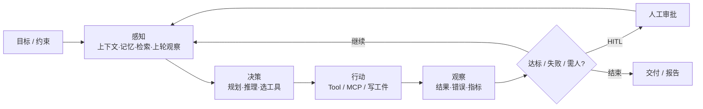
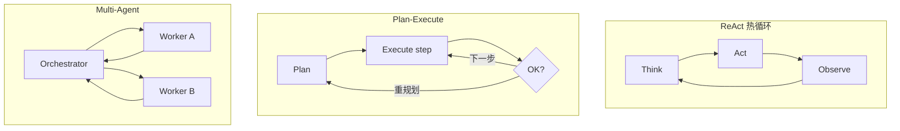
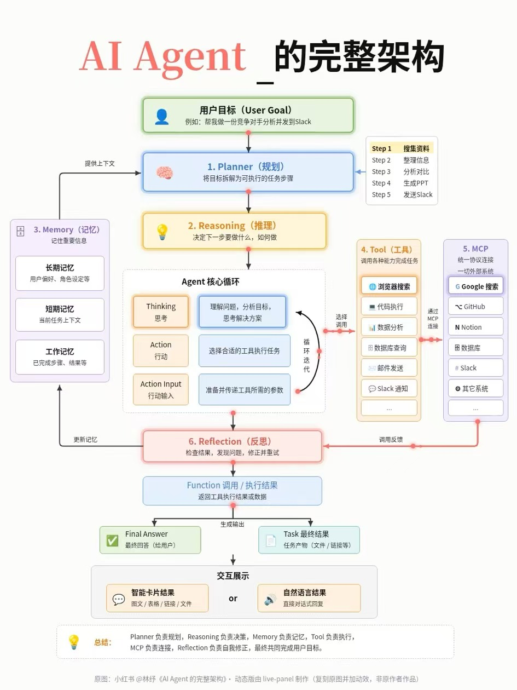

# Agent 是什么？

> 入门主文 · 工程理解优先；外部示意图见附录  
> 下一步：[02-agent-architecture.md](02-agent-architecture.md) · [glossary 索引](glossary/README.md)

---

## 0. 结论先行

| 问题 | 一句话答案 |
|---|---|
| **Agent 是什么？** | 以**目标**为驱动，在环境中**感知 → 决策 → 行动 → 观察**并迭代，直到达标或失败的软件运行时 |
| **与 chatbot / 单次 LLM 差在哪？** | 后者偏「答一句」；Agent 偏「为达成目标而**行动**」，通常多步、多工具、有状态 |
| **由哪些组成？** | LLM 推理核 · Planner · Tools/FC · Memory · **RAG** · MCP · Orchestration · Reflection/Eval · Guardrails/HITL · Observability |
| **对本仓有何用？** | 竞品与框架选型共用词汇：编排 LangGraph、会话/压缩 pi、门禁 HITL、质量流水线 YoungFlow/VH |

---

## 1. 定义：目标驱动的闭环

**AI Agent（智能体）** 在本调研语境中指：

> 接受用户或系统给出的**目标**与约束，通过**规划与推理**决定下一步，经 **Tools / Function calling / MCP** 作用于外部世界，用 **Memory / RAG** 保持事实与上下文，再经 **Reflection / Eval / 门禁** 决定继续、回退、请求人工或交付结果的软件系统。

### 1.1 与 chatbot、单次 LLM 调用对比

| | 单次 LLM 调用 | 聊天机器人（多轮对话） | **Agent** |
|---|---|---|---|
| 输入 | 一段 prompt | 对话历史 + 新消息 | **目标**（可多步、可跨系统） |
| 过程 | 一次生成 | 多轮文本往返 | **循环**：想 → 做 → 看结果 → 再想 |
| 能力边界 | 模型参数内知识 | 同上，偶有检索插件 | 模型 + **工具** + **记忆** + **检索** + **协议连接** |
| 状态 | 无 / 调用方自管 | 会话窗口 | 显式状态机 / checkpointer / 工件 |
| 失败处理 | 用户再问 | 用户澄清 | **Reflection / 门禁 / HITL** |
| 输出 | 文本 | 文本 | 文本 + **任务结果**（文件、工单、通知、库变更…） |

一句话：

> **Agent ≠ 一次问答；是「目标驱动 + 规划 + 工具行动 + 记忆/检索 + 反思与门禁」的闭环。**

### 1.2 感知–决策–行动（工程抽象）



> 上图为本仓自写示意，不绑定任何外部配图。

---

## 2. 核心组成（工程清单）

下表是**产品/架构选型时要能点名的模块**；细节见 glossary 专篇。

| 组成 | 职责（一句话） | 专篇 |
|---|---|---|
| **LLM 推理核** | 理解、推理、生成计划与工具调用参数 | [llm](glossary/llm.md) · [03-large-language-models](03-large-language-models.md) · [reasoning](glossary/reasoning.md) · [prompt](glossary/prompt-system-prompt.md) |
| **Planner / Planning** | 把目标拆成可执行步骤或阶段 | [planner](glossary/planner.md) |
| **Tools / Function calling** | 让模型调用外部能力（检索、库、API、Shell…） | [tool](glossary/tool.md) |
| **Memory** | 短/长/工作记忆，跨步一致与续跑 | [memory](glossary/memory.md) |
| **RAG（检索增强）** | 运行时从知识库取证再生成；**≠ Memory** | [rag](glossary/rag.md) · [embedding](glossary/embedding-vector-store.md) |
| **MCP / 连接器** | 统一协议或适配层对接外部系统 | [mcp](glossary/mcp.md) |
| **Orchestration** | 图 / 状态机 / 工作流：阶段、分支、并行、持久化 | [orchestration](glossary/orchestration.md) |
| **Agent Loop / ReAct** | 热循环：Thinking → Action → Observation | [agent-loop](glossary/agent-loop.md) |
| **Reflection / Eval** | 检查结果、自评、回流或熔断 | [reflection](glossary/reflection.md) · [evaluation-trace](glossary/evaluation-trace.md) |
| **Guardrails / HITL** | 范围、权限、不可逆操作、人工审批 | [guardrails-hitl](glossary/guardrails-hitl.md) |
| **Observability** | Trace、日志、成本、回放 | [evaluation-trace](glossary/evaluation-trace.md) |
| **Context compaction** | 长会话压窗，保关键事实 | [context-compaction](glossary/context-compaction.md) |
| **Multi-agent** | 多角色分工与协调 | [multi-agent](glossary/multi-agent.md) · [05-multi-agent-collaboration](05-multi-agent-collaboration.md) |
| **Vector database** | 存向量并做相似度检索，支撑 RAG/记忆 | [vector-database](glossary/vector-database.md) |
| **Context engineering** | 决定每次调用放什么进上下文 | [06-context-engineering](06-context-engineering.md) · [context-explosion](glossary/context-explosion.md) |

### 2.0 一张图看组成



*图 1：Agent 系统架构。中间黄色框是 **Agent 内核**（Planner → LLM 推理 → Reflection 自循环）；内核外侧是它的「手」（工具层 + MCP）、「资料室」（RAG）、「笔记本」（Memory）；上方编排层管流程与检查点，HITL 挂在编排层上，虚线的 Trace/Eval 横切全部模块。上表每一行都能在图中找到对应方块。PNG：[system-architecture.png](assets/system-architecture.png)*



*图 2：一次请求的数据流：请求 → 理解 → 规划 → 工具/检索 → 观察并写记忆 → 反思（不满意回到规划）→ 输出。这正是 §1.2「感知–决策–行动」的工程展开：理解＝感知，规划/反思＝决策，工具＝行动。PNG：[dataflow.png](assets/dataflow.png)*

### 2.1 Memory vs RAG（易混，先钉死）

| | Memory | RAG |
|---|---|---|
| 存什么 | **本任务/本会话/本用户**的状态与偏好 | **外部知识库**（文档、代码、漏洞库摘要…） |
| 何时用 | 记住「做到哪了」「用户偏好中文」 | 需要**引用性事实**且不宜塞进权重 |
| 典型实现 | 对话缓冲、checkpointer、图记忆、偏好 KV | chunk → embedding → 向量检索 →（可选 rerank）→ 注入 prompt |
| 失败模式 | 失忆 / 偏好污染 | 检索不准 / 幻觉仍写「据文档」 |

两者常**同时**存在：Memory 管「我是谁、做到哪」；RAG 管「世界知识里哪段相关」。

---

## 3. 典型循环模式

### 3.1 ReAct（Reason + Act）

推理与行动交替；每轮看工具结果再想。适合探索性强、工具结果不确定的任务。见 [agent-loop](glossary/agent-loop.md)。



*图 3：ReAct 循环：Thought → Action（tool_call）→ 执行 → Observation 回填 → 判断完成/超限。终止由代码判断（无 tool_call 或步数上限），而非信任模型「说完成了」。PNG：[react-loop.png](assets/react-loop.png)*

### 3.2 Plan-Execute

先出计划（或阶段图），再逐步执行；中途可重规划。适合目标清晰、步骤可枚举的战役式任务（渗透流水线、多阶段审计）。编排层常用 [LangGraph](../02-frameworks/langgraph.md)。



*图 4：Plan-Execute：Planner 生成步骤队列，Executor 逐步执行（单步内可再跑 ReAct），Replanner 决定继续/调整/收尾。PNG：[plan-execute.png](assets/plan-execute.png)*

### 3.3 多 Agent

Orchestrator 拆子任务给专长 Agent（检索、分析、写作、审查）；需共享状态与消息协议。见 [multi-agent](glossary/multi-agent.md) 与五种模式详解 [05-multi-agent-collaboration.md](05-multi-agent-collaboration.md)；竞品样板：Strix、DeepAudit。



*图 5：Supervisor 模式：主管分派子任务给 Research/Coder/Reviewer，结果汇入共享状态再由主管汇总。PNG：[multi-agent.png](assets/multi-agent.png)*



---

## 3.4 技术实现原理：Agent 的最小可运行形态

一个 Agent 在代码层面就是「**带工具的 LLM + 一个 while 循环 + 状态**」：

```python
msgs = [{"role": "system", "content": "你是研究助理，可用工具：search, read"},
        {"role": "user", "content": goal}]
while True:
    r = llm.chat(msgs, tools=[SEARCH_SCHEMA, READ_SCHEMA])   # 1 决策
    msgs.append(r.message)
    if not r.tool_calls:                                    # 2 无动作 = 完成
        break
    for c in r.tool_calls:                                  # 3 行动
        msgs.append({"role": "tool", "tool_call_id": c.id,
                     "content": TOOLS[c.name](**json.loads(c.arguments))})  # 4 观察回填
print(r.content)
```

其余所有组件都是在这个骨架上加功能：Planner＝循环前先生成计划；Memory/RAG＝组装 `msgs` 时注入额外上下文；Guardrails＝执行工具前插检查；Orchestration＝把多个这样的循环串成图；Compaction＝`msgs` 过长时压缩。**为什么是循环**：单次调用无法利用行动后的新信息，循环让模型基于观察修正下一步——这正是 Agent 与 chatbot 的本质区别。

---

## 4. 与本仓选型的挂钩（一句一张表）

| 概念 | 本仓落点（链已有文档，不重写竞品） |
|---|---|
| 战役编排 / 状态机 / interrupt HITL | [langgraph.md](../02-frameworks/langgraph.md)、AuroraRecon |
| 会话执行、tool loop、工业压缩 | [pi.md](../02-frameworks/pi.md)、[dsh.md](../02-frameworks/dsh.md)、Full-Chain-Sentinel |
| 工具链与适配 | [langchain.md](../02-frameworks/langchain.md)、MCP |
| 双图 / 世界模型记忆 | ARTEX、Aurora |
| 门禁四层 + fail-closed | Aurora；见 [guardrails-hitl](glossary/guardrails-hitl.md) |
| decide 螺旋 / gate 路由 | YoungFlow、VulnHunter |

**不建议**把「会聊天的 bot」直接当调度平台内核：缺编排、缺门禁、缺可续跑状态时，长程安全工作负载会在上下文爆炸与不可控副作用上翻车。

---

## 5. 附录：外部示意图参考（非主骨架）

以下两张图来自外部媒体，**仅作对照**；主文组成表与 Mermaid 才是本仓口径。


> 来源：微信公众号「雪峰大数据」。七层（任务理解→…→检查修正）可与上文「核心组成」对照，但本仓另补了 RAG、Orchestration、HITL、Observability 等工程模块。



> 来源：改编自小红书「林纾」思路。中轴 Planner→Reasoning→Loop→Reflection 与侧翼 Memory/Tool/MCP 仍有效；落地时请叠上门禁与编排层。

下一篇建议读 **[03-large-language-models.md](03-large-language-models.md)**（LLM 入门）；更细的端到端走读见 **[02-agent-architecture.md](02-agent-architecture.md)**。
