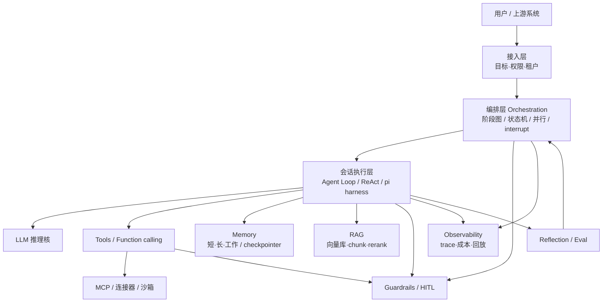
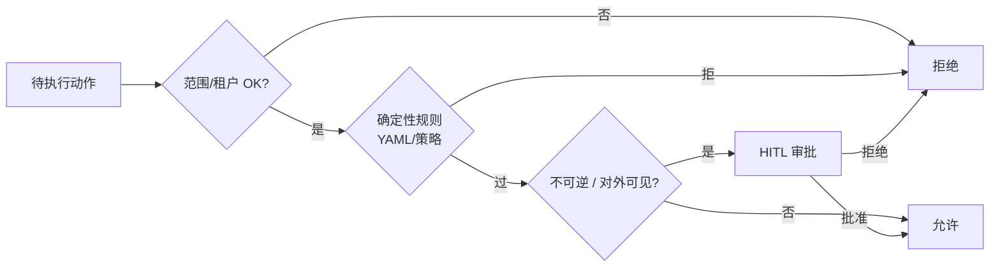

# Agent 工程架构走读

> 主文 · 以工程模块与数据流为主；外部示意图仅附录  
> 相关：[01-what-is-an-agent.md](01-what-is-an-agent.md) · [glossary](glossary/README.md)

---

## 0. 结论先行

| 要点 | 说明 |
|---|---|
| **架构不是一张能力海报** | 要能回答：状态存在哪、工具谁批准、失败怎么回、人何时介入 |
| **推荐分层** | 接入 → 编排(Orchestration) → 会话执行(Agent Loop) → 工具/MCP → 记忆/RAG → 门禁/HITL → 观测 |
| **本仓默认取向** | 编排偏 LangGraph；会话偏 pi；门禁 fail-closed；检索与记忆分家 |

---

## 1. 推荐逻辑分层（本仓口径）

| 层 | 负责 | 不负责 |
|---|---|---|
| 接入 | 鉴权、目标归一、配额 | 具体推理 |
| 编排 | 阶段、分支、战役进度、跨 Agent 派发 | 单步 tool 细节 |
| 会话执行 | 热循环、消息历史、压缩 | 全局战役拓扑 |
| 工具/MCP | 副作用与外部 I/O | 是否允许调用（应交禁裁） |
| Memory | 任务内/跨任务状态 | 整库文档问答（那是 RAG） |
| RAG | 外部知识取证 | 替代工作记忆 |
| 门禁/HITL | 范围、不可逆、审批 | 替代业务逻辑 |
| 观测 | 可审计、可复盘 | 自动「变聪明」 |

---

## 2. 一次任务的端到端数据流（中性示例）

**目标（中性）**：根据内部知识库与公开文档，整理某开源竞品的「调度与门禁」要点，写入 Notion，并在 Slack 通知负责人。

| 步 | 模块 | 发生什么 |
|---|---|---|
| 1 | 接入 | 校验用户身份与「可写 Notion / 可发 Slack」权限 |
| 2 | Planner | 拆成：检索资料 → 摘要对比 → 写页面 → 通知 |
| 3 | RAG | 从竞品笔记库检索相关 chunk；不足再 Web 检索 |
| 4 | Agent Loop | 多轮 tool：search → read → draft |
| 5 | Memory | 工作记忆记下已读来源与草稿路径 |
| 6 | Reflection | 检查是否覆盖「调度/门禁」两节；缺则回流 |
| 7 | Guardrails | 「发 Slack」属对外可见 → **HITL 审批** |
| 8 | 执行 | 写 Notion；审批通过后发 Slack |
| 9 | Observability | 留下 trace：用了哪些 tool、token、审批人 |

此例刻意**不含**扫描利用类动作，只演示闭环与门禁切面。

---

## 3. 编排 vs 会话执行（选型常混）

| | Orchestration（编排） | Agent Loop / Harness（会话执行） |
|---|---|---|
| 粒度 | **阶段 / 战役 / 多 Agent** | **单会话内** think-act-observe |
| 状态 | 图节点、checkpoint、业务实体 | 消息列表、tool 结果、压缩摘要 |
| 典型技术 | LangGraph、工作流引擎 | pi、dsh、LangChain AgentExecutor |
| HITL 位置 | 节点 interrupt、阶段门 | 单次 tool 前确认 |
| 本仓建议 | 长流水线用编排托底 | 每阶段内用 harness 跑热循环 |

详见 [orchestration](glossary/orchestration.md) · [agent-loop](glossary/agent-loop.md) · [pi](../02-frameworks/pi.md) · [langgraph](../02-frameworks/langgraph.md)。

---

## 4. 门禁切面应插在哪

原则：**默认 fail-closed**（不确定则拦）。产品化参考 Aurora 四层；概念见 [guardrails-hitl](glossary/guardrails-hitl.md)。

---

## 5. 上下文爆炸时怎么拆

长程任务失败的头号工程原因往往是**窗满 + 失忆 + 重复劳动**，不是「模型不够大」。

| 手段 | 作用 | 专篇 / 落点 |
|---|---|---|
| Context compaction | 摘要/折叠历史，保留关键事实与待办 | [context-compaction](glossary/context-compaction.md)、pi |
| 结构化 Memory | 图、工件、checklist 代替纯聊天记录 | [memory](glossary/memory.md)、ARTEX 双图 |
| RAG 外置知识 | 大文档不进权重、不进永久窗口 | [rag](glossary/rag.md) |
| 阶段切分 | 每阶段新会话 + 只传 digests | Orchestration |

---

## 6. 附录：外部示意图对照

> 外部面板强调 Planner / Reasoning / Loop / Reflection + Memory / Tool / MCP。对照本仓分层：请把 **Orchestration、RAG、Guardrails、Observability** 视为一等公民，而不是「Loop 里顺便做」。

> 七层能力图适合对产品讲「智能体有什么本事」；落地架构仍以第 1 节分层为准。

---

## 7. 读完下一步

1. 按需查 [glossary/](glossary/README.md)（建议先：agent-loop · rag · orchestration · guardrails-hitl · context-compaction）  
2. 再进 [02-frameworks/](../02-frameworks/) 与 [01-competitors/](../01-competitors/)  
3. 总选型见根 [00-index.md](../00-index.md)
