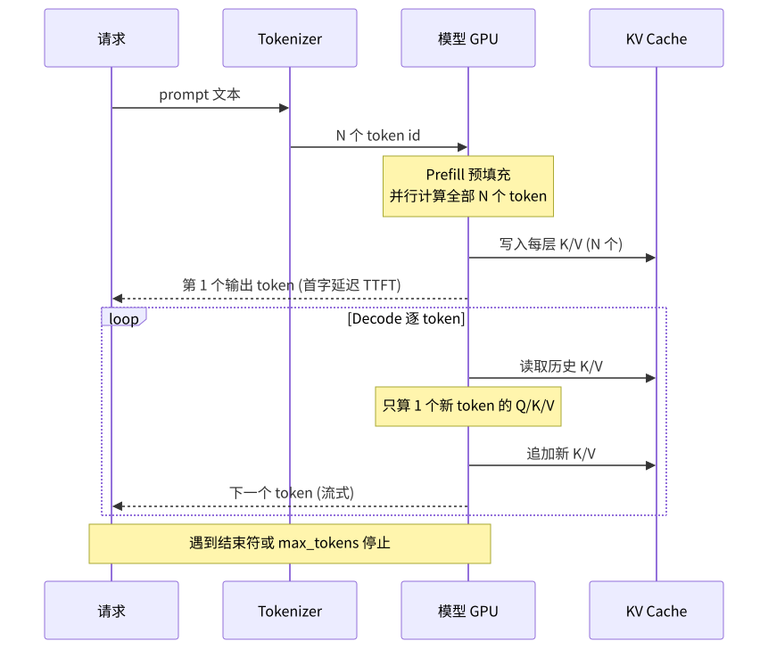

# 大语言模型（LLM）入门

> 主文 · 建议紧接 [01-what-is-an-agent.md](01-what-is-an-agent.md) 阅读  
> 相关：[glossary/llm.md](glossary/llm.md) · [glossary/reasoning.md](glossary/reasoning.md) · [glossary/tool.md](glossary/tool.md) · [06-context-engineering.md](06-context-engineering.md) · [glossary/embedding-vector-store.md](glossary/embedding-vector-store.md)  
> 各家描述与价格的**查阅日期：2026-10-16**。价格会变，**以官网为准**。

---

## 1. 定义

**大语言模型（Large Language Model, LLM）** 是在海量文本（以及代码、图像等）上训练出来的超大规模神经网络，核心任务只有一个：**给定前文，预测下一个 token 的概率分布**。把这一步反复执行（自回归），就能生成连贯的文本、代码和结构化输出。当前主流 LLM 几乎都基于 **Transformer 解码器**架构。

## 2. 核心能力：理解 / 生成 / 推理

| 能力 | 含义 | 在 Agent 中的用途 |
|---|---|---|
| **理解** | 读懂自然语言、代码、图片里的意图、实体、约束 | 任务理解、读工具结果、读检索片段 |
| **生成** | 按要求产出文本、代码、JSON | 写答复、写代码、产出 tool_call 参数 |
| **推理** | 多步推导、规划、比较取舍（可显式思考） | 规划步骤、决定下一步调用哪个工具、反思 |

这三种能力都来自同一个机制（下一 token 预测）在足够大的数据和模型上训练后「涌现」出来的，而不是分别写的模块。

## 3. 训练方式：预训练 + 微调



*图 1：训练流程。海量语料上做**预训练**（下一 token 预测）得到 Base 模型；再用指令-回答对做**监督微调 SFT**（含工具调用示范）；然后用人类偏好做**偏好优化**（RLHF 的奖励模型+PPO，或 DPO）；近年还普遍加入**带可验证奖励的强化学习**（测试是否通过、答案是否正确）来提升推理与 Agent 能力。PNG：[llm-training.png](assets/llm-training.png)*

- **预训练**：学「语言与世界知识」。数据量最大、成本最高，产物会续写但不一定听指令。
- **SFT**：学「按指令回答、按格式输出、调用工具」。
- **偏好优化 / RL**：学「哪种回答更好、更安全、更正确」，以及长链推理。

## 4. 参数规模的意义

- **参数**是网络中可学习的权重数量（常以 B＝十亿计）。参数越多，可存储的知识与可表达的模式越多。
- **Scaling law**：在数据和算力匹配增长时，损失随参数、数据、算力按幂律平滑下降——这是行业持续做大模型的依据。
- **但不是越大越好**：推理成本、延迟、显存与参数量正相关；**MoE**（混合专家）让总参数很大但每个 token 只激活一部分，从而兼顾容量与成本；小模型经过蒸馏和高质量数据也能在特定任务上很强。
- 选型原则：用评测集在**你的任务**上比较「效果 / 成本 / 延迟」，而不是只看参数量。

## 5. 上下文窗口

- **上下文窗口**＝模型单次可处理的 token 上限（输入 + 输出）。官网当前主流旗舰已普遍标注到百万 token 级别（如下文价格表各行所列）。
- 窗口大≠可以随便塞：成本与输入 token 线性相关，长上下文中段信息利用率偏低（lost in the middle）。如何管理见 [06-context-engineering.md](06-context-engineering.md) 与 [glossary/context-explosion.md](glossary/context-explosion.md)。

## 6. 与 Agent 的关系：LLM 是大脑 / 推理引擎


*图 2：LLM 在 Agent 中的位置。上下文组装（system、工具 Schema、记忆、RAG、历史）输入 LLM；LLM 要么直接输出文本，要么输出结构化 **tool_call** 交给执行器，执行结果作为 Observation 回到上下文，形成循环；编排、门禁、预算从外部控制 LLM 的调用。PNG：[llm-in-agent.png](assets/llm-in-agent.png)*

- LLM 负责**判断**（理解、规划、选择工具、生成参数、总结），不直接产生副作用。
- 记忆、工具、检索、门禁、编排都在 LLM 之外，由确定性代码实现——这就是 [01](01-what-is-an-agent.md) 所说「带工具的 LLM + 循环 + 状态」。
- 所以选 LLM 时 Agent 场景最看重：**工具调用可靠性、指令遵循、长上下文、推理质量、成本与延迟**。

## 7. 各家官方描述（转述）

> 以下均为 2026-10-16 查阅官网/官方文档后的简短转述，引号内为原文短引。

| 厂商 | 官方定位（转述） | 来源 |
|---|---|---|
| **OpenAI** | API 定价页把 GPT-6 系列列为「Flagship models / Our latest models」，按 Astra / Sol / Luna 分档，另有面向网络安全、生命科学的专用模型；ChatGPT 面向个人提供 Free / Go / Plus / Pro 档 | https://platform.openai.com/docs/pricing · https://openai.com/chatgpt/pricing/ |
| **Anthropic** | 「Claude is a family of state-of-the-art large language models」。建议多数负载从 Opus 5.5 起步；Fable 5.1 用于「demanding reasoning and long-horizon agentic work」；Sonnet 5.5 是速度与智能的最佳组合；Haiku 5.5 面向高并发、低延迟的分类/抽取/路由。所有当前模型支持文本+图像输入、工具调用，上下文 1M tokens | https://docs.anthropic.com/en/docs/about-claude/models/overview |
| **Google（Gemini）** | Gemini 4 Argon 为「Our flagship reasoning model」，统一 1M 上下文、长解码最多 1M tokens；Gemini 3.8 Flash 是「Our most intelligent Flash model」，面向长程软件工程与自主 Agent；Flash-Lite 系列主打成本效率 | https://ai.google.dev/gemini-api/docs/models |
| **Meta** | 官网（llama.com 现指向 Muse 品牌页）主推 Muse 系列：Muse Wonder 面向前沿编码、长程 Agent 与计算机操作，可规划任务并委派子 Agent；Muse Spark 面向长程编码与 Agent；**Muse Spark Open** 被描述为「The most capable US open-weight model to date」。通过 Meta Model API（公开预览）按量计费 | https://www.llama.com/ · https://dev.meta.ai/docs/pricing-rate-limits |
| **Mistral** | 「Mistral develops, or makes available, open-weight and commercial large language models」。Mistral Large 4 为开权重通用多模态模型；Mistral Medium 3.5 为面向 Agent 与编码的前沿级多模态模型（Modified MIT）；Mistral Small 4 统一指令/推理/编码（Apache 2.0） | https://docs.mistral.ai/getting-started/models/ |
| **DeepSeek** | API 文档列出 deepseek-flash（DeepSeek-V4.1-Flash）与 deepseek-v4-pro（DeepSeek-V4-Pro-0813）：支持思考/非思考模式、JSON 输出、工具调用，上下文 1M，兼容 OpenAI 与 Anthropic 接口格式 | https://api-docs.deepseek.com/quick_start/pricing |
| **阿里云（Qwen）** | 百炼「提供千问及第三方模型服务，覆盖文本、图像、音频、视频等多种模态」，文本生成主推 qwen3.8-max / qwen3.7-plus / qwen3.8-flash | https://help.aliyun.com/zh/model-studio/models |
| **Moonshot（Kimi）** | 开放平台为「按量计费」模式，不提供订阅制；当前列出 K3 与 K2 系列 | https://platform.moonshot.cn/docs/pricing/chat |

## 8. 价格对比表

> **规则**：只填官网定价页实际读到的数字（查阅 2026-10-16）；读不到的写「未能从官网核实」；官网未列的型号写「官网当前未列」。海外为美元 / 1M tokens，国内为官方人民币价 / 1M tokens。价格会变，以官网为准。「开源/开权重」一列只写官网明确写出的信息。

### 8.1 API 按量价格

| 厂商 | 模型 | 输入 / 1M | 输出 / 1M | 缓存价（若官网列出） | 上下文窗口 | 开源 / 开权重 | 来源（查阅 2026-10-16） |
|---|---|---|---|---|---|---|---|
| OpenAI | gpt-6-astra | $10.00 | $50.00 | 缓存输入 $1.00；缓存写入 $12.50 | 定价页未列（≤272K 为短上下文档，>272K 为长上下文档，价格更高） | 官网定价页未注明 | https://platform.openai.com/docs/pricing |
| OpenAI | gpt-6.1-sol | $2.00 | $10.00 | 缓存输入 $0.10；缓存写入 $2.50 | 同上 | 官网定价页未注明 | 同上 |
| OpenAI | gpt-6-luna | $0.10 | $0.50 | 缓存输入 $0.01；缓存写入 $0.125 | 同上 | 官网定价页未注明 | 同上 |
| OpenAI | gpt-4o | $2.50 | $10.00 | 缓存输入 $1.25 | 定价页未列 | 官网定价页未注明 | 同上 |
| OpenAI | gpt-4o-mini | $0.15 | $0.60 | 缓存输入 $0.075 | 定价页未列 | 官网定价页未注明 | 同上 |
| OpenAI | o1 | $15.00 | $60.00 | 缓存输入 $7.50 | 定价页未列 | 官网定价页未注明 | 同上 |
| OpenAI | o3 | $2.00 | $8.00 | 缓存输入 $0.50 | 定价页未列 | 官网定价页未注明 | 同上 |
| Anthropic | Claude Fable 5.1 | $10 | $50 | 缓存读 $0.25；缓存写 $12.50（5 分钟 TTL） | 1M | 官网未注明 | https://www.anthropic.com/pricing · https://docs.anthropic.com/en/docs/about-claude/models/overview |
| Anthropic | Claude Opus 5.5 | $4 | $20 | 缓存读 $0.20；缓存写 $5 | 1M | 官网未注明 | 同上 |
| Anthropic | Claude Sonnet 5.5 | $2 | $10 | 缓存写 $2.50（缓存读在抓取文本中未显示） | 1M | 官网未注明 | 同上 |
| Anthropic | Claude Haiku 5.5 | 定价页：提示 ≤100K 时 $0.50；模型页：「From $0.10」 | 定价页：提示 ≤100K 时 $2.50；模型页：「From $0.50」 | 缓存 $0.125 / $0.625（定价页未清楚标明哪个是读、哪个是写） | 1M | 官网未注明 | 同上（两页表述不一，以官网为准） |
| Anthropic | Claude Opus 4.5 / Sonnet 4.5（legacy） | $5 / $3 | $25 / $15 | 读 $0.50 / $0.30；写 $6.25 / $3.75 | 未能从官网核实 | 官网未注明 | https://www.anthropic.com/pricing |
| Anthropic | Claude 3.5 系列、Claude 4（Opus 4 / Sonnet 4） | 官网当前未列 | 官网当前未列 | — | — | — | 同上（legacy 列表从 Opus 4.5 / Sonnet 4.5 / Haiku 4.5 起） |
| Google | gemini-4-argon（Standard，付费档） | $2.00（2026-11-30 前）；2026-12-01 起 $4.00 | $10.00（含 thinking）；12-01 起 $20.00 | 上下文缓存 $0.10；12-01 起 $0.20（仅隐式缓存） | 1M | 官网未注明 | https://ai.google.dev/gemini-api/docs/pricing · https://ai.google.dev/gemini-api/docs/models |
| Google | gemini-3.8-flash（Standard，付费档） | $0.75（2026-12-31 前）；2027-01-01 起 $1.50 | $3.75；2027 起 $7.50 | $0.075；2027 起 $0.15（另收存储费） | 未能从官网核实 | 官网未注明 | 同上 |
| Google | gemini-3.5-flash-lite（Standard） | $0.30 | $2.50 | $0.03（另收存储费） | 未能从官网核实 | 官网未注明 | https://ai.google.dev/gemini-api/docs/pricing |
| Meta | muse-wonder-1.0（Meta Model API） | $4.00 | $20.00 | 缓存输入 $0.20 | 1M（产品页） | API 模型；官网另有开权重的 Muse Spark Open | https://dev.meta.ai/docs/pricing-rate-limits · https://dev.meta.ai/products/meta-model-api |
| Meta | muse-spark-1.3 / 1.2（Standard） | $1.25 | $4.25 | 缓存输入 $0.15 | 1M（产品页） | 同上 | 同上 |
| Meta | Llama 系列 | 官网当前未列（llama.com 现指向 Muse 页） | — | — | — | — | https://www.llama.com/ |
| Mistral | Mistral Large（定价 FAQ 示例） | $0.5 | $1.5 | 官网写「缓存输入最多降 90%」，未给具体数字 | 未能从官网核实 | Large 4 被描述为 open-weight | https://mistral.ai/pricing · https://docs.mistral.ai/getting-started/models/ |
| Mistral | Medium 3.5 / Small 4 等其他型号 | 未能从官网核实（价格表需 JS 渲染） | 未能从官网核实 | — | 未能从官网核实 | Medium 3.5：Modified MIT；Small 4：Apache 2.0 | https://docs.mistral.ai/getting-started/models/ |
| DeepSeek | deepseek-v4-pro（V4-Pro-0813） | 未命中缓存：高峰 $1.32 / 非高峰 $0.66 | 高峰 $3.96 / 非高峰 $1.98 | 命中缓存：高峰 $0.044 / 非高峰 $0.022 | 1M | 定价页未注明 | https://api-docs.deepseek.com/quick_start/pricing |
| DeepSeek | deepseek-flash（V4.1-Flash） | 未命中缓存：高峰 $0.3 / 非高峰 $0.15 | 高峰 $1.2 / 非高峰 $0.6 | 命中缓存：高峰 $0.006 / 非高峰 $0.003 | 1M | 定价页未注明 | 同上 |
| 阿里云 Qwen | qwen3.8-max（华北2 北京） | ¥12 | ¥36 | 「上下文缓存享有折扣」；Batch 半价 | 定价阶梯写到 0<Token≤1M | 定价页未注明 | https://help.aliyun.com/zh/model-studio/model-pricing |
| 阿里云 Qwen | qwen3.7-plus（北京） | ¥2（≤256K），¥6（256K–1M），原价，页面注明限时 8 折 | ¥8（≤256K），¥24（256K–1M） | 享有折扣；Batch 半价 | 阶梯写到 1M | 定价页未注明 | 同上 |
| 阿里云 Qwen | qwen3.8-flash（北京） | ¥0.8 | ¥2.7 | 享有折扣 | 阶梯写到 1M | 定价页未注明 | 同上 |
| Moonshot Kimi | kimi-k3 | 未命中缓存 ¥20.00 | ¥100.00 | 命中缓存 ¥2.00；缓存写入 ¥20（5 分钟 TTL）/ ¥40（1 小时 TTL） | 1,048,576 tokens | 定价页未注明 | https://platform.moonshot.cn/docs/pricing/chat（表格内容来自 https://platform.kimi.com/docs/pricing/chat.md） |
| Moonshot Kimi | kimi-k2.6 | 未命中缓存 ¥6.50 | ¥27.00 | 命中缓存 ¥1.10 | 262,144 tokens | 定价页未注明 | 同上 |
| Moonshot Kimi | kimi-k2.7-code | 未命中缓存 ¥6.50 | ¥27.00 | 命中缓存 ¥1.30 | 262,144 tokens | 定价页未注明 | 同上 |

### 8.2 订阅套餐（月费）

| 厂商 | 套餐 | 月费 | 来源（查阅 2026-10-16） |
|---|---|---|---|
| OpenAI | ChatGPT Go / Plus / Pro | 未能从官网核实（抓取的页面未显示具体金额） | https://openai.com/chatgpt/pricing/ |
| OpenAI | ChatGPT Business（Premium 席位） | 年付 $100/月，月付 $125/月 | https://openai.com/api/pricing/（跳转到 Business 定价页） |
| Anthropic | Claude Pro | 年付 $17/月（一次付 $200），月付 $20 | https://www.anthropic.com/pricing |
| Anthropic | Claude Max | 起价 $100/月 | 同上 |
| Anthropic | Claude Enterprise | 每席位 $20/月 + 按 API 价计用量（年付） | 同上（FAQ） |
| Google | Gemini 消费级订阅 | 未能从官网核实（本次未抓取） | — |
| Mistral | Pro | $14.99/月（不含税；学生 $5.99） | https://mistral.ai/pricing |
| Mistral | Team | $24.99（页面未明确写出计费单位） | 同上 |
| Meta | Muse Code 订阅 | 未能从官网核实（定价页只写「有月度订阅」） | https://dev.meta.ai/docs/pricing-rate-limits |
| DeepSeek | — | API 按量计费，定价页未列订阅 | https://api-docs.deepseek.com/quick_start/pricing |
| Moonshot Kimi | — | 开放平台「不提供订阅制方案」（Kimi 会员是另一产品） | https://platform.moonshot.cn/docs/pricing/chat |
| 阿里云 Qwen | — | 本次只核实了按量价格 | — |

**价格会变，以各官网为准。** 未核实项一律未填数字。

## 9. 技术实现原理



*图 3：一次前向计算。文本经 Tokenizer 变成 token id → Embedding 查表成向量（加位置编码，如 RoPE）→ 经过 N 层 Transformer Block（自注意力 + 前馈/MoE，各带归一化与残差）→ LM Head 输出词表大小的 logits → softmax 得到下一 token 概率 → 采样出一个 token。PNG：[llm-transformer.png](assets/llm-transformer.png)*

### 9.1 Token 化
用 BPE / SentencePiece 等子词算法把文本切成 token（常见词一个 token，生僻字可能多个）。**为什么**：字符级序列太长、词级词表太大且有未登录词，子词在两者间折中；计费、上下文长度都按 token 算。

### 9.2 嵌入（Embedding）
每个 token id 查一张 `vocab × d` 的矩阵得到 d 维向量；位置信息用 RoPE 等旋转位置编码注入。**为什么**：神经网络只处理连续向量，语义相近的 token 会学到相近的向量。

### 9.3 自注意力
每个位置算出 Q、K、V 三个向量：`Attention = softmax(QKᵀ/√d + mask)·V`。因果掩码让每个位置只看左侧。多头（multi-head）并行学习不同关系；GQA/MQA 让多个头共享 K/V 以省显存。**为什么**：任意两个位置一步直连，能建模长距离依赖，并且训练时可完全并行（相比 RNN）。

### 9.4 下一 token 预测
训练目标：最小化真实下一 token 的交叉熵损失 `−log p(xₜ | x<t)`。**为什么**：目标简单、数据无需人工标注（文本本身就是标签），可无限扩展规模；理解、推理能力作为副产物涌现。

### 9.5 采样（temperature / top-p）
```python
logits = model(tokens)[-1] / temperature          # T<1 更确定，T>1 更发散
probs  = softmax(logits)
idx    = sort_desc(probs); keep = cumsum(probs[idx]) <= top_p   # nucleus
next_token = sample(idx[keep], probs[idx[keep]])
```
**为什么**：总取最大概率（greedy）易重复、单调；采样增加多样性。Agent 中工具调用/结构化输出通常用低温度求稳定。

### 9.6 KV Cache



*图 4：推理两阶段。**Prefill** 并行处理整段 prompt 并把每层 K/V 写入 KV Cache，决定首字延迟（TTFT）；**Decode** 每步只为 1 个新 token 计算 Q/K/V，读取缓存的历史 K/V，逐 token 流式输出。PNG：[llm-inference.png](assets/llm-inference.png)*

**为什么**：不缓存则每生成一个 token 都要重算全部历史，复杂度从 O(n) 变 O(n²)。代价是显存随上下文长度线性增长——这也是长上下文贵的原因之一。**Prompt cache**（各家定价里的「缓存输入」）就是跨请求复用相同前缀的 KV，所以缓存命中价远低于普通输入价。

### 9.7 MoE（混合专家）
把 FFN 换成 E 个专家 + 路由器，每个 token 只送入 top-k 个专家：`y = Σ gate_i(x)·Expert_i(x)`。**为什么**：总参数（容量）大，但每 token 计算量只与激活参数相关，单位成本下效果更好；难点是负载均衡与通信。

### 9.8 上下文窗口
窗口上限受**训练时的序列长度**、位置编码外推能力（RoPE 缩放等）和**推理显存**（KV Cache）共同决定。**为什么不能无限大**：注意力计算随长度平方增长，KV 显存线性增长，且模型需要在长序列上训练过才能用好。

### 9.9 工具调用是怎么训出来的
1. 定义格式：工具以 JSON Schema 放进上下文，模型输出特殊格式的 `tool_call{name, arguments}`。
2. **SFT**：用大量「用户请求 → 选择工具 → 生成参数 → 读取结果 → 回答」的轨迹做监督训练（含何时**不**调用工具）。
3. **RL**：在可执行环境中让模型真的调用工具，以任务成功、参数合法等可验证信号作为奖励。
4. 推理侧：API 用约束解码/语法引导保证输出是合法 JSON。

**为什么**：让模型只学「决定和填参」，执行交给代码——可校验、可审计（见 [glossary/tool.md](glossary/tool.md)、[glossary/reasoning.md](glossary/reasoning.md)）。

---

下一步：[02-agent-architecture.md](02-agent-architecture.md) · [06-context-engineering.md](06-context-engineering.md)
