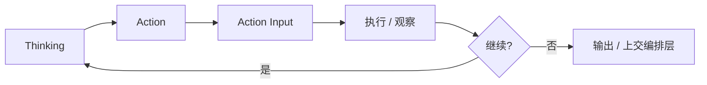

# Agent Loop / ReAct（核心循环）

> 相关：[reasoning.md](reasoning.md) · [tool.md](tool.md) · [execution.md](execution.md) · [reflection.md](reflection.md) · [orchestration.md](orchestration.md)

---

## 定义

**Agent Loop** 是会话执行层最热的内环：模型**思考** → 选择并调用**工具** → **观察**结果 → 再思考，直到结束条件。业界常称的 **ReAct**（Reason + Act）与此同族。

| 步 | 输入 | 输出 |
|---|---|---|
| Thinking | 目标片段、记忆、上轮观察 | 中间分析 |
| Action | 分析、工具列表 | 工具名 |
| Action Input | 工具 schema | 参数对象 |
| Observe | 工具返回 / 错误 | 写入上下文 |

---

## 解决什么

- 工具结果不确定时，必须**边看边做**  
- 单次生成无法覆盖多跳信息需求  
- 为审批、限流、审计提供**自然边界**（每轮可打断）

---

## 怎么用

1. 暴露带 JSON schema 的工具；强制模型按 schema 填参  
2. 设 `max_loops` / 预算；超限熔断或上交编排层重规划  
3. 每轮落 trace（思考摘要可脱敏、tool 名、耗时、成败）  
4. 需要战役级阶段时：**不要**用无限 Loop 硬撑，外挂 [orchestration](orchestration.md)

---

## 常见坑

- 把 Loop 当成全部 Agent（忽略 Memory / RAG / 门禁 / 编排）  
- Action Input 不校验 → 无效调用空转  
- 无 max_loops → 死循环烧钱  
- 把不可逆 tool 放进无人值守循环

---

## 本仓关联

**pi / dsh** 把该循环做成工业会话运行时（含压缩与审计）；**LangGraph** 可把循环收成节点，或在阶段内嵌套。平台应设循环上限与工具白名单。
