# Context compaction（上下文压缩）

> 相关：[memory.md](memory.md) · [agent-loop.md](agent-loop.md)  
> 框架：[../../02-frameworks/pi.md](../../02-frameworks/pi.md)

---

## 定义

**Context compaction** 是在上下文窗口接近上限时，把历史消息/工具输出**折叠、摘要或外置**，同时尽量保留：目标、约束、关键事实、待办、失败教训。与「简单截断最早消息」不同，好的压缩是**有损但可控**的记忆治理。

---

## 解决什么

- 长程任务 token 爆炸  
- 保留审计所需关键路径（谁做了什么决定）  
- 让 Agent 在多小时任务中仍「记得」验收标准

---

## 怎么用

1. 触发阈值：token 占比、轮次、工具输出体积  
2. 策略组合：摘要、保留最近 K 轮原文、大工具输出落盘只留指针  
3. 摘要写入工作记忆；原文进冷存储可回看  
4. 压缩后跑一次一致性检查（目标是否仍在上下文中）

---

## 常见坑

- 截断掉安全约束或 HITL 决议  
- 摘要引入错误事实（压缩幻觉）  
- 不压缩 tool 大块 JSON，只压缩用户话 —— 搞反了重点

---



*图：压缩位于工作记忆的回路上：上下文超过阈值时，把较早轮次摘要后放回，保留最近轮次原文。PNG：[memory-layers.png](../assets/memory-layers.png)*

## 技术实现原理

**触发**：每次调用前用 tokenizer 估算 `tokens(messages)`，超过窗口的某比例（如 70–80%）触发。

**策略**：
1. **截断**：保留 system + 最近 k 轮（最简单，丢信息）。
2. **摘要**：把 `messages[1:-k]` 交给 LLM 生成结构化摘要（目标、已完成、关键事实、待办、文件/ID 等），替换为一条 summary 消息。
3. **工具结果裁剪**：大输出只保留头尾或摘要，原文落盘留引用路径。
4. 注意保持 tool_call 与对应 tool 结果成对，不能拆散。

```python
def maybe_compact(msgs, limit):
    if count_tokens(msgs) < 0.75 * limit: return msgs
    head, old, recent = msgs[:1], msgs[1:-8], msgs[-8:]
    summary = llm(COMPACT_PROMPT, old)   # 结构化摘要
    return head + [{"role": "user", "content": "[历史摘要]\n" + summary}] + recent
```

**为什么**：长任务必然超窗；有损压缩换取可持续运行。结构化摘要比自由摘要更不易丢失「待办与约束」。

## 相关

- 相关：[context-explosion.md](context-explosion.md)（成因与全套解法） · [../06-context-engineering.md](../06-context-engineering.md) · [memory.md](memory.md) · [rag.md](rag.md)

## 本仓关联

**pi** 以工业级 compaction / 会话树见长；Full-Chain-Sentinel 验证其可撑长会话控制台。自建平台应把压缩策略视为一等配置，而不是「模型自己会忘」。
