# Context Explosion（上下文爆炸）

> 相关：[context-compaction.md](context-compaction.md) · [memory.md](memory.md) · [rag.md](rag.md) · [orchestration.md](orchestration.md) · 主文 [../06-context-engineering.md](../06-context-engineering.md) · [../05-multi-agent-collaboration.md](../05-multi-agent-collaboration.md#上下文爆炸)



*图：上半为成因（多轮累积、长工具结果、多 Agent 共享历史、全量塞文档），汇聚为「超窗·变慢·变贵·变笨」；下半为六类解法。PNG：[context-explosion.png](../assets/context-explosion.png)*

## 定义

Agent 运行过程中送入模型的 token 数持续增长，逼近或超过上下文窗口，导致报错（overflow）、延迟与费用上升、以及注意力被稀释后推理质量下降的现象。

## 成因

| 成因 | 机制 |
|---|---|
| 多轮对话 | `messages` 只增不减，每轮都重发全部历史 |
| 长工具结果 | 日志、网页、文件、数据库查询结果原样回填，一次就可能上万 token |
| 多 Agent 共享上下文 | 子 Agent 之间转发完整历史，或主管把所有子结果原文汇总，N 个 Agent 近似 N 倍膨胀 |
| 全量加载 | 把整份文档、全部工具 Schema、所有记忆一次性塞入 |
| 重试与反思 | 每次失败的尝试与批评都留在历史中 |

## 解法

1. **摘要压缩**：旧轮次 → 结构化摘要（见 [context-compaction.md](context-compaction.md)）。
2. **滑动窗口**：只保留最近 N 轮/N token 原文（如 pi 的 `keepRecentTokens`）。
3. **RAG 检索替代全量**：文档入向量库，按问题检索 top-k 片段（见 [rag.md](rag.md#用-rag-缓解上下文爆炸)）。
4. **分层记忆**：工作记忆只放当前任务；事实下沉长期记忆按需召回（见 [memory.md](memory.md)）。
5. **按需加载/渐进披露**：工具与文档先给目录/摘要，用到再展开。
6. **子 Agent 隔离**：子任务在独立上下文完成，只向上返回摘要（见 [orchestration.md](orchestration.md#编排层如何防上下文爆炸)）。
7. **工具结果裁剪**：大输出落盘，回填「头尾 + 路径」。

## 技术实现原理

**预算器**：每次调用前计算 `used = tokens(system) + tokens(tools) + tokens(messages)`，判断 `used > window - reserve`。

```python
def build_context(state, window, reserve=16_000):
    ctx = [system(state), *select_tools(state.intent)]          # 按需加载工具
    ctx += recall_memory(state.query, k=5)                       # 分层记忆
    ctx += rag_search(state.query, k=5)                          # 检索替代全量
    ctx += [state.summary] if state.summary else []
    ctx += trim_tool_outputs(state.recent, max_each=2_000)       # 裁剪
    while tokens(ctx) > window - reserve:
        state.summary = summarize(state.summary, state.recent[:4])  # 滚动摘要
        state.recent = state.recent[4:]                             # 滑动窗口
        ctx = rebuild(...)
    return ctx
```

**多 Agent 场景**：子 Agent 返回 `{result_summary, artifacts: [path/id]}` 而非完整轨迹；共享黑板只存结构化事实与引用。

**为什么**：窗口是硬上限、成本按 token 线性增长、长上下文中段利用率又偏低，所以「少而精」比「全而长」更好；把信息放在外部存储（文件、向量库、记忆库）并按需取回，是把上下文当缓存而非数据库。

## 常见坑

- 只在报 overflow 后才压缩，压缩本身又超窗 → 预留 reserve、提前触发。
- 压缩拆散 tool_call 与 tool 结果，导致 API 报错。
- 摘要丢失约束与待办 → 用固定模板（目标/约束/已完成/待办/关键 ID）。

## 本仓关联

- pi：`contextTokens > contextWindow - reserveTokens` 触发压缩，保留 `keepRecentTokens`（见 [../02-frameworks/pi.md](../../02-frameworks/pi.md)）。
- Strix：旧轮摘要为 `<conversation-checkpoint>`，切分保证 tool_call/tool_result 成对（见 [strix](../../01-competitors/strix.md)）。
- ARTEX：探索图冷节点 digest（见 [ARTEX](../../01-competitors/ARTEX.md)）。
