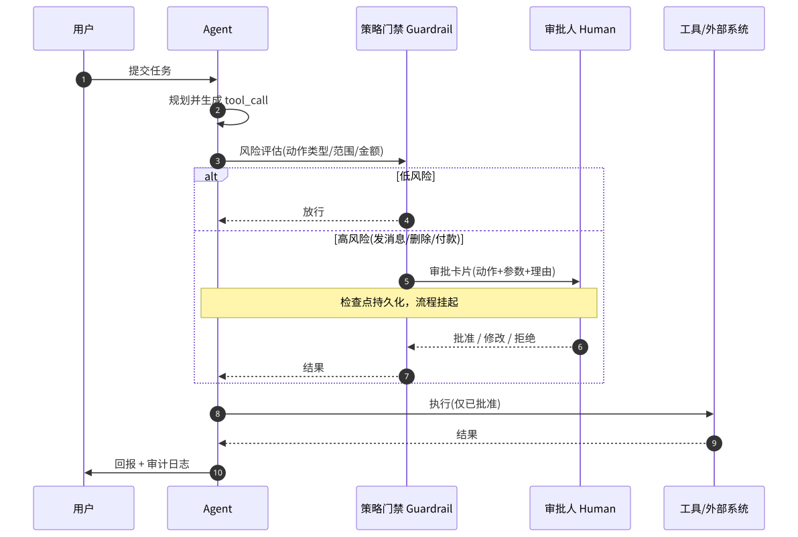

# Guardrails / HITL（门禁与人机审批）

> 相关：[tool.md](tool.md) · [orchestration.md](orchestration.md) · [reflection.md](reflection.md)

---

## 定义

- **Guardrails（门禁）**：在 Agent 行动前后施加的**强制约束**——范围/租户、工具白名单、速率、内容策略、不可逆操作分级等。  
- **HITL（Human-in-the-loop）**：对特定动作暂停自动化，等待**人类批准、拒绝或修改**后再继续。

原则：**默认 fail-closed**（不确定则拦截）。

---

## 解决什么

- 防止越权、误发、误删、超范围操作  
- 满足合规与「人要负最终责任」的产品要求  
- 把高风险点从「模型自觉」升级为「系统硬闸」

---

## 怎么用

分层（示例，与 Aurora 思路同族）：

1. **Runtime scope**：租户、资产范围、环境  
2. **确定性规则**：YAML/策略引擎，不经模型「商量」  
3. **不可逆分级**：只读 / 可写可回滚 / 对外可见 / 破坏性  
4. **Autonomy 档位**：全自动 / 关键审批 / 步步审批  
5. 审批落在编排 interrupt 或 tool 包装器上；超时策略显式（拒绝 vs 保持等待）

---

## 常见坑

- 审批 **fail-open**（超时当同意）  
- 只做提示词「你要小心」而无运行时拦截  
- HITL 点过多 → 人肉瓶颈；过少 → 风险裸奔  
- 门禁日志不可审计

---



*图：HITL 门禁时序。Agent 生成动作后先过策略门禁：低风险直接放行，高风险（发消息、删除、付款）生成审批卡并挂起流程，人批准/修改/拒绝后才执行，全程落审计日志。PNG：[hitl-sequence.png](../assets/hitl-sequence.png)*

## 技术实现原理

**数据结构**：`Policy{action_pattern, risk_level, require_approval, scope_limits}`；`ApprovalRequest{id, action, args, reason, status, approver, ts}`；审计日志 append-only。

**流程**：
1. **输入护栏**：提示注入检测、PII 脱敏、话题范围分类（规则 + 小模型分类器）。
2. **动作护栏**：在工具执行前拦截 tool_call，按策略表打风险等级（工具名、参数如收件人/金额/路径、目标是否在授权范围内）。
3. **HITL**：高风险 → 持久化 checkpoint → 推送审批卡 → 流程 `interrupt`；回调到达后 resume；超时视为拒绝。
4. **输出护栏**：敏感信息、格式/Schema 校验、引用核对。

```python
def guarded_call(call):
    risk = policy.assess(call.name, call.args)
    if risk == "block": return deny(call)
    if risk == "high":
        req = approvals.create(call, reason=explain(call))
        decision = interrupt(req)          # 挂起，等待人
        if decision.status != "approved": return deny(call)
        call.args = decision.edited_args or call.args
    audit.log(call); return execute(call)
```

**为什么**：模型输出不可完全信任；把不可逆动作的决定权留在确定性策略与人手中；拦截点放在「执行前」而非 prompt 里，确保无法被模型绕过。

## 本仓关联

Aurora 四层门禁为基线；Sentinel 类实现需警惕审批 fail-open。概念上任何「发 Slack / 改生产 / 扩扫范围」都应进本表评估。
