# LLM（Large Language Model，大语言模型）

> 详解主文：[../03-large-language-models.md](../03-large-language-models.md) · 相关：[reasoning.md](reasoning.md) · [tool.md](tool.md) · [prompt-system-prompt.md](prompt-system-prompt.md) · [../06-context-engineering.md](../06-context-engineering.md)

*图：LLM 是 Agent 的推理引擎。它读入组装好的上下文，输出文本或 tool_call；工具、记忆、门禁都在它外面。PNG：[llm-in-agent.png](../assets/llm-in-agent.png)*

## 定义

在海量语料上以「预测下一个 token」为目标训练出来的 Transformer 大模型，具备理解、生成和推理能力。

## 解决什么

用一个通用模型处理开放式语言任务：理解意图、写作、写代码、规划、选择工具并填写参数，免去为每个任务单独训练模型。

## 怎么用

通过 Chat API 发送 `messages`（加上可选的 `tools`），取回文本或 tool_call；按任务需要调节 temperature、推理强度和 max_tokens；按「效果 / 成本 / 延迟」选择模型档位。

## 技术实现原理

Tokenizer → Embedding → N 层（自注意力 + FFN/MoE）→ logits → 采样；推理时分为 prefill 和 decode 两个阶段，并用 KV Cache 复用历史计算；训练分预训练 → SFT → 偏好优化/RL。详见主文 §9。

## 常见坑

- 把 LLM 当数据库用：知识有截止日期且可能幻觉，需要 RAG 或工具补充。
- 让 LLM 直接执行副作用：应由代码执行并经过门禁。
- 只看参数量或榜单选型：应在自己的评测集上比较。

## 本仓关联

各家定位与价格见 [../03-large-language-models.md §7–§8](../03-large-language-models.md)。
