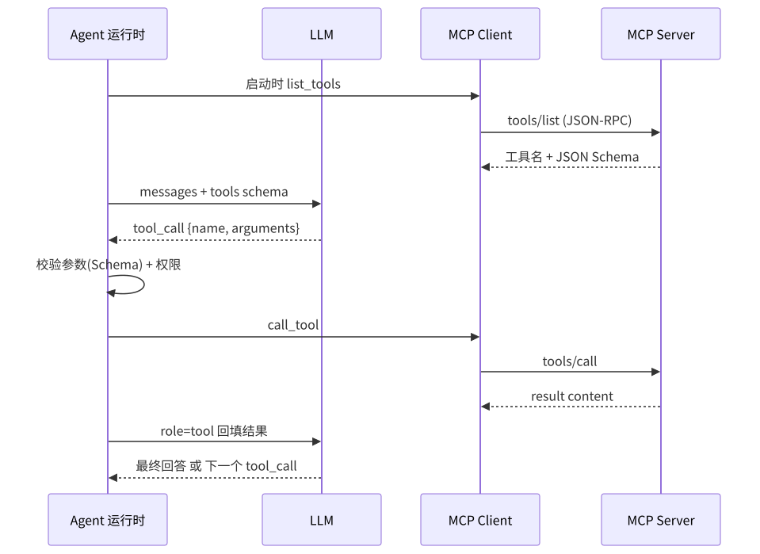

# MCP（Model Context Protocol）

> 相关：[tool.md](tool.md) · [guardrails-hitl.md](guardrails-hitl.md)

---

## 定义

**MCP（Model Context Protocol）** 是一种让 LLM 应用以**统一协议**连接外部系统（数据源、工具、上下文服务）的开放协议思路：服务端暴露资源/工具，客户端（Agent 宿主）发现并调用。相对「每个集成手写一套插件 API」，MCP 强调标准化发现与调用。

---

## 解决什么

- 降低 N×M 集成成本（多个宿主 × 多个外部系统）  
- 让工具与上下文服务可插拔  
- 便于在宿主侧统一做鉴权与审计切面

---

## 怎么用

1. 外部系统侧实现 MCP server（工具与资源）  
2. Agent 宿主做 client：列举工具 → 映射进 Function calling  
3. **门禁仍在宿主**：协议不等于安全；调用前照样 scope / HITL  
4. 凭证留在 server/宿主密钥管理，不进提示词

---

## 常见坑

- 误以为「接了 MCP 就安全」  
- 把全部 server 工具无过滤暴露给模型  
- 协议版本/能力协商不一致导致运行期失败

---



*图：MCP 在工具调用中的位置。MCP Client（在 Agent 运行时内）通过 JSON-RPC 向 MCP Server 发现工具（`tools/list`）并调用（`tools/call`），模型侧看到的仍是普通工具 Schema。PNG：[tool-calling-mcp.png](../assets/tool-calling-mcp.png)*

## 技术实现原理

**协议要点**：基于 JSON-RPC 2.0；传输层常见 stdio（本地子进程）与 Streamable HTTP（远程）；握手 `initialize` 协商能力；三类原语——**tools**（可执行动作）、**resources**（可读数据，URI 寻址）、**prompts**（模板）。

**流程**：
1. Host（如 IDE / Agent 应用）为每个 Server 起一个 Client 连接，`initialize` 后 `tools/list` 拿到 `{name, description, inputSchema}`。
2. 把这些 Schema 转成 LLM 的 tools 参数（与普通 function calling 相同）。
3. 模型返回 tool_call → Client 发 `tools/call {name, arguments}` → Server 执行返回 `content[]`。
4. 远程 Server 走 OAuth 授权；Host 负责用户确认与权限。

```json
{"jsonrpc":"2.0","id":7,"method":"tools/call",
 "params":{"name":"search_issues","arguments":{"query":"label:bug"}}}
```

**为什么**：把「N 个应用 × M 个系统」的集成从 N×M 个私有适配降为 N+M——工具方写一次 Server，所有支持 MCP 的 Host 都能用；Schema 动态发现免去硬编码。

## 本仓关联

架构图侧翼的「MCP」表示协议化连接器；落地时与 LangChain 工具、自研插件并列评估。本仓竞品分析不依赖某一 MCP 发行版细节。
