# Orchestration（编排 / 状态机）

> 相关：[agent-loop.md](agent-loop.md) · [planner.md](planner.md) · [guardrails-hitl.md](guardrails-hitl.md) · [multi-agent.md](multi-agent.md)  
> 框架：[../../02-frameworks/langgraph.md](../../02-frameworks/langgraph.md)

---

## 定义

**Orchestration** 是在「单次会话热循环」之上，用**图、状态机或工作流**管理：阶段顺序、分支、并行、重试、持久化状态、跨 Agent 派发与中断恢复。LangGraph 一类框架是其常见实现；本质是**显式状态 + 显式转移**。

---

## 解决什么

- 多阶段战役（侦察→分析→报告）不能靠无限 ReAct 硬撑  
- 需要 checkpoint、从失败节点恢复  
- 需要在**节点边界**插入 HITL，而不是淹没在 token 流里  
- 多 Agent 时要有「谁先谁后、如何汇合」

---

## 怎么用

1. 把业务阶段建成图节点；边表示转移条件  
2. 状态 schema 明确（Pydantic/TypedDict 等）  
3. 长副作用节点配 timeout / 补偿  
4. `interrupt` / 人工节点：对外发送、高风险操作  
5. 节点**内部**可再跑 Agent Loop（编排套会话）

---

## 常见坑

- 用纯聊天 Agent「假装」有阶段，实际无持久化  
- 图过细变成难维护的流程图地狱  
- 编排与会话职责反转：编排里塞 prompt 细节、会话里塞全局拓扑

---



*图：编排状态机示例。Intake→Plan→Execute→Review，失败有限次重试，高风险进入人工审批，每节点后写 checkpoint 以便中断恢复。PNG：[orchestration-graph.png](../assets/orchestration-graph.png)*

## 技术实现原理

**数据结构**：`State`（类型化字典：目标、计划、步骤结果、计数器、待审批项）；`Graph{nodes: name→fn(State)->StateUpdate, edges, conditional_edges: fn(State)->next}`；`Checkpoint{thread_id, step, state_snapshot}`。

**流程**：
1. 执行器从入口节点开始，调用节点函数得到状态增量，用 reducer 合并（如列表追加、字段覆盖）。
2. 条件边根据状态选择下一节点（例如 `review.ok ? "report" : retries<N ? "execute" : "fail"`）。
3. 每步后持久化 checkpoint（SQLite/Postgres/Redis）；遇到 `interrupt` 挂起，人工输入后从同一 checkpoint 继续。
4. 可并行分支（fan-out）后在汇合节点（fan-in）合并。

```python
g = StateGraph(State)
g.add_node("plan", plan); g.add_node("execute", execute); g.add_node("review", review)
g.add_edge("plan", "execute"); g.add_edge("execute", "review")
g.add_conditional_edges("review", lambda s: "end" if s["ok"] else
                        ("execute" if s["retries"] < 3 else "end"))
app = g.compile(checkpointer=SqliteSaver(...), interrupt_before=["execute"])
```

**为什么**：把控制流从 prompt 中拿出来写成显式图——可测试、可重放、可在节点间加门禁；LLM 只负责节点内的「判断」，流程骨架确定。

## 编排层如何防上下文爆炸

> 总览见 [context-explosion.md](context-explosion.md) · [../06-context-engineering.md](../06-context-engineering.md)

| 手段 | 编排层做法 |
|---|---|
| 状态而非历史 | 节点间传递类型化 `State`（计划、结果摘要、ID），不传完整 messages |
| 子图隔离 | 每个子任务在子图/子 Agent 独立上下文运行，返回 `{summary, artifacts}` |
| 节点级窗口 | 每个节点只组装自己需要的上下文（滑动窗口 + 按需检索） |
| 压缩节点 | 在图中显式放置 `compact` 节点，按阈值条件边触发 |
| 检查点外置 | 完整轨迹写 checkpoint/日志存储，上下文中只留引用 |

```python
g.add_conditional_edges("execute", lambda s: "compact" if tokens(s) > LIMIT else "review")
g.add_edge("compact", "review")
```

## 本仓关联

**优先 LangGraph 做战役编排**；pi 做阶段内会话。Aurora 的 Kill-Chain 图、YoungFlow 的 flow runner 都是编排样板。详见框架对比章。
