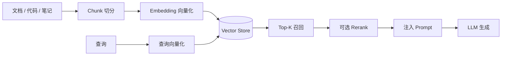

# RAG（Retrieval-Augmented Generation，检索增强生成）

> 相关：[embedding-vector-store.md](embedding-vector-store.md) · [memory.md](memory.md) · [tool.md](tool.md)

---

## 定义

**RAG** 指：在生成答案或决策前，先从**外部知识库**检索相关片段，把片段注入提示，再让 LLM 基于「检索到的证据 + 用户问题」生成。目的是补模型未训练/易过时的事实，并提供可引用依据。

概念流水线（产品级，不绑定具体厂商版本）：



---

## 解决什么

- 私有知识、内部文档、最新变更不宜或不能塞进微调  
- 需要「据某段资料」的可追溯回答  
- 降低纯参数记忆导致的过时与幻觉（**不能消灭幻觉**）

---

## 与 Memory 的区别（必读）

| | RAG | Memory |
|---|---|---|
| 对象 | **外部知识语料** | **本任务/用户/会话状态** |
| 问题例 | 「竞品门禁怎么写的？」 | 「这份报告写到第几节了？」 |
| 典型失败 | 检错篇、漏篇、过时索引 | 失忆、偏好写错、进度丢 |

可同时使用：RAG 取证，Memory 记进度。

---

## 怎么用

1. **Chunk**：按标题/语义切；过大噪声高，过小丢失上下文  
2. **Embedding + Vector Store**：建索引；更新语料要重建或增量  
3. **检索**：向量近邻；可加关键词/过滤（租户、时间、标签）  
4. **Rerank（可选）**：用更强模型重排 Top-K，提高精度  
5. **生成**：提示中明确「仅依据下列摘录；没有则说不知道」  
6. Agent 场景：常把「检索」封成 [Tool](tool.md)，由 Loop 决定何时查

---

## 常见坑

- 以为上了 RAG 就不会胡说——检错时仍会编  
- Chunk / 元数据混乱 → 权限穿透或串租户  
- 用 RAG 替代工作记忆  
- 索引不更新，回答一直基于旧文档  
- 无引用格式，无法审计「依据哪段」

---



*图：RAG 检索链路。上半「离线索引」把文档变成可检索的向量；下半「在线查询」把问题变成带引用的答案。PNG：[rag-pipeline.png](../assets/rag-pipeline.png)*

**图中各块**：解析清洗＝去页眉页脚、表格转文本；切块＝控制每块语义完整；Embedding＝把文本映射到向量空间；向量库＝存向量 + 元数据并建 ANN 索引（详见 [vector-database.md](vector-database.md)）；查询改写＝补全指代/扩展同义词；ANN + BM25＝语义召回与关键词召回互补；Rerank＝用更贵但更准的交叉编码器精排；拼 Prompt＝把 top 片段带编号放进上下文；LLM 生成＝要求按编号引用。

## 技术实现原理

**关键数据结构**：`Chunk{id, doc_id, text, vector: float[d], metadata{source, page, acl, updated_at}}`；索引 = 向量 ANN 索引（HNSW/IVF）+ 倒排索引（BM25）。

**流程**：
1. **切块**：按标题/段落递归切分，目标 300–800 token、10–20% 重叠——太大则语义被稀释、太小则丢上下文。
2. **Embedding**：同一模型编码文档块与查询（必须一致，否则向量空间不对齐），通常 L2 归一化后用 cosine/内积。
3. **召回**：ANN 取 topK（如 20–50），并行 BM25，用 RRF（Reciprocal Rank Fusion：`score=Σ 1/(k+rank_i)`）融合。
4. **Rerank**：cross-encoder 对 (query, chunk) 成对打分，取 top 3–8。原因：双塔 embedding 快但粗，交叉编码器准但慢，只适合小候选集。
5. **拼 Prompt**：`系统指令 + [1]片段… [n]片段 + 问题 + "只依据上文回答并标注 [编号]，无依据则说不知道"`。
6. **生成与校验**：可做引用核对（答案句是否能在片段中找到支撑）。

```python
def rag_answer(q):
    q2 = rewrite(q)                          # 查询改写
    qv = embed(q2)
    cand = rrf(vdb.search(qv, k=30, filter={"acl": user.groups}),
               bm25.search(q2, k=30))
    top = reranker.rank(q2, cand)[:5]
    ctx = "\n".join(f"[{i+1}] {c.text}" for i, c in enumerate(top))
    return llm(SYSTEM_CITE + ctx + "\n问题：" + q)
```

**为什么这样设计**：把「知识」放在模型外部 → 可更新、可溯源、可做权限过滤；两阶段（召回→精排）是在延迟与精度之间的经典折中；引用约束降低幻觉。

## 相关

- 上下文治理：[context-explosion.md](context-explosion.md) · [../06-context-engineering.md](../06-context-engineering.md)
- 向量库专篇：[vector-database.md](vector-database.md) · Embedding：[embedding-vector-store.md](embedding-vector-store.md)

## 用 RAG 缓解上下文爆炸

> 总览见 [context-explosion.md](context-explosion.md)

| 手段 | 做法 |
|---|---|
| 检索替代全量 | 文档不整份塞入，入向量库后每轮按问题取 top-k（rerank 后 3–8 段） |
| 工具结果入库 | 超长工具输出切块写入临时索引，回填「摘要 + 可检索句柄」，后续按需检索 |
| 历史入库 | 被压缩掉的旧轮次原文写入向量库，需要细节时检索回来（摘要 + 检索双保险） |
| 预算感知 k | 根据剩余 token 预算动态决定 k 与片段长度 |

```python
k = min(8, remaining_budget // avg_chunk_tokens)
ctx += rerank(q, vdb.search(embed(q), k=30))[:k]
```

## 本仓关联

调研笔记、架构决策、竞品摘要适合进知识库做 RAG；**战役进度、审批状态**应走 Memory / Orchestration 状态，而不是「再检索一次旧报告」。本仓框架章不绑定某一向量库产品版本。
