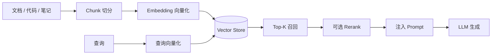

# RAG（Retrieval-Augmented Generation，检索增强生成）

> 相关：[embedding-vector-store.md](embedding-vector-store.md) · [memory.md](memory.md) · [tool.md](tool.md)

---

## 定义

**RAG** 指：在生成答案或决策前，先从**外部知识库**检索相关片段，把片段注入提示，再让 LLM 基于「检索到的证据 + 用户问题」生成。目的是补模型未训练/易过时的事实，并提供可引用依据。

概念流水线（产品级，不绑定具体厂商版本）：

---

## 解决什么

- 私有知识、内部文档、最新变更不宜或不能塞进微调  
- 需要「据某段资料」的可追溯回答  
- 降低纯参数记忆导致的过时与幻觉（**不能消灭幻觉**）

---

## 与 Memory 的区别（必读）

| | RAG | Memory |
|---|---|---|
| 对象 | **外部知识语料** | **本任务/用户/会话状态** |
| 问题例 | 「竞品门禁怎么写的？」 | 「这份报告写到第几节了？」 |
| 典型失败 | 检错篇、漏篇、过时索引 | 失忆、偏好写错、进度丢 |

可同时使用：RAG 取证，Memory 记进度。

---

## 怎么用

1. **Chunk**：按标题/语义切；过大噪声高，过小丢失上下文  
2. **Embedding + Vector Store**：建索引；更新语料要重建或增量  
3. **检索**：向量近邻；可加关键词/过滤（租户、时间、标签）  
4. **Rerank（可选）**：用更强模型重排 Top-K，提高精度  
5. **生成**：提示中明确「仅依据下列摘录；没有则说不知道」  
6. Agent 场景：常把「检索」封成 [Tool](tool.md)，由 Loop 决定何时查

---

## 常见坑

- 以为上了 RAG 就不会胡说——检错时仍会编  
- Chunk / 元数据混乱 → 权限穿透或串租户  
- 用 RAG 替代工作记忆  
- 索引不更新，回答一直基于旧文档  
- 无引用格式，无法审计「依据哪段」

---

## 本仓关联

调研笔记、架构决策、竞品摘要适合进知识库做 RAG；**战役进度、审批状态**应走 Memory / Orchestration 状态，而不是「再检索一次旧报告」。本仓框架章不绑定某一向量库产品版本。
