# Vector Database（向量数据库）

> 相关：[embedding-vector-store.md](embedding-vector-store.md)（Embedding 本身） · [rag.md](rag.md) · [memory.md](memory.md) · 主文 [../02-agent-architecture.md](../02-agent-architecture.md)



*图：向量库写入流与查询流。写入：文本块经 Embedding 变成向量，先写 WAL，再落入段/分片，后台建 ANN 索引与元数据索引。查询：用同一模型编码问题 → 元数据过滤 → ANN 近邻搜索 → 可选与 BM25 融合 → 返回 topK（id、分数、原文 payload）。PNG：[vector-database.png](../assets/vector-database.png)*

## 定义

专门存储高维向量并支持**相似度检索**（找「离查询向量最近的 K 个」）的数据库，同时存储每条向量对应的原文与元数据（payload），并支持过滤、增删改、持久化、分片与副本。

## 为何 Agent / RAG 需要

- **RAG**：在海量文档块里按语义而非关键词找到相关片段。
- **长期记忆**：按「与当前话题相似」召回用户事实与历史经验。
- **工具/技能检索**：工具很多时，先向量检索出相关工具再交给模型（渐进披露）。
- 普通数据库的 B 树索引只适合精确/范围匹配，无法高效回答「最相似」。

## 核心概念

| 概念 | 说明 |
|---|---|
| Embedding 存储 | 每条记录 `{id, vector: float[d], payload/metadata}`；d 由模型决定，同一集合内固定 |
| 相似度检索 | kNN：精确暴力扫描 O(N·d)；ANN：近似最近邻，牺牲少量召回换数量级提速 |
| 距离度量 | **cosine**（方向相似，文本最常用）· **L2 欧氏距离** · **内积 IP**（向量已归一化时与 cosine 等价）；须与模型训练时的度量一致 |
| HNSW | 分层可导航小世界图：多层稀疏→稠密图，从顶层贪心逼近再下沉；查询快、召回高，内存占用大；参数 `M`（每点邻居数）、`efConstruction`、`efSearch` |
| IVF | 倒排文件：先 k-means 聚成 nlist 个簇，查询只搜最近的 nprobe 个簇；建索引快、内存省，召回取决于 nprobe |
| PQ | 乘积量化：把向量切成 m 段，每段用码本编号代替，压缩存储、用查表近似算距离；常与 IVF 组合（IVF-PQ），以精度换内存 |
| 元数据过滤 | 按租户、权限、时间、标签过滤；**预过滤**（先过滤再 ANN，结果准但可能慢）vs **后过滤**（先 ANN 再过滤，可能凑不够 K） |
| 混合检索 | 向量（语义）+ BM25/稀疏向量（关键词、专有名词、编号）结果用 RRF 或加权融合 |

## 技术实现原理

**写入路径**：`upsert(id, vector, payload)` → 写 WAL 保证持久 → 进入内存段（可立即被暴力搜索）→ 段写满后封存并后台构建 ANN 索引 → 删除多用墓碑标记，后台 compaction 合并段时物理清理。

**HNSW 查询（简化）**：
```python
def hnsw_search(q, k, ef):
    ep = entry_point
    for layer in range(top, 0, -1):          # 上层贪心找更近入口
        ep = greedy_closest(q, ep, layer)
    cand = beam_search(q, ep, layer=0, ef=ef) # 底层宽度 ef 的最佳优先搜索
    return sorted(cand, key=lambda n: dist(q, n))[:k]
```

**IVF 查询**：计算 q 到 nlist 个质心的距离 → 取最近 nprobe 个簇 → 只在这些簇的向量里算距离（PQ 时用查表）→ 合并取 topK。

**分布式**：按 id 哈希分片，查询广播到各分片取局部 topK 再全局归并；副本提供读扩展与高可用。

**为什么这样设计**：高维空间里精确最近邻没有比线性扫描好太多的通用解（维度灾难），所以工业界用 ANN 以「召回率 95%+」换取数量级的速度；图索引（HNSW）适合低延迟在线场景，聚类+量化（IVF-PQ）适合超大规模省内存场景。

## 常见产品高层对比

> 只做定性比较，不列版本或性能数字；选型请以官方文档与自测为准。

| 产品 | 形态 | 特点（定性） | 适合 |
|---|---|---|---|
| **Milvus** | 开源，分布式服务（另有托管版） | 存算分离架构，多种索引类型（HNSW/IVF/PQ/GPU 等），面向大规模 | 大数据量、需要水平扩展的平台 |
| **Qdrant** | 开源（Rust），单机/集群，另有云托管 | payload 过滤能力强，支持量化与稀疏向量混合 | 需要复杂过滤的中大型应用 |
| **pgvector** | PostgreSQL 扩展 | 与业务数据同库，SQL + 事务 + 向量；支持 HNSW / IVFFlat | 已有 Postgres、数据量中等、想少一个组件 |
| **Chroma** | 开源，嵌入式/轻量服务 | 上手极快，Python 友好 | 原型、本地开发、小规模 |
| **Pinecone** | 全托管 SaaS（闭源） | 免运维、Serverless 计费 | 不想自运维的团队 |
| **Weaviate** | 开源，另有云托管 | 内置模块化向量化、混合检索、GraphQL 风格 API | 需要开箱混合检索与模块生态 |
| 其他 | Elasticsearch/OpenSearch kNN、Redis、FAISS（库而非数据库）等 | 在已有搜索/缓存设施上加向量能力；FAISS 适合嵌入自研系统 | 复用现有基础设施 |

## 在本目录 Agent 架构中的位置

位于「知识与记忆层」：[系统架构图](../assets/system-architecture.svg) 中的 **RAG** 与 **Memory** 两块底下共用向量库；数据流图第 5b 步（检索）与第 6 步（写入记忆）都会访问它。它不做推理，只负责「快速找相似」。

## 常见坑

- 查询与入库用了不同 embedding 模型或不同度量。
- 只用向量检索，编号/专有名词查不准 → 加 BM25 混合。
- 忘了做权限过滤，检索结果越权泄露。
- 换模型未重建索引；删除不清理导致结果脏。
- 盲目调大 topK 塞满上下文，反而引发 [上下文爆炸](context-explosion.md)。

## 本仓关联

RAG 链路见 [rag.md](rag.md)；长期记忆见 [memory.md](memory.md)；上下文治理见 [../06-context-engineering.md](../06-context-engineering.md)。
