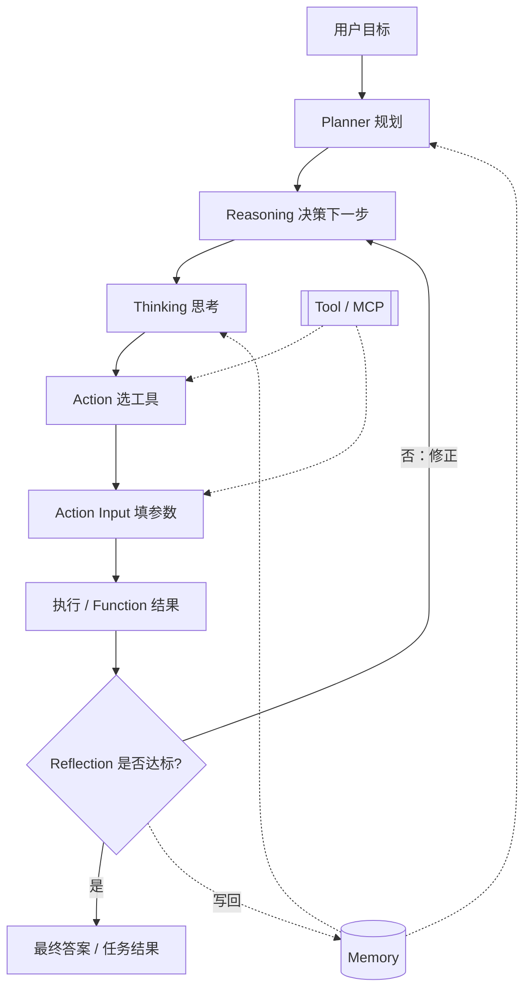

# Agent 是什么？

> 入门主文 · 配图：思维链总览 + 完整架构  
> 阅读后建议：[02-agent完整架构.md](02-agent完整架构.md) · [名词索引](名词/README.md)

---

## 0. 结论先行

| 问题 | 一句话答案 |
|---|---|
| **Agent 是什么？** | 能**理解目标、规划步骤、调用工具、记住上下文、检查结果并迭代**的软件系统，而不是单轮问答框 |
| **与聊天机器人差在哪？** | 聊天机器人偏「答一句」；Agent 偏「为达成目标而行动」 |
| **由哪些组成？** | 规划（Planner）· 推理（Reasoning / 思维链）· 核心循环（Thinking / Action / Action Input）· 记忆 · 工具 · MCP · 反思（Reflection）· 执行与检查修正 |
| **对本仓有何用？** | 后续竞品与框架选型（LangGraph 编排、pi 会话内核、门禁与 Reflection 产品化）共用同一套词汇 |

---

## 1. 定义：目标驱动的闭环系统

**AI Agent（智能体）** 在本调研语境中指：

> 以用户（或系统）给出的**目标**为驱动，通过**分步推理与规划**决定下一步，经**工具 / 外部系统**采取行动，用**记忆**保持一致性，再经**检查与反思**决定继续、回退或交付结果的软件运行时。

关键对比：

| | 传统聊天机器人 / 单次 LLM 调用 | Agent |
|---|---|---|
| 输入 | 一句话问题 | 目标（可多步、可跨系统） |
| 过程 | 一次生成 | **循环**：想 → 做 → 看结果 → 再想 |
| 能力边界 | 模型参数内知识 | 模型 + **工具** + **记忆** + **协议连接** |
| 失败处理 | 用户再问 | **检查 / Reflection** 自动或半自动修正 |
| 输出 | 一段文本 | 文本 + **任务结果**（文件、通知、数据库变更等） |

一句话记住：

> **Agent ≠ 一次问答；是「目标驱动 + 规划 + 工具行动 + 记忆 + 反思迭代」的闭环。**

---

## 2. 图1：思维链工作原理总览（七层能力）


> 图源：微信公众号「雪峰大数据」。本仓仅作教学引用，非自绘。

### 2.1 七层从上到下

| 层 | 名称 | 做什么 | 专篇 |
|---|---|---|---|
| 1 | **任务理解** | 识别意图、提取约束、澄清目标 | [task-understanding.md](名词/task-understanding.md) |
| 2 | **思维链 / 推理拆解** | 把问题拆成可推理的小步 | [chain-of-thought.md](名词/chain-of-thought.md) |
| 3 | **规划** | 选定步骤、设子目标、形成执行计划 | [planning.md](名词/planning.md) |
| 4 | **工具调用** | 搜索、代码、数据库、API 等外挂能力 | [tool.md](名词/tool.md) |
| 5 | **记忆** | 短期上下文 + 长期偏好 / 资产状态 | [memory.md](名词/memory.md) |
| 6 | **执行** | 真正发起调用、产生中间结果 | [execution.md](名词/execution.md) |
| 7 | **检查与修正** | 自检、发现偏差、回退到规划再试 | [check-and-correction.md](名词/check-and-correction.md) |

图中从「检查与修正」回到「规划」的箭头，就是**反馈回路**：发现问题不是停在报错，而是回到规划层调整。

### 2.2 底部四特征（产品语言）

1. **分步推理** — 复杂问题可拆  
2. **目标规划** — 按目标动态调计划  
3. **工具协同** — 用外部系统扩能力边界  
4. **反馈迭代** — 边做边改，逼近可靠结果  

这四点也是评估「某个竞品算不算真 Agent 产品」的速查清单。

---

## 3. 图2：完整架构（端到端组件）


> 图源：改编自小红书「林纾」思路（动态面板复刻）。本仓仅作教学引用，非自绘。

### 3.1 中轴（主流程）

```
用户目标
  → Planner（拆成任务步骤）
  → Reasoning（决定下一步怎么做）
  → Agent 核心循环（Thinking → Action → Action Input）
  → Reflection（检查 / 修正，可回流）
  → 最终答案 / 任务结果 → 交互展示
```

专篇：[planner.md](名词/planner.md) · [reasoning.md](名词/reasoning.md) · [agent-loop.md](名词/agent-loop.md) · [reflection.md](名词/reflection.md)

### 3.2 侧翼（支撑）

| 侧翼 | 作用 | 专篇 |
|---|---|---|
| **Memory** | 给 Planner / 循环供上下文；Reflection 后写回 | [memory.md](名词/memory.md) |
| **Tool** | 浏览器、代码、库查询、邮件、Slack… | [tool.md](名词/tool.md) |
| **MCP** | 用统一协议连接外部系统 | [mcp.md](名词/mcp.md) |

### 3.3 与图1的关系

| 图1（能力层视角） | 图2（运行时架构视角） |
|---|---|
| 强调「智能体内部怎么分层思考」 | 强调「产品里模块如何接线」 |
| 七层 + 反馈 | Planner / Reasoning / Loop / Reflection + Memory/Tool/MCP |
| 偏教学总览 | 偏实现与选型对照 |

两张图讲的是同一件事的两种切面；**不要二选一，要对照读**。更细的端到端走读见 [02-agent完整架构.md](02-agent完整架构.md)。

---

## 4. 自写示意：Agent 核心循环（Mermaid）

> 以下为本仓自写示意，用于对照图2中部黄框；非正式产品架构图。



---

## 5. 与本仓选型的关系（挂钩一句）

| 概念 | 本仓后续落点 |
|---|---|
| 多阶段编排、审批 interrupt | **LangGraph**（战役状态机）；见 `02-frameworks/langgraph.md` |
| 单会话 tool loop、压缩、审计 | **pi / dsh**；见 `02-frameworks/pi.md`、`dsh.md` |
| 模型与工具适配层 | **LangChain**；编排内核仍建议图状态机 |
| Reflection / 检查修正的产品化 | 门禁四层、decide/gate、人在环路（竞品章） |
| Memory 结构化 | ARTEX 双图、Aurora 世界模型（竞品章） |

读完本目录后，建议顺序：`00-index.md` 结论 → `01-competitors/` → `02-frameworks/`。

---

## 6. 反例：什么不算「本语境下的 Agent」

- 仅包一层 Chat API、无工具、无多步状态 — 仍是聊天机器人  
- 写死脚本「先 A 后 B」且无模型决策 — 是工作流自动化，不是 Agent（可与 Agent **组合**）  
- 只有思维链提示、从不调用外部系统 — 是「会推理的模型调用」，缺行动面  

---

## 7. 下一步

1. 用图2走一遍中性示例 → [02-agent完整架构.md](02-agent完整架构.md)  
2. 查名词 → [名词/README.md](名词/README.md)  
3. 回总索引 → [../00-index.md](../00-index.md)
