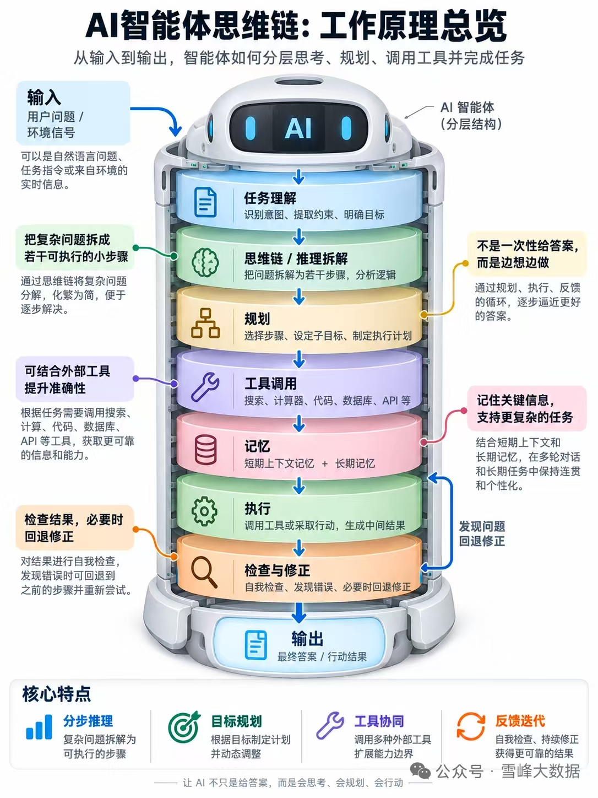

# Agent 完整架构：端到端走读

> 以图2「AI Agent 的完整架构」为主线；配图与图1对照。  
> 前置阅读：[01-agent是什么.md](01-agent是什么.md)

---

## 0. 结论先行

| 要点 | 说明 |
|---|---|
| **主轴** | 用户目标 → Planner → Reasoning → 核心循环 → Reflection → 输出 |
| **侧翼** | Memory 供上下文并写回；Tool 执行动作；MCP 统一接外部系统 |
| **产品含义** | 「能聊天」只覆盖 Reasoning 的一小段；平台价值在规划、工具、记忆、反思与门禁 |
| **示例原则** | 本文用「竞品分析并发 Slack」——中性办公场景；**不写**任何攻击利用步骤 |

---

## 1. 总览图（再看一遍）


> 图源：改编自小红书「林纾」思路。本仓教学引用，非自绘。

对照图1（能力层）见 [01-agent是什么.md](01-agent是什么.md#2-图1思维链工作原理总览七层能力)：



---

## 2. 主轴分步走读

### 2.1 用户目标（入口）

用户给出的是**目标**，不是「请用某某 API 调三次」。

示例目标（图中原文同类）：

> 「帮我做一份竞品分析，并发送到 Slack。」

好目标通常含：做什么、交付物形态、约束（渠道、时限）。任务理解层负责澄清模糊约束（见 [task-understanding.md](名词/task-understanding.md)）。

### 2.2 Planner（规划）

Planner 把目标拆成**可执行步骤**，例如：

1. 收集公开资料  
2. 整理信息  
3. 对比分析  
4. 生成纪要 / PPT  
5. 发送 Slack  

要点：Planner 产出的是**计划**，不是最终答案。专篇：[planner.md](名词/planner.md)。与「规划作为能力层」的区分见 [planning.md](名词/planning.md)。

### 2.3 Reasoning（推理 / 决策）

在计划与当前状态之间，Reasoning 回答：「**下一步做什么、怎么做？**」

- 计划说「收集资料」→ 推理决定先搜官网还是先读已有文档  
- 某步失败 → 推理决定换工具还是回 Planner 改计划  

专篇：[reasoning.md](名词/reasoning.md)。思维链是推理的常用技法：[chain-of-thought.md](名词/chain-of-thought.md)。

### 2.4 Agent 核心循环（Thinking / Action / Action Input）

这是运行时最热的内环：

| 步 | 含义 | 竞品分析示例（中性） |
|---|---|---|
| **Thinking** | 理解当前子问题、权衡方案 | 「需要 A 产品定价页公开信息」 |
| **Action** | 选择工具 | 选「网页检索」或「浏览器」工具 |
| **Action Input** | 填工具参数 | `query="A 公司 产品定价 2026"` |

执行后得到 Function 结果，进入 Reflection 或继续下一轮循环。专篇：[agent-loop.md](名词/agent-loop.md)。

### 2.5 Reflection（反思）

Reflection 检查：结果是否够用？是否偏题？是否违反约束？

- **够用** → 进入生成输出  
- **不够** → 回流 Reasoning / 核心循环，必要时触发 Planner 改计划  
- **写回 Memory** → 记下「已完成步骤 / 中间结论」  

专篇：[reflection.md](名词/reflection.md)。与图1「检查与修正」同族：[check-and-correction.md](名词/check-and-correction.md)。

### 2.6 生成输出与交互展示

| 路径 | 内容 |
|---|---|
| **最终答案** | 对话中的自然语言总结 |
| **任务结果** | 文件、链接、表格、已发送的 Slack 消息等 |
| **展示** | 智能卡片（图/表/文件）或自然语言气泡 |

平台产品往往同时需要两者：用户既要「读懂结论」，也要「拿到可转发的工件」。

---

## 3. 侧翼：Memory / Tool / MCP

### 3.1 Memory（记忆）

| 类型 | 存什么 | 示例 |
|---|---|---|
| 长期 | 用户偏好、角色设定 | 「报告默认中文、发 #research 频道」 |
| 短期 | 当前任务上下文 | 本轮对话与目标原文 |
| 工作 | 已完成步骤、中间结果 | 「已收集 A/B 公开资料摘要」 |

专篇：[memory.md](名词/memory.md)。本仓竞品中的「双图 / 世界模型」是 Memory 的**结构化升级**，不是另一套无关概念。

### 3.2 Tool（工具）

工具是 Agent 的「手」：浏览器检索、代码执行、数据分析、数据库查询、邮件、Slack 通知等。

Action 只**选**工具；真正副作用发生在执行面（常需权限与审计）。专篇：[tool.md](名词/tool.md) · [execution.md](名词/execution.md)。

### 3.3 MCP（Model Context Protocol）

MCP 把「每个系统一套私有插件」收敛为**统一协议连接**：Google 检索、GitHub、Notion、数据库、Slack、其他系统。

产品意义：工具生态可插拔，编排层不必为每个 SaaS 重写适配。专篇：[mcp.md](名词/mcp.md)。

---

## 4. 端到端示例：「竞品分析 → 发 Slack」

> 仅演示架构数据流；工具名与步骤为示意，非可运行脚本。

```
1. 用户目标
   「对比开源 Agent 框架 pi / LangGraph 的定位，发到 Slack #arch」

2. Planner
   步骤：检索公开文档 → 对照维度表 → 写一页纪要 → 调用 Slack 发送

3. Reasoning + 核心循环（多轮）
   Thinking → Action=网页/文档检索 → Input=官方 README 关键词
   … 得到摘要 …
   Thinking → Action=写文件 → Input=纪要 Markdown
   Thinking → Action=Slack 发送 → Input=频道 + 正文

4. Reflection
   检查：是否覆盖「定位差异」？频道是否正确？敏感信息是否剔除？
   不通过则回流；通过则交付

5. Memory 写回
   长期：用户偏好该频道；工作：本次纪要路径与发送 message id

6. 输出
   最终答案：「已发送，摘要如下…」
   任务结果：Slack 消息 + 纪要文件链接
```

对应图1：任务理解 → 思维链 → 规划 → 工具 → 记忆 → 执行 → 检查修正（可回规划）。

---

## 5. 图注总结（与产品门禁）

图脚总结可记为：

> **Planner 负责规划，Reasoning 负责决策，Memory 负责记录，Tool 负责执行，MCP 负责连接，Reflection 负责自我修正——共同完成用户目标。**

本仓建设调度平台时，还需在 Reflection / 执行外侧叠加**门禁**（范围、确定性规则、不可逆审批、自治档位）——那是竞品章与架构总报告的主题，不是「多一轮聊天」能替代的。

挂钩：

- 编排与 HITL → [LangGraph](../02-frameworks/langgraph.md)  
- 会话循环与压缩 → [pi](../02-frameworks/pi.md)  
- 工具适配 → [LangChain](../02-frameworks/langchain.md) / MCP  

---

## 6. 下一步

- 名词速查：[名词/README.md](名词/README.md)  
- 回入门主文：[01-agent是什么.md](01-agent是什么.md)  
- 进入选型：[../00-index.md](../00-index.md)
