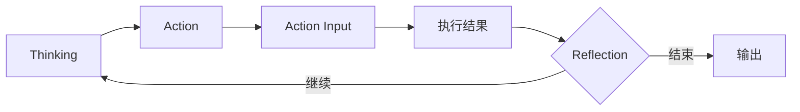

# Agent Loop（核心循环：Thinking / Action / Action Input）

> 图位：完整架构中部黄框 · [架构图](../assets/agent-complete-architecture.jpg)  
> 相关：[reasoning.md](reasoning.md) · [tool.md](tool.md) · [execution.md](execution.md) · [reflection.md](reflection.md)

---

## 结论先行

**Agent 核心循环**是运行时最热的内环，由图2标出的三步组成：

1. **Thinking（思考）** — 理解当前子问题、分析目标、权衡方案  
2. **Action（行动）** — 选择要调用的工具  
3. **Action Input（行动输入）** — 准备并传入工具参数  

然后执行得结果，经 Reflection 决定再进循环或结束。这正是「边想边做」的工程含义。

---

## 是什么

> 上图为本仓自写示意。

| 步 | 输入 | 输出 |
|---|---|---|
| Thinking | 目标片段、记忆、上轮结果 | 中间分析 |
| Action | 分析结论、可用工具列表 | 工具名 |
| Action Input | 工具 schema | 合法参数对象 |

业界常称的 ReAct（Reason + Act）与此同族：推理与行动交替，而不是一次说完。

---

## 应用场景

- 需要多次工具调用才能凑齐信息的任务  
- 工具结果不确定、必须根据返回再决定下一步  
- 会话型编码 / 调研 Agent（pi 等 harness 的主循环）  

---

## 效益

| 效益 | 说明 |
|---|---|
| 适应环境 | 每步看到真实结果再决策 |
| 可观测 | 每轮 Thinking/Action 可打点 |
| 可打断 | 循环边界适合插入审批 |

---

## 常见误区

- 把 Loop 当成全部 Agent（忽略 Planner / Memory / MCP / 门禁）  
- Action Input 不校验 schema 导致无效调用  
- 无 max_loops → 死循环烧预算  

---

## 与本仓挂钩

**pi / dsh** 把该循环做成工业会话运行时（含压缩与审计）；**LangGraph** 可把循环收成节点，或在阶段内嵌套。平台应设循环上限与工具白名单。
