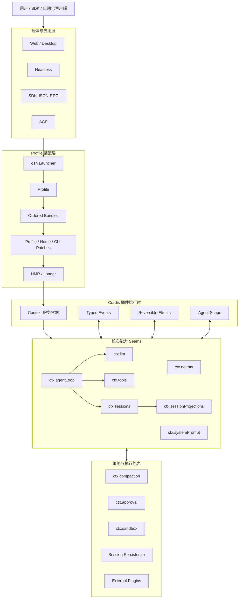
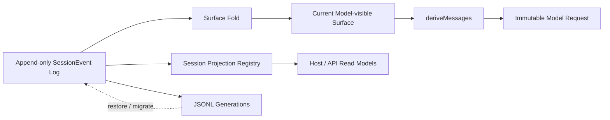
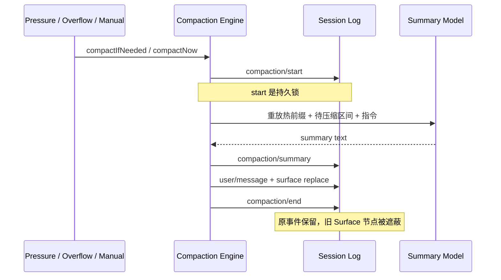
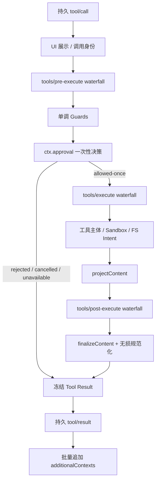

# DeepSeek Harness（deepseek-ai/deepseek-harness）Agent Harness 架构调研报告

> 调研对象：[`deepseek-ai/deepseek-harness`](https://github.com/deepseek-ai/deepseek-harness)  
> 核验分支：`master`  
> 核验提交：[`687f282e8625c6b8d11ff58211a90524be2e4317`](https://github.com/deepseek-ai/deepseek-harness/tree/687f282e8625c6b8d11ff58211a90524be2e4317)  
> 对应版本：`0.2.1-rc.2`（Developer Preview）  
> 核验日期：2026-10-19  
> 研究范围：DeepSeek Harness 的 Cordis 插件架构、Profile/Bundle 组装、Agent Loop、Session/Event Sourcing、Session Projection、Compaction、工具执行、安全边界及扩展机制。

## 1. 结论摘要

DeepSeek Harness（命令名 `dsh`）不是“围绕一个固定 Agent Loop 增加若干钩子”的应用框架，而是一个**由 Cordis 驱动、以能力 seam 为边界、以事件日志为事实源的插件化 Agent Harness**。官方将模型适配器、工具注册表、会话日志乃至 Agent Loop 本身都实现为插件，因此运行时不存在不可替换的特权内核；产品形态由 Profile、Bundle 与 Patch 逐层组装。

其最值得关注的架构特征有六组：

1. **Everything is a Plugin**：服务、事件、注册与生命周期都落在 Cordis 上；注册是可撤销 effect，插件卸载或热重载时自动回收。
2. **Profile 是产品装配单元**：`web`、`headless`、`sdk`、`sdk-minimal`、`acp` 使用同一 launcher，通过 Bundle 和分层 Patch 得到不同运行时，而不是维护多套旁路入口。
3. **Agent Loop 是可替换的具体驱动**：它只负责 turn/step、输入认领、模型请求、工具调度与持久 settlement；扩展应依赖 `dsh-agent` 的服务和事件，而不是直接耦合具体循环实现。
4. **Session Log 与 Model Surface 分离**：Session 是仅追加事件日志，模型上下文由 `surfaceOp` 折叠得到；替换只遮蔽旧节点，不删除原始事实，因此请求可重建、行为可审计。
5. **Compaction 是事务式能力 seam**：压缩通过 `compaction/start → summary + surface replace → compaction/end` 落日志，以持久锁和替换代际控制并发、失败恢复与重试，不是隐藏在循环内部的临时字符串截断。
6. **安全是分层策略而非绝对隔离**：工具前置策略、单调守卫、一次性审批、进程沙箱和结果后处理形成流水线；但官方明确说明项目未经过安全审计，沙箱只定义文件系统效果，不能等同于生产级安全边界。

综合判断：DeepSeek Harness 适合需要构建多载体 Agent 产品、替换底层能力、保留完整事件审计、研究上下文治理和插件组合的团队；不适合未经额外隔离、审计和治理就直接运行在高价值生产主机、强合规多租户环境或完全无人值守的高风险执行场景。

## 2. 调研对象与身份核验

### 2.1 仓库身份

| 识别项 | 已核验结果 |
|---|---|
| 官方仓库 | `https://github.com/deepseek-ai/deepseek-harness` |
| 官方名称 | DeepSeek Harness，命令名 `dsh` |
| 所属组织 | `deepseek-ai` |
| 根包 | `@deepseek-ai/dsh-root` |
| 核验版本 | `0.2.1-rc.2` |
| 包管理器 | `pnpm@11.28.5` |
| 运行形态 | Web、Headless、SDK、SDK Minimal、ACP、Desktop |
| 架构基座 | 仓库内 vendored Cordis，发布时使用 `@deepseek-ai` 命名空间 |

本报告不讨论其他名为 Harness、DeepSeek Agent 或 Pi 的项目，也不把 DeepSeek 模型 API 本身等同于此 Agent Harness。所有源码链接均固定到上述提交，避免 `master` 后续变化导致结论漂移。

证据：官方 [README 定位与插件架构说明](https://github.com/deepseek-ai/deepseek-harness/blob/687f282e8625c6b8d11ff58211a90524be2e4317/README.zh.md#L1-L15)、[根包清单](https://github.com/deepseek-ai/deepseek-harness/blob/687f282e8625c6b8d11ff58211a90524be2e4317/package.json)、[架构总览](https://github.com/deepseek-ai/deepseek-harness/blob/687f282e8625c6b8d11ff58211a90524be2e4317/docs/architecture.zh.md#L1-L27)。

### 2.2 证据等级

本文区分三类结论：

- **已核验**：可由固定提交下的官方源码、官方文档、包清单或配置直接确认。
- **架构判断**：由多个已核验事实推导出的设计评价，使用“意味着”“可视为”等措辞。
- **待核验**：必须通过真实负载、平台兼容、安全测试或扩展生态调查才能确认。

## 3. 框架定位与总体架构

### 3.1 定位：可重组的 Agent Runtime

DeepSeek Harness 的核心定位可以概括为：

> 用 Cordis 将 Agent 运行时拆成可替换服务、类型化事件和可逆生命周期，再由 Profile 把它们组装成不同产品载体。

“Harness”在这里包含三层含义：

- **运行时层**：Agent、LLM、Session、Tool、System Prompt、Scope 等基础能力；
- **策略层**：Compaction、Approval、Sandbox、Permission、Retry、Telemetry、Plan、Subagent 等可插拔能力；
- **载体层**：Web、Headless、SDK、ACP、Desktop 等不同交互或自动化入口。

这与“一个主程序直接 import 所有组件”的架构不同。受支持的 Node 应用统一经由 `dsh --profile <name>` 启动，Profile 选择的是一棵插件配置树，而不是另一份手写应用入口。[应用启动约定](https://github.com/deepseek-ai/deepseek-harness/blob/687f282e8625c6b8d11ff58211a90524be2e4317/docs/architecture.zh.md#L41-L47) 支持这一判断。

### 3.2 模块关系图



### 3.3 核心模块及协作

| 模块 / 服务 | 主要职责 | 关键协作方式 |
|---|---|---|
| `dsh-agent` / `ctx.agents` | 定义 Agent 接口、生命周期事件和活跃 Agent 注册表 | 扩展依赖抽象 Agent 契约，不需要依赖具体 loop |
| `dsh-agent-loop` / `ctx.agentLoop` | 默认 ReAct 风格 turn/step 驱动、Inbox、模型请求、工具调度 | 消费 Session、LLM、Tools、Prompt、Projection；发布 `agent/*` 事件 |
| `dsh-session` / `ctx.sessions` | 仅追加的 `SessionEvent` 日志、Surface 折叠、请求历史重建 | 为循环、持久化、fork、压缩、遥测提供事实源 |
| `dsh-session-projection` / `ctx.sessionProjections` | 把领域事件增量折叠为按 Session 的类型化读模型 | 领域插件注册纯投影单元，Host/API 读取一致快照 |
| `dsh-tools` / `ctx.tools` | 作用域化工具注册、模型 schema、策略与执行流水线 | 通过三个 waterfall、单调守卫、Approval 和结果投影执行 |
| `dsh-system-prompt` / `ctx.systemPrompt` | 组合提示词片段和工具相关声明 | 每步组装；结果以 `system/message` 进入 Session Surface |
| `dsh-llm` / `ctx.llm` | Provider 中立的消息、路由、模型能力和流式调用 | `prepareCall()` 先绑定实际路由，再由 `llm/stream` 发起请求 |
| `dsh-scope` | 为同一进程中的 Agent 建立作用域化注册层 | 允许每个 Agent 拥有不同工具、Persona、策略和服务覆盖 |
| `dsh-compaction` / `ctx.compaction` | 定义压缩契约和结果，不规定具体摘要策略 | `compaction-basic` 提供默认实现，loop 只通过事件和 seam 消费 |
| `dsh-user-approval` / `ctx.approval` | 一次性授权、按会话策略、审计事件 | 工具守卫只接受 `allowed-once`，其他结果全部拒绝 |
| `dsh-sandbox` / `ctx.sandbox` | 将受限文件效果策略转换为后端 argv | Bash/PowerShell 等进程工具消费；后端可本地或 SSH |

官方架构表将 Session、Tools、Scope 等列为核心包，并明确 `ctx.agentLoop` 是唯一具体循环插件而不是扩展必须依赖的内核。[核心包表](https://github.com/deepseek-ai/deepseek-harness/blob/687f282e8625c6b8d11ff58211a90524be2e4317/docs/architecture.zh.md#L55-L67) 与 [能力 seam 目录](https://github.com/deepseek-ai/deepseek-harness/blob/687f282e8625c6b8d11ff58211a90524be2e4317/docs/capability-seams.zh.md#L670-L690) 支持该结论。

## 4. Agent Loop 运行机制

### 4.1 Turn、Step 与 Inbox

DeepSeek Harness 对运行边界的定义较严格：

- **Turn**：从 `turn/start` 到 `turn/end` 的持久工作单元，可包含零个或多个 Step；
- **Step**：一次模型请求及其对应工具调用阶段，从 `step/start` 到 `step/end`；
- **Inbox**：持久的待处理输入，分为 `next-step` 与 `next-turn` 两个队列。

`next-step` 在当前 Turn 的下一步边界被批量领取，适合中途追加引导或上下文；`next-turn` 每次只领取一条，在 Agent 原本结束后开启下一 Turn。两者都通过 `agent/inbox/spliced` 事件持久化，并由 Session Projection 重建，因此 Agent 暂时不活跃时，待处理输入仍可被读取。[Inbox 投影与双队列实现](https://github.com/deepseek-ai/deepseek-harness/blob/687f282e8625c6b8d11ff58211a90524be2e4317/packages/core/agent-loop/src/inbox.ts#L20-L65)、[领取语义](https://github.com/deepseek-ai/deepseek-harness/blob/687f282e8625c6b8d11ff58211a90524be2e4317/packages/core/agent-loop/src/inbox.ts#L81-L123)。

这在效果上对应两类不同的输入调度：当前推理链中的“下一步输入”与当前工作自然停止后的“下一轮输入”。与简单内存队列相比，其优势是可恢复、可观察和可从日志解释；代价是输入队列也进入了格式兼容与投影一致性约束。

### 4.2 完整流程

```mermaid
sequenceDiagram
    participant Inbox as Durable Inbox
    participant Loop as ReactLoopAgent
    participant Hooks as Cordis Events
    participant Session as Session Log
    participant Prompt as System Prompt
    participant LLM as ctx.llm
    participant Tools as ctx.tools

    Inbox->>Loop: 唤醒 / pending input
    Loop->>Session: turn/start
    Loop->>Inbox: claim(next-step + 可选 next-turn)
    Loop->>Prompt: assemble
    Loop->>Hooks: agent/pre-step waterfall
    alt 拒绝或无输入
        Loop->>Session: turn/end
    else 接纳
        Loop->>Session: step/start
        Loop->>Hooks: agent/request waterfall
        Loop->>LLM: prepareCall(config, signal)
        Note over Loop,Session: prepare 成功后才提交 system/user 输入
        Loop->>Session: request/header + request/context
        Loop->>Session: system/message + user/message
        Loop->>Session: deriveMessages()
        Loop->>LLM: llm/stream waterfall
        alt 成功 settlement
            Loop->>Session: assistant/message
        else 失败 / 重试 / 取消 / stream error
            Loop->>Session: assistant/attempt
        end
        Loop->>Tools: 并发池与 exclusive barrier
        Tools->>Session: tool/call + tool/result
        Loop->>Session: step/end
        alt 仍有工具或 next-step 输入
            Loop->>Loop: 下一 Step
        else 自然停止
            Loop->>Hooks: agent/turn-stopping serial
            Loop->>Session: turn/end
        end
    end
```

流程中的关键顺序不是偶然实现细节，而是决定可恢复性和取消语义的架构约束：

1. Loop 先领取输入并运行 `agent/pre-step`，扩展可拒绝或改写消息；
2. `agent/request` 与 `ctx.llm.prepareCall()` 解析实际 Provider、Model 和能力；
3. 只有准备成功后，系统提示词和已接纳用户消息才会提交；在这两个异步阶段取消，不会污染模型历史；
4. 请求头、实际请求上下文和模型可见消息落日志后，Loop 从 Session 推导冻结请求；
5. 成功响应写入 `assistant/message`，到达 settlement 的失败、重试、取消和流错误写入 `assistant/attempt`；
6. 工具完成后决定进入下一 Step，或在 `agent/turn-stopping` 后结束 Turn。

证据：官方 [Agent 生命周期时序](https://github.com/deepseek-ai/deepseek-harness/blob/687f282e8625c6b8d11ff58211a90524be2e4317/docs/agent-lifecycle.zh.md#L20-L89)、[Agent Loop 主流程源码](https://github.com/deepseek-ai/deepseek-harness/blob/687f282e8625c6b8d11ff58211a90524be2e4317/packages/core/agent-loop/src/agent.ts#L267-L400)、[请求准备与持久化](https://github.com/deepseek-ai/deepseek-harness/blob/687f282e8625c6b8d11ff58211a90524be2e4317/packages/core/agent-loop/src/agent.ts#L563-L688)。

### 4.3 扩展点与重试语义

主要实时扩展点分为不同事件模式：

| 扩展点 | 模式 | 适合的职责 |
|---|---|---|
| `agent/pre-step` | waterfall | 输入准入、上下文压缩、Step 前策略 |
| `agent/request` | waterfall | 路由、模型配置、请求包络调整 |
| `llm/stream` | waterfall | Provider 调用包装、重试、记录、回放 |
| `tools/pre-execute` | waterfall | 权限、参数策略、审批准备、拒绝 |
| `tools/execute` | waterfall | 超时、重试、指标、环绕执行 |
| `tools/post-execute` | waterfall | 结果接受、替换、阻断、附加上下文 |
| `agent/turn-stopping` | serial | Agent 即将自然停止时的顺序检查 |

Waterfall 监听器调用 `next()` 才会委托下游，也可以短路并返回自己的结果；Serial 则按顺序执行且没有 `next()`。这使策略既可包裹默认行为，也可完整替换某个能力，但同时要求扩展作者理解调用链和短路语义。[Cordis Waterfall 语义](https://github.com/deepseek-ai/deepseek-harness/blob/687f282e8625c6b8d11ff58211a90524be2e4317/docs/cordis-primer.zh.md#L17-L39)。

重试不会重新运行输入组装、`agent/pre-step` 或用户消息准入，而是复用已接纳的输入与渲染结果，再次准备调用并从日志派生请求。这样避免一次 Provider 重试被错误计为新用户输入，也避免有副作用的准入逻辑重复执行。

### 4.4 工具调用调度

默认 Loop 将工具调用分为：

- **parallel**：被工具声明或分类器确认可并发；
- **exclusive**：单独运行，并在调用序列中形成顺序屏障。

并发调用使用有界滚动池，默认 `maxParallelToolCalls = 10`；遇到 exclusive 调用时，先等待当前并发池清空，再独占执行，之后才继续后续调用。[调度器实现](https://github.com/deepseek-ai/deepseek-harness/blob/687f282e8625c6b8d11ff58211a90524be2e4317/packages/core/agent-loop/src/tool-calls.ts#L114-L205)、[工具执行模式定义](https://github.com/deepseek-ai/deepseek-harness/blob/687f282e8625c6b8d11ff58211a90524be2e4317/packages/core/tools/src/index.ts#L350-L365)。

若取消、进程中断或恢复导致工具调用未形成完整结果，系统不会让模型面对破损的 call/result 配对，而会合成带风险语义的结果：

- `ABORTED_BEFORE_DISPATCH`：工具主体尚未开始；
- `TOOL_NOT_STARTED`：模型请求了工具，但持久日志中没有开始记录；
- `TOOL_OUTCOME_UNKNOWN`：已有 `tool/call`，但没有持久 `tool/result`，外部副作用是否发生未知。

其中 `TOOL_OUTCOME_UNKNOWN` 明确要求模型不要盲目重试非幂等操作，应先检查外部状态或询问用户。这是将恢复风险显式编码进模型上下文的设计，而不是简单补一个通用错误。[会话恢复约定](https://github.com/deepseek-ai/deepseek-harness/blob/687f282e8625c6b8d11ff58211a90524be2e4317/packages/core/session/README.zh.md#L161-L175)。

## 5. 特色机制深度分析

### 5.1 Cordis：“一切皆插件”不是口号

Cordis 在 Harness 中同时承担四类职责：

1. **服务容器**：插件通过稳定的 `ctx.*` 键提供能力；消费者依赖服务定义而非具体实现；
2. **依赖与启动顺序**：`inject` 声明插件需要哪些服务，Loader 据此管理激活；
3. **类型化事件总线**：`emit`、`waterfall`、`parallel`、`serial`、`bail` 对应不同协作语义；
4. **可逆生命周期**：工具、提示词、适配器、监听器等注册都属于 effect，插件卸载时 disposer 自动执行。

因此，“替换 Agent Loop”“替换 Session 持久化”“为单个 Agent 增加工具”和“热重载一段配置”使用的是同一套组合模型。官方明确写明没有需要打补丁的特权内核，扩展只是把插件挂载到其他插件旁边。[架构原则](https://github.com/deepseek-ai/deepseek-harness/blob/687f282e8625c6b8d11ff58211a90524be2e4317/docs/architecture.zh.md#L7-L11)、[Cordis 五个核心概念](https://github.com/deepseek-ai/deepseek-harness/blob/687f282e8625c6b8d11ff58211a90524be2e4317/docs/cordis-primer.zh.md#L7-L15)。

**架构价值**：框架扩展不必围绕一个巨型 Agent 类继承；能力提供方、消费者和分发层可独立替换。  
**代价**：运行行为由插件树、作用域、事件顺序和 Patch 共同决定，静态阅读单个入口难以得到完整答案；诊断工具和配置可视化因此非常重要。

### 5.2 Profile、Bundle、Patch 与 HMR

Profile 是用户可选择的具名装配，Bundle 是可安装的 Cordis 配置分发层，Patch 是对配置树的覆盖或插入。默认层级从低到高为：

```text
Profile 中有序 Bundles
        ↓
Profile cordis.patch.yml
        ↓
Harness Home Patch
        ↓
--patch 命令行 Overlay
```

`dsh-base` 为 `web`、`headless`、`sdk`、`acp` 提供模型、工具、持久化、沙箱、审批、设置、凭据和遥测等共同底座；各载体 Bundle 再增加自己的服务。`sdk-minimal` 是刻意设计的例外：它拥有独立、显式的极简配置树，而不是叠加 `dsh-base`。[Profile 与 Bundle 规则](https://github.com/deepseek-ai/deepseek-harness/blob/687f282e8625c6b8d11ff58211a90524be2e4317/docs/architecture.zh.md#L13-L27)。

这种设计使“产品发行形态”也成为配置化组合，而不是源码分叉。HMR 进一步复用 effect 生命周期：配置或模块变化后，旧注册被撤销，新插件重新挂载。需要注意，HMR 由 Profile 决定是否启用；Headless、SDK、ACP 默认不采用与 Web 相同的实时重载行为。

**技术边界**：Patch 是强能力。它可以替换配置、插入插件，因而应视为受信任的部署级输入，不是面向不可信租户的细粒度策略语言。

### 5.3 Event-Sourced Session 与 Model Surface

Session 是 DeepSeek Harness 的事实存储。它不负责调用模型，而是维护一个仅追加的 `SessionEvent` 日志。所有模型可见事实都必须记录，模型历史由 `deriveMessages()` 从当前 Surface 推导。



Surface 事件显式携带 `surfaceOp`：

- `append`：把新消息节点追加到当前模型视图；
- `replace(startSeq, endSeq)`：以当前 Surface 中两个位置边界为准，用新节点替换一个可见区间。

Replace 不修改或删除历史事件，只让旧节点在模型视图中被遮蔽。因此 Compaction、工具结果剪枝、系统提示词更新等机制可以改变后续请求的上下文，同时保留原始证据和来源关系。源码中的 `replaceGeneration` 还提供一个单调代际，用于判断是否真的发生了可见替换。[Surface 折叠与替换](https://github.com/deepseek-ai/deepseek-harness/blob/687f282e8625c6b8d11ff58211a90524be2e4317/packages/core/session/src/surface.ts#L236-L278)、[应用 Surface 事件](https://github.com/deepseek-ai/deepseek-harness/blob/687f282e8625c6b8d11ff58211a90524be2e4317/packages/core/session/src/surface.ts#L516-L575)。

请求可重建性还依赖两类持久事件：

- `request/header`：记录请求包络和工具定义历史；
- `request/context`：记录实际 Provider、Model、上下文窗口及系统提示词更新能力。

成功的 `assistant/message` 嵌入完整的紧凑流记录；已结算但未形成模型消息的失败、取消、重试和流错误进入 `assistant/attempt`，后者不进入模型历史。这样实时 UI 流和持久回放分开：UI 可以看瞬态增量，恢复和审计依赖 settlement。[会话日志约定](https://github.com/deepseek-ai/deepseek-harness/blob/687f282e8625c6b8d11ff58211a90524be2e4317/docs/architecture.zh.md#L122-L130)。

### 5.4 Session Projection：日志之上的 CQRS 式读模型

Session Surface 解决“模型看到什么”，Session Projection 解决“Host 或客户端需要看到哪些领域状态”。两者不能混为一谈。

`ctx.sessionProjections` 允许领域插件注册纯投影单元：

- `init` 创建初始状态；
- `apply(state, event)` 同步折叠已提交事件；
- 可选 `wire.view` 把 Host 状态裁剪成客户端载荷；
- `stateVersion` 管理投影定义兼容性；
- Registry 为每个 Session、每个 Key 维护水位线并提供一致快照。

Registry 只订阅一次 `session/event`，再驱动所有已注册单元；领域插件不各自维护订阅，客户端也不需要理解领域事件。迟注册的单元或早于 Registry 创建的 Session，会在首次读取时从日志惰性补算。注册本身也是 effect，插件卸载后对应 Key 从后续快照中消失。[Session Projection 总览](https://github.com/deepseek-ai/deepseek-harness/blob/687f282e8625c6b8d11ff58211a90524be2e4317/docs/subsystems/session-projection.zh.md#L1-L9)、[Registry 驱动语义](https://github.com/deepseek-ai/deepseek-harness/blob/687f282e8625c6b8d11ff58211a90524be2e4317/docs/subsystems/session-projection.zh.md#L104-L107)。

这可视为一种轻量 CQRS：Session Event 是写侧事实，Projection 是按需物化的读侧状态。其优势是 API/前端无需重放全部领域事件；其成本是每个投影必须保持确定性、同步执行，并承担 `stateVersion` 和缓存失效约束。

### 5.5 Compaction：可审计的上下文事务

压缩由三个角色组成：

- `dsh-compaction`：定义 `ctx.compaction` 抽象服务、事件和结果类型；
- `dsh-compaction-basic`：默认阈值、保留策略、摘要和溢出恢复实现；
- `dsh-command-compact`：提供显式手动触发入口。

其持久事务为：



`compaction/start` 与 `compaction/end` 包住整个操作。中途崩溃会留下可检测的未闭合锁，而不会伪装成成功压缩。摘要本身写入仅日志事件，真正改变模型视图的是带 `surfaceOp: replace` 的 `user/message` 检查点。[压缩事件与锁](https://github.com/deepseek-ai/deepseek-harness/blob/687f282e8625c6b8d11ff58211a90524be2e4317/docs/subsystems/compaction.zh.md#L9-L19)、[事务实现](https://github.com/deepseek-ai/deepseek-harness/blob/687f282e8625c6b8d11ff58211a90524be2e4317/packages/compaction/compaction-basic/src/region.ts#L158-L245)。

默认压力阈值为：

```text
floor(min(W × 0.8, W − O − B))
```

其中 `W` 为上下文窗口，`O` 为有效请求输出上限，`B = 65,536` 为额外余量；近期历史默认逐字保留 `W - O` 的 16%。这些值支持按 Provider/Model 覆盖，但官方也明确承认默认比例尚无基于语料的理想值指导。[默认压缩策略](https://github.com/deepseek-ai/deepseek-harness/blob/687f282e8625c6b8d11ff58211a90524be2e4317/packages/compaction/compaction-basic/README.zh.md#L62-L78)、[默认比例限制](https://github.com/deepseek-ai/deepseek-harness/blob/687f282e8625c6b8d11ff58211a90524be2e4317/packages/compaction/compaction-basic/README.zh.md#L250-L258)。

自动压缩有两条路径：

- **Pressure**：在 `agent/pre-step`、请求推导前检查；先尝试可选工具结果剪枝，再摘要最老的平衡区间；
- **Context Overflow**：在 Provider 明确返回上下文溢出后触发，绕过常规阈值与保留策略；只有 Surface replacement generation 前进时才允许重试。

压缩不会删除原日志，不能缩减工具 schema、请求包络或不可拆分的单元，也依赖 token 估算质量。超大系统提示词、工具定义或单个不可拆消息仍可能让请求无法修复。

### 5.6 Scope：同一运行时中的 Agent 隔离面

`dsh-scope` 提供 `ScopeKey`、`Scoped<T>` 和分层注册表，使全局 Context 下的不同 Agent 可以得到不同的工具、Persona、提示词、策略或能力覆盖。插件仍由全局 Loader 管理生命周期，但注册可只对某个 Agent 可见。

这种机制解决了两个常见问题：

- 不必为每个 Agent 启动一套完整 Node 进程和插件树；
- 不必把所有 Agent 的差异塞进每次函数调用的条件分支。

但 Scope 是能力可见性和所有权机制，不应自动等同于操作系统级租户隔离。共享进程中的恶意插件仍可能访问其进程权限范围内的资源。

## 6. Extensions 与能力组合

### 6.1 扩展不是旁路 Hook 集合

外部扩展是完整 Cordis 插件，可提供或消费服务、注册事件监听器、添加工具和提示词、声明配置 schema，并通过 effect 绑定生命周期。它们可以：

- 新增 LLM Provider 或替换路由策略；
- 增加工具、工具策略或 PTC 运行时；
- 增加 Session Event 与纯消息投影；
- 注册 Session Projection 读模型；
- 提供 Sandbox、Persistence、Subagent 等 seam 的实现；
- 通过 Profile/Bundle 分发一整套产品能力。

因此，Extensions 的能力上限高于只允许监听几个生命周期事件的插件系统。相应地，其信任要求也更高：插件代码与 Harness 同进程运行，能获得 Context 中注入的服务，并可能访问 Node 进程本身可访问的环境。

### 6.2 能力 Seam 的三方结构

官方将可替换能力描述为三方：

1. **Service Definition**：定义稳定的 `ctx.*` 契约；
2. **Service Provider**：提供某个具体实现；
3. **Consumer**：只依赖抽象服务，不依赖实现包。

例如，`ctx.sandbox` 的定义、Local/SSH 后端和 Bash/PowerShell 消费者可以独立变化；`ctx.compaction` 的定义、`compaction-basic` 实现和命令/Agent Loop 触发方也彼此解耦。这个结构是 DeepSeek Harness 模块化的真正边界，比包目录层级更重要。

### 6.3 内置能力与框架边界

仓库内置 Plan、Goal、Todo、Subagent、Jobs、Schedule、Workflow、MCP、LSP、Browser/Computer Use、Workspace/Worktree 等大量包，但不应据此把它们都视为不可替换内核。多数能力是 Profile 选择的插件，甚至实验性包也与核心循环分离。

架构判断：DeepSeek Harness 追求的是“可组装的完整产品底座”，而不是极小核心。它比纯 Agent Loop 库覆盖更多产品能力，但复杂度、依赖图和配置治理成本也更高。

## 7. 工具执行与安全边界

### 7.1 工具流水线



流水线体现了几个关键原则：

- **策略与工具解耦**：权限、审批、超时、重试、指标等不需要写进每个工具；
- **单调拒绝**：守卫可以拒绝或不表态，但后续守卫不能把已拒绝调用重新放行；
- **结果可持久化**：参数与结果都进行无损 JSON 快照并冻结；
- **模型视图与内部元数据分离**：结构化错误和展示数据可持久保存，但不必全部暴露给模型；
- **Native 与 PTC 共用安全管线**：PTC 子调用仍经过同一执行策略，而不是绕过注册表直接调用实现。

证据：官方 [工具执行流水线](https://github.com/deepseek-ai/deepseek-harness/blob/687f282e8625c6b8d11ff58211a90524be2e4317/docs/tool-execution-pipeline.zh.md#L4-L65)、[三个工具 Waterfall 定义](https://github.com/deepseek-ai/deepseek-harness/blob/687f282e8625c6b8d11ff58211a90524be2e4317/packages/core/tools/src/index.ts#L146-L197)。

### 7.2 Approval：失败关闭的一次性授权

Approval 结果是闭合集合：

```text
allowed-once | rejected | cancelled | unavailable
```

只有 `allowed-once` 授权当前被询问的具体操作；其余结果全部拒绝。没有应答者、应答者抛错、返回非法值或不负责该请求时，结果为 `unavailable`，不会默认放行。按会话策略 `never` 在 Waterfall 分发前强制执行，因此后注册的应答者也无法绕过。[Approval 结果与失败关闭](https://github.com/deepseek-ai/deepseek-harness/blob/687f282e8625c6b8d11ff58211a90524be2e4317/docs/subsystems/approval.zh.md#L5-L33)、[审计与不可绕过规则](https://github.com/deepseek-ai/deepseek-harness/blob/687f282e8625c6b8d11ff58211a90524be2e4317/docs/subsystems/approval.zh.md#L84-L88)。

每次请求写入 `approval/asked` 与 `approval/decided`，但两者仅用于日志审计，不直接进入模型 transcript。模型看到的是工具最终结果和当前运行时上下文，而不是审批 UI 的内部细节。

### 7.3 Sandbox：只定义文件系统效果

Sandbox 模式为：

| 模式 | 语义 |
|---|---|
| `read-only` | 要求后端拒绝写入，必要运行时接收器除外 |
| `workspace-write` | 允许工作区根目录和后端承诺的临时区域写入 |
| `danger-full-access` | 绕过约束，直接执行原始命令 |

受限模式必须由 Provider 返回实际强制执行的 argv；没有可用后端时抛出 `SANDBOX_UNAVAILABLE`，不能静默退化为无隔离执行。后端还报告 `full` 或 `partial` 的强制完整性，以反映 Windows ACL 或较旧内核能力的差异。[Sandbox 模式](https://github.com/deepseek-ai/deepseek-harness/blob/687f282e8625c6b8d11ff58211a90524be2e4317/docs/subsystems/sandbox.zh.md#L9-L27)、[Fail-closed 规则](https://github.com/deepseek-ai/deepseek-harness/blob/687f282e8625c6b8d11ff58211a90524be2e4317/docs/subsystems/sandbox.zh.md#L154-L158)。

最重要的边界是：**这里的 Sandbox 只定义文件系统效果；网络访问和进程可见性不在该抽象的保证范围内。** 因此 `workspace-write` 不能被解释为“网络不可达、凭据不可见、系统进程不可观察”的完整安全沙箱。

### 7.4 官方安全声明

官方安全文档明确指出：

- 当前是实验性 Developer Preview；
- 尚未经过安全审计；
- 不得视为安全或生产可用软件；
- 会执行模型生成代码和命令、加载第三方插件，并访问对进程开放的网络、进程、凭据和文件；
- 沙箱、审批和权限只能降低风险，不能提供绝对保证。

因此，正确部署边界应是一次性 VM、容器、专用低权限账户或其他可销毁环境，配合最小权限、凭据隔离和可恢复备份，而不是把 Harness 自身的 Approval/Sandbox 当作最终防线。[官方安全声明](https://github.com/deepseek-ai/deepseek-harness/blob/687f282e8625c6b8d11ff58211a90524be2e4317/SAFETY.zh.md#L1-L25)。

## 8. 技术边界与限制

### 8.1 架构边界

1. **插件化不等于低复杂度**：最终行为取决于 Profile、Bundle、Patch、Scope、事件顺序和 Provider 能力，排查需要读取生效配置与运行诊断。
2. **Session 是事实源，但不是数据库事务系统**：事件追加、Surface 折叠和持久化 generation 提供可重建性；跨外部系统副作用仍需工具自身保证幂等或补偿。
3. **Projection 是确定性读模型，不适合任意异步工作**：`apply` 必须同步且可回放；网络查询、随机数或当前时间不应直接进入投影计算。
4. **Compaction 只重写模型视图**：它不能压缩工具 schema、系统外的请求包络或单个不可拆分超大单元；摘要还可能丢失细节。
5. **Scope 不是安全租户边界**：它控制注册可见性和生命周期，不隔离内存、Node 权限或恶意插件。
6. **HMR 有产品差异**：Web 与其他 Profile 的默认重载行为不同，扩展不能假设所有载体都会实时应用配置变化。

### 8.2 可靠性边界

- Assistant 流只有到达 settlement 后才有完整持久记录；进程在此前硬崩溃，可能没有 `assistant/attempt`。
- 工具结果缺失可被修复为风险明确的合成结果，但无法凭日志判断未记录的外部副作用是否实际发生。
- Token 估算可能低估 CJK、工具 schema 或 Provider 特有开销；默认阈值不是面向所有模型验证过的最佳值。
- Session 格式迁移采用相邻版本链和不可变 generation，有利于审计，但会增加长期格式维护成本。
- Provider 能力差异会影响系统提示词更新、工具声明和缓存前缀复用，不能只按统一 Message 类型推断实际请求表现。

### 8.3 安全边界

- 外部插件属于受信任代码，Profile Patch 和插件安装也属于部署级权限。
- Approval 只回答“当前操作是否继续”，不能证明操作本身安全，也不能验证模型意图正确。
- Sandbox 不覆盖网络和完整进程隔离；`partial` 强制执行尤其不能作为强对抗边界。
- `danger-full-access` 明确绕过约束；自动化载体若允许该模式，应由外部环境承担隔离责任。
- Web 公网暴露、凭据管理、反向代理和多用户鉴权属于额外部署问题，不能从 Agent Loop 的正确性推导。

## 9. 优缺点与适用场景

### 9.1 主要优点

| 优点 | 架构价值 |
|---|---|
| 真正可替换的能力 seam | LLM、Session、Tool、Sandbox、Compaction 等可以独立实现和组合 |
| 事件日志与模型视图分离 | 同时支持审计、回放、上下文替换与请求重建 |
| Profile 化产品装配 | 同一运行时可交付 Web、SDK、ACP、Headless 等不同载体 |
| 可逆 effect 生命周期 | 插件卸载、HMR 和作用域释放有统一资源回收语义 |
| 事务式 Compaction | 长上下文治理可检测中断、可重试、可回放，而非黑盒截断 |
| 分层工具策略 | 权限、审批、沙箱、超时和结果治理可跨工具复用 |
| 持久 Inbox 与 Projection | Agent 暂停、恢复和多客户端同步不依赖进程内临时状态 |

### 9.2 主要缺点

| 缺点 | 影响 |
|---|---|
| 组合模型复杂 | 新开发者需要同时理解 Cordis、Profile、Patch、Scope、事件模式和 Session Surface |
| 运行行为不易由单文件推断 | 同一包在不同 Profile 或 Scope 中可能表现不同，调试依赖生效配置和诊断 |
| Developer Preview 稳定性不足 | 官方提示快速迭代和破坏性变化，不适合作为冻结 API 基础直接长期承诺 |
| 安全能力有明确上限 | 审批和文件沙箱无法替代容器、VM、账户隔离、网络策略与安全审计 |
| 上下文治理参数需实测 | 默认压缩比例和 token 估算不保证适配所有模型、语言和工具规模 |
| 插件信任面较大 | 强扩展能力意味着恶意或缺陷插件可造成宿主级影响 |

### 9.3 适合场景

- 构建需要 Web、SDK、自动化协议等多种载体的 Agent 产品；
- 研究可重建 Agent、事件溯源、上下文投影和压缩事务；
- 需要替换 LLM Provider、文件系统、进程后端、Sandbox 或 Session 存储；
- 需要同一运行时承载多个作用域不同的 Agent；
- 需要完整记录请求、响应、工具调用、审批和上下文变化；
- 团队能够维护 Profile/Bundle，并愿意为扩展建立版本和安全治理。

### 9.4 不适合直接采用的场景

- 未经额外隔离就运行在生产数据库、个人主机或保存高价值凭据的环境；
- 要求稳定长期 API、严格向后兼容而又不能跟随 Release Candidate 变化的系统；
- 只需要几十行代码即可嵌入的极简单 Agent Loop；
- 把插件来源开放给不可信租户、但没有进程或容器隔离的平台；
- 要求 Sandbox 同时强制网络、进程、内核与文件系统多维隔离的高对抗环境；
- 无法接受摘要导致信息损失、也无法通过外部记忆系统补偿的任务。

## 10. 已核验与待核验

### 10.1 已核验

- 仓库身份、分支、提交和 `0.2.1-rc.2` 版本；
- “一切皆插件”、无特权内核与 Cordis effect 生命周期；
- Profile、Bundle、Patch 的组装顺序及随附 Profile；
- Agent Loop 的 Turn/Step、请求准备、settlement 与双队列 Inbox；
- Session 仅追加日志、Surface append/replace 和请求重建原则；
- Session Projection 的注册、增量折叠、一致快照与 effect 生命周期；
- Compaction 的持久锁、Surface 替换、默认阈值和溢出恢复；
- 工具的并发/独占调度、策略流水线和中断恢复错误；
- Approval 的 `allowed-once` 与失败关闭语义；
- Sandbox 的三种模式、受限模式 fail-closed，以及不覆盖网络/进程可见性；
- 官方“未安全审计、不得视为生产安全软件”的声明。

### 10.2 架构判断

- DeepSeek Harness 更接近“可组装 Agent 操作系统”而不是单一 Agent Loop 库；
- Session Event + Surface + Projection 构成了事实源、模型视图与客户端读模型三层分离；
- Compaction 的核心价值是可审计事务，而不仅是节省 token；
- Profile/Bundle 使产品形态可配置化，但也把大量复杂度从代码转移到部署组合；
- Scope 提供运行时多 Agent 组合能力，但不构成安全租户隔离。

### 10.3 待核验

以下项目不能仅凭静态源码和官方文档下结论：

- 长会话下 Session Log、Projection Cache 和 JSONL generation 的实际性能；
- 大规模并发 Agent 时 Cordis Loader、Scope 和事件分发的内存与调度开销；
- Windows、macOS、Linux 各 Sandbox 后端对复杂文件操作、符号链接和子进程的真实覆盖率；
- 不同 Provider 对系统提示词更新、工具声明、缓存命中和重试的端到端一致性；
- Compaction 对中文、代码、大型工具结果和多模态内容的信息保真度；
- 第三方插件生态的成熟度、版本兼容、安全审查和维护活跃度；
- Web 公网部署、多人协作、权限模型和审计导出的生产可用性；
- Release Candidate 到稳定版期间的 API 与 Session 格式变化幅度。

## 11. 参考资料

### 11.1 官方总体文档

- [README（中文）](https://github.com/deepseek-ai/deepseek-harness/blob/687f282e8625c6b8d11ff58211a90524be2e4317/README.zh.md)
- [总体架构](https://github.com/deepseek-ai/deepseek-harness/blob/687f282e8625c6b8d11ff58211a90524be2e4317/docs/architecture.zh.md)
- [Cordis 入门](https://github.com/deepseek-ai/deepseek-harness/blob/687f282e8625c6b8d11ff58211a90524be2e4317/docs/cordis-primer.zh.md)
- [能力 Seams 与核心服务](https://github.com/deepseek-ai/deepseek-harness/blob/687f282e8625c6b8d11ff58211a90524be2e4317/docs/capability-seams.zh.md)
- [Agent 轮次与步骤生命周期](https://github.com/deepseek-ai/deepseek-harness/blob/687f282e8625c6b8d11ff58211a90524be2e4317/docs/agent-lifecycle.zh.md)
- [工具执行流水线](https://github.com/deepseek-ai/deepseek-harness/blob/687f282e8625c6b8d11ff58211a90524be2e4317/docs/tool-execution-pipeline.zh.md)
- [官方安全声明](https://github.com/deepseek-ai/deepseek-harness/blob/687f282e8625c6b8d11ff58211a90524be2e4317/SAFETY.zh.md)

### 11.2 子系统文档

- [Session](https://github.com/deepseek-ai/deepseek-harness/blob/687f282e8625c6b8d11ff58211a90524be2e4317/docs/subsystems/session.zh.md)
- [Session Projection](https://github.com/deepseek-ai/deepseek-harness/blob/687f282e8625c6b8d11ff58211a90524be2e4317/docs/subsystems/session-projection.zh.md)
- [Compaction](https://github.com/deepseek-ai/deepseek-harness/blob/687f282e8625c6b8d11ff58211a90524be2e4317/docs/subsystems/compaction.zh.md)
- [Approval](https://github.com/deepseek-ai/deepseek-harness/blob/687f282e8625c6b8d11ff58211a90524be2e4317/docs/subsystems/approval.zh.md)
- [Sandbox](https://github.com/deepseek-ai/deepseek-harness/blob/687f282e8625c6b8d11ff58211a90524be2e4317/docs/subsystems/sandbox.zh.md)
- [Scope](https://github.com/deepseek-ai/deepseek-harness/blob/687f282e8625c6b8d11ff58211a90524be2e4317/docs/subsystems/scope.zh.md)

### 11.3 关键源码

- [`ReactLoopAgent`](https://github.com/deepseek-ai/deepseek-harness/blob/687f282e8625c6b8d11ff58211a90524be2e4317/packages/core/agent-loop/src/agent.ts)
- [Agent Inbox](https://github.com/deepseek-ai/deepseek-harness/blob/687f282e8625c6b8d11ff58211a90524be2e4317/packages/core/agent-loop/src/inbox.ts)
- [工具调用调度](https://github.com/deepseek-ai/deepseek-harness/blob/687f282e8625c6b8d11ff58211a90524be2e4317/packages/core/agent-loop/src/tool-calls.ts)
- [Session 核心](https://github.com/deepseek-ai/deepseek-harness/blob/687f282e8625c6b8d11ff58211a90524be2e4317/packages/core/session/src/index.ts)
- [Surface 折叠](https://github.com/deepseek-ai/deepseek-harness/blob/687f282e8625c6b8d11ff58211a90524be2e4317/packages/core/session/src/surface.ts)
- [Session Projection Registry](https://github.com/deepseek-ai/deepseek-harness/blob/687f282e8625c6b8d11ff58211a90524be2e4317/packages/session/session-projection/src/index.ts)
- [Compaction 默认实现](https://github.com/deepseek-ai/deepseek-harness/blob/687f282e8625c6b8d11ff58211a90524be2e4317/packages/compaction/compaction-basic/src/index.ts)
- [Compaction 事务](https://github.com/deepseek-ai/deepseek-harness/blob/687f282e8625c6b8d11ff58211a90524be2e4317/packages/compaction/compaction-basic/src/region.ts)
- [Tool Runtime](https://github.com/deepseek-ai/deepseek-harness/blob/687f282e8625c6b8d11ff58211a90524be2e4317/packages/core/tools/src/index.ts)
- [Approval Service](https://github.com/deepseek-ai/deepseek-harness/blob/687f282e8625c6b8d11ff58211a90524be2e4317/packages/interaction/user-approval/src/index.ts)
- [Sandbox Service Definition](https://github.com/deepseek-ai/deepseek-harness/blob/687f282e8625c6b8d11ff58211a90524be2e4317/packages/sandbox/sandbox/src/index.ts)

---

本报告基于固定提交进行架构级静态调研。涉及安全强度、性能、跨平台一致性和生产稳定性的结论，应以目标版本、目标 Profile、实际插件组合与隔离环境中的验证结果为准。
