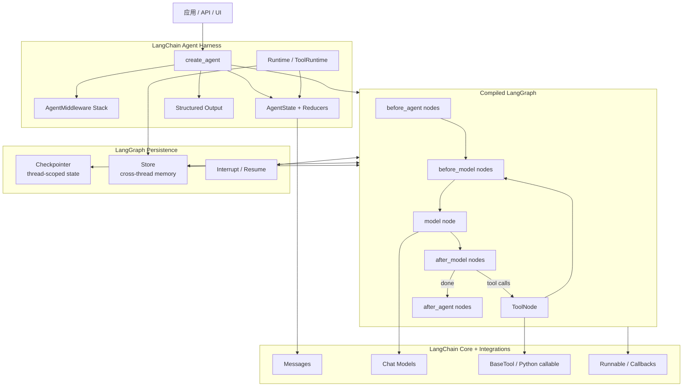
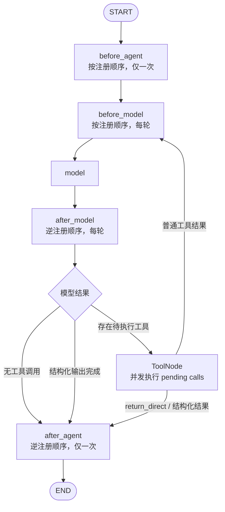
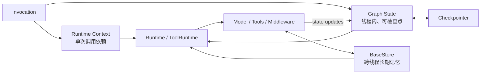
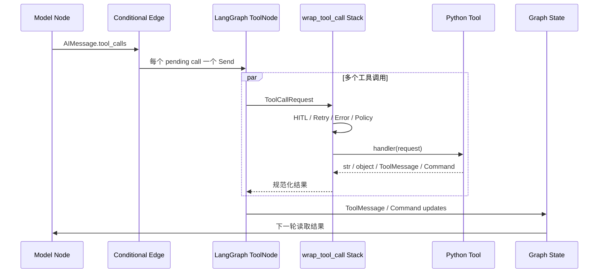

# LangChain（langchain-ai/langchain）Agent Harness 架构调研报告

> 调研对象：[`langchain-ai/langchain`](https://github.com/langchain-ai/langchain) Python 主仓库  
> 核验分支：`master`  
> 核验提交：[`4fe944a581895ab47b0f56e204829594d5ba74a8`](https://github.com/langchain-ai/langchain/tree/4fe944a581895ab47b0f56e204829594d5ba74a8)  
> 对应 `langchain` 版本：`1.4.6`  
> Agent Runtime 依赖：`langgraph>=1.2.12,<1.3.0`；运行时源码辅助核验于 [LangGraph `1.2.12`](https://github.com/langchain-ai/langgraph/tree/49cce0ca852be4cfb567a1cbe0e511ff325a1682)  
> 核验日期：2026-10-19  
> 研究范围：LangChain v1 的 `create_agent` Agent Harness、LangGraph Runtime 边界、中间件、状态与记忆、工具执行、结构化输出、Human-in-the-Loop、安全边界及扩展方式。

## 1. 结论摘要

LangChain v1 的 Agent Harness 可以概括为：**以 `create_agent` 为装配入口、以 Middleware 为策略扩展面、以 LangGraph 编译图为执行内核、以 LangChain Core 和 Provider 包为模型/消息/工具协议层的通用 Agent 框架**。

它不是一个独立实现所有调度与持久化能力的封闭 Agent Loop。相反，`create_agent` 将模型节点、工具节点和中间件节点编译成 LangGraph `CompiledStateGraph`；LangGraph 负责图调度、并发、检查点、暂停与恢复，LangChain 负责 Agent 语义、模型与工具适配、动态上下文和中间件生态。

其最值得关注的架构机制有六组：

1. **Agent Loop 是编译出的状态图**：核心循环不是手写的无限 `while`，而是 `model → tools → model` 的条件边；多个工具调用通过 `Send` 扇出到 `ToolNode`。
2. **Middleware 同时拥有节点钩子与环绕钩子**：`before/after_agent`、`before/after_model` 会成为图节点；`wrap_model_call`、`wrap_tool_call` 则组成可短路、重试或替换请求的嵌套调用栈。
3. **State、Context、Store 三类数据边界明确**：State 是线程内可检查点状态；Context 是单次调用的依赖注入；Store 是跨线程长期记忆。三者通过 LangGraph Runtime 统一提供给工具与中间件。
4. **持久化来自 LangGraph Checkpointer**：短期记忆、故障恢复、时间旅行和 Human-in-the-Loop 均依赖图状态检查点，而不是 LangChain 自己维护追加式会话日志。
5. **上下文治理有两种不同语义**：Summarization Middleware 会更新持久 State；Context Editing Middleware 只重写当前模型请求副本。两者都不是不可变事件日志上的事务式投影。
6. **安全策略默认是可选组合，而非强制管线**：HITL、PII、调用上限、重试、Guardrails 都以 Middleware 提供；普通 Tool 本质上仍是宿主进程中的 Python 可调用对象，`create_agent` 不自动提供沙箱、最小权限或审批。

综合判断：LangChain 适合需要快速组装模型、工具、状态、记忆、结构化输出和可观测策略的 Python Agent 应用，也适合希望在简单 Agent API 与 LangGraph 低层控制之间保留升级路径的团队。它不适合被误解为自带安全沙箱、不可变审计日志或完整生产托管面的 Agent 操作系统；这些能力需要额外的基础设施和治理。

## 2. 调研对象与边界核验

### 2.1 如何确认研究对象

| 识别项 | 已核验结果 |
|---|---|
| 官方仓库 | `https://github.com/langchain-ai/langchain` |
| Python 主包 | `langchain` |
| 核验版本 | `1.4.6` |
| Python 要求 | `>=3.10,<4.0` |
| 核心依赖 | `langchain-core>=1.6.10,<2.0.0` |
| Agent Runtime | `langgraph>=1.2.12,<1.3.0` |
| Agent 装配入口 | `langchain.agents.create_agent` |
| 主要扩展面 | `AgentMiddleware`、Tools、Model Integrations、State/Context Schema |

官方 README 将 LangChain 定义为构建 Agent 和 LLM 应用的框架；包清单将 LangGraph 声明为 `langchain` 的直接运行时依赖。证据见 [README 定位](https://github.com/langchain-ai/langchain/blob/4fe944a581895ab47b0f56e204829594d5ba74a8/README.md#L20-L31) 与 [包版本及依赖](https://github.com/langchain-ai/langchain/blob/4fe944a581895ab47b0f56e204829594d5ba74a8/libs/langchain_v1/pyproject.toml#L18-L30)。

### 2.2 LangChain 与 LangGraph 的边界

本报告以 LangChain Agent Harness 为主体，但不能绕开 LangGraph，因为：

- `create_agent` 的返回值就是 `CompiledStateGraph`；
- Agent 的节点、边、并发工具调用、检查点和 Interrupt 都由 LangGraph 执行；
- `checkpointer`、`store`、`interrupt_before`、`interrupt_after` 等参数直接透传给图编译；
- LangChain Middleware 通过增加节点、包裹调用和写入 State 改造这张图。

因此，本文采用以下边界：

- **LangChain**：Agent 语义、Middleware、ModelRequest/Response、Tool/Model 适配、结构化输出和预置策略；
- **LangGraph**：图执行、状态 Channel、并行任务、检查点、持久恢复、Interrupt 和 Runtime；
- **LangSmith**：可观测、评估、部署与托管产品，不视为开源 `langchain` 包的内核能力。

这一区分很重要。把 LangGraph 的持久化和暂停恢复全部归因于 LangChain，会夸大 LangChain 主仓库自身的职责；反过来只把 LangChain 看成若干 Prompt/Tool Helper，又会忽略 `create_agent` 已经提供的完整 Harness 装配层。

### 2.3 证据等级

- **已核验**：固定提交源码、包清单或官方文档可直接确认。
- **架构判断**：由多个已核验事实推导，使用“意味着”“可视为”等措辞。
- **待核验**：必须通过真实 Provider、并发负载、安全环境或部署平台验证。

## 3. 框架定位与总体架构

### 3.1 定位：高层 Agent Harness，低层交给 LangGraph

LangChain 官方把 Agent 描述为“模型循环调用工具直到任务完成”，把 Harness 描述为包围该循环的 Prompt、Tools 和 Middleware。[`create_agent` 官方说明](https://docs.langchain.com/oss/python/langchain/agents) 也明确指出它是高度可配置的 Harness。

从架构上看，LangChain v1 处于四层体系的中间：

1. **Provider / Integration 层**：不同模型、Embedding、Vector Store、Retriever 和外部工具包；
2. **LangChain Core 层**：Message、ChatModel、Tool、Runnable、Callback、Serialization 等通用协议；
3. **LangChain Agent 层**：`create_agent`、Middleware、AgentState、结构化输出与预置策略；
4. **LangGraph Runtime 层**：StateGraph、Pregel 调度、Checkpoint、Store、Interrupt、Streaming。

### 3.2 总体模块关系图

### 3.3 核心模块及协作

| 模块 | 主要职责 | 与其他模块的协作 |
|---|---|---|
| `create_agent` | 解析模型、工具、响应格式和 Middleware；构建并编译图 | 返回 `CompiledStateGraph`，将 Checkpointer/Store/Interrupt 配置交给 LangGraph |
| `AgentMiddleware` | 声明 State 扩展、附加工具、节点钩子、模型/工具环绕钩子 | 被 Factory 编译为图节点或嵌套调用栈 |
| `AgentState` | 保存 Messages、结构化响应和 Middleware 自定义字段 | 通过 LangGraph Reducer 合并每个节点的更新 |
| Model Node | 构造 `ModelRequest`、应用环绕 Middleware、绑定工具并调用模型 | 输出 `AIMessage`、`structured_response` 或额外 `Command` |
| `ToolNode` | 执行客户端工具、注入 Runtime、并发处理工具调用 | 工具结果写为 `ToolMessage`，也可返回 `Command` 更新 State |
| Structured Output | 在 Provider 原生格式与 Tool Calling 格式之间选择 | 成功结果写入 `structured_response` 并参与循环终止 |
| LangGraph Checkpointer | 按 `thread_id` 保存图状态快照和待执行任务 | 支撑短期记忆、恢复、Interrupt 和时间旅行 |
| LangGraph Store | 保存图状态之外的跨线程数据 | 通过 Runtime 注入工具和 Middleware，用于长期记忆 |
| LangChain Core | 定义 Model、Message、Tool、Runnable 等通用接口 | Agent 层和 Provider 包共同依赖 |

## 4. Agent Loop 运行机制

### 4.1 `create_agent` 的真实产物

`create_agent` 不是返回一个拥有 `run()` 方法的传统 Agent 类，而是返回编译后的 LangGraph `CompiledStateGraph`。其签名直接接受：

- `model`
- `tools`
- `system_prompt`
- `middleware`
- `response_format`
- `state_schema`
- `context_schema`
- `checkpointer`
- `store`
- `interrupt_before / interrupt_after`
- `cache`

证据见 [`create_agent` 实现与参数](https://github.com/langchain-ai/langchain/blob/4fe944a581895ab47b0f56e204829594d5ba74a8/libs/langchain_v1/langchain/agents/factory.py#L892-L1014)。

Factory 先合并 Middleware 提供的 Tools 和 State Schema，再创建 Model/Tool 节点及中间件节点，最后调用 `graph.compile(...)`。[图编译入口](https://github.com/langchain-ai/langchain/blob/4fe944a581895ab47b0f56e204829594d5ba74a8/libs/langchain_v1/langchain/agents/factory.py#L1900-L1923) 显示 Checkpointer、Store、Interrupt 和 Cache 均交给 LangGraph。

### 4.2 图结构与执行顺序

中间件节点的顺序具有明确语义：

- `before_agent`：注册顺序执行，在整个 Agent Run 开头运行一次；
- `before_model`：注册顺序执行，在每次模型调用前运行；
- `after_model`：逆注册顺序执行，在每次模型调用后运行；
- `after_agent`：逆注册顺序执行，在整个 Agent Run 结束前运行一次；
- `wrap_model_call` / `wrap_tool_call`：第一个 Middleware 是最外层，Request 正向进入，Response 反向返回。

图节点及边的构造见 [中间件节点注册](https://github.com/langchain-ai/langchain/blob/4fe944a581895ab47b0f56e204829594d5ba74a8/libs/langchain_v1/langchain/agents/factory.py#L1611-L1713) 与 [中间件边顺序](https://github.com/langchain-ai/langchain/blob/4fe944a581895ab47b0f56e204829594d5ba74a8/libs/langchain_v1/langchain/agents/factory.py#L1715-L1896)；环绕顺序见 [Tool Wrapper 组合](https://github.com/langchain-ai/langchain/blob/4fe944a581895ab47b0f56e204829594d5ba74a8/libs/langchain_v1/langchain/agents/factory.py#L710-L790)。

### 4.3 Model Node

每次进入 Model Node，Harness 从当前 State 和 Runtime 构造 `ModelRequest`，其中包括：

- 当前模型；
- 系统提示词；
- State 中的 Messages；
- 可见 Tools；
- Response Format；
- Runtime（Context、Store、Stream Writer、执行信息）。

随后：

1. `wrap_model_call` 链可以动态替换模型、提示词、消息、工具和响应格式；
2. 最内层处理器根据当前模型能力绑定 Tools 或 Provider 原生结构化输出；
3. 模型返回值被规范化为 `ModelResponse`；
4. 响应 Messages、结构化结果和 Middleware 返回的 `Command` 被转换成图状态更新。

同步和异步 Model Node 的实现见 [请求执行与 Model Node](https://github.com/langchain-ai/langchain/blob/4fe944a581895ab47b0f56e204829594d5ba74a8/libs/langchain_v1/langchain/agents/factory.py#L1493-L1606)。

### 4.4 条件路由与终止

Model Node 之后的路由遵循以下优先级：

1. Middleware 写入 `jump_to` 时，显式跳转到 `model`、`tools` 或 `end`；
2. 没有最新 `AIMessage` 时结束；
3. 最新模型消息没有工具调用时结束；
4. 有未完成的客户端工具调用时，为每个调用生成 `Send("tools", [tool_call])`；
5. 已生成结构化响应时结束；
6. 工具调用都已被人工注入结果或处理后，回到 Model。

工具节点之后，若所有已执行工具都设置 `return_direct=True`，或结构化输出工具已成功执行，则结束；否则回到 Model。[Model → Tools 路由](https://github.com/langchain-ai/langchain/blob/4fe944a581895ab47b0f56e204829594d5ba74a8/libs/langchain_v1/langchain/agents/factory.py#L1991-L2042) 与 [Tools → Model 路由](https://github.com/langchain-ai/langchain/blob/4fe944a581895ab47b0f56e204829594d5ba74a8/libs/langchain_v1/langchain/agents/factory.py#L2072-L2111) 支持该流程。

### 4.5 工具并发

LangChain Factory 为每个待执行调用创建一个 LangGraph `Send`。LangGraph `ToolNode` 在同步路径使用 Executor Map，在异步路径使用 `asyncio.gather` 并发执行调用。[LangChain 扇出](https://github.com/langchain-ai/langchain/blob/4fe944a581895ab47b0f56e204829594d5ba74a8/libs/langchain_v1/langchain/agents/factory.py#L2021-L2033)、[ToolNode 同步/异步并发](https://github.com/langchain-ai/langgraph/blob/49cce0ca852be4cfb567a1cbe0e511ff325a1682/libs/prebuilt/langgraph/prebuilt/tool_node.py#L810-L861)。

这意味着并发是默认图调度行为，而不是由每个工具显式声明“可并行”。应用若包含非线程安全、顺序敏感或共享外部事务的工具，需要自行增加锁、路由或 Middleware 策略。

## 5. Middleware：LangChain Agent 的核心特色机制

### 5.1 两类扩展点

Middleware 同时提供两种不同控制面：

| 类型 | 扩展点 | 语义 |
|---|---|---|
| Node-style | `before_agent`、`before_model`、`after_model`、`after_agent` | 成为 LangGraph 节点；返回 State Update；可声明 `jump_to` |
| Wrap-style | `wrap_model_call`、`wrap_tool_call` | 环绕下游 Handler；可改写请求、重试、Fallback、缓存、短路或替换响应 |

接口定义见 [`AgentMiddleware`](https://github.com/langchain-ai/langchain/blob/4fe944a581895ab47b0f56e204829594d5ba74a8/libs/langchain_v1/langchain/agents/middleware/types.py#L385-L824)。

Node-style Middleware 适合状态转换和图路由；Wrap-style Middleware 适合重试、缓存、动态模型选择、工具审批和结果转换。两者混用能覆盖大多数 Harness 策略，但顺序会直接影响行为，例如：

- 外层 Cache 是否缓存 Retry 后的最终结果；
- HITL 应位于 Tool Retry 外层还是内层；
- Summarization 发生在 Dynamic Prompt 之前还是之后；
- Guardrail 拒绝时是直接结束、返回合成消息还是抛异常。

### 5.2 Middleware 可以扩展 State 与 Tools

每个 Middleware 可以声明自己的 `state_schema` 和 `tools`。Factory 会：

1. 收集所有 Middleware Tools，与用户传入 Tools 合并；
2. 合并 Middleware State Schema 与显式 `state_schema`；
3. 检查 Middleware 名称不能重复；
4. 只为实际实现的 Hook 创建图节点或 Wrapper。

这使调用上限、Todo、HITL 编辑状态、摘要等能力不必侵入 Agent Core。[Middleware 收集与 State Schema 合并](https://github.com/langchain-ai/langchain/blob/4fe944a581895ab47b0f56e204829594d5ba74a8/libs/langchain_v1/langchain/agents/factory.py#L1087-L1239)。

### 5.3 动态模型、工具与 Prompt

`ModelRequest.override()` 返回带指定覆盖项的新请求，Middleware 可以在每一步动态改变：

- Model；
- Messages；
- System Prompt；
- Tools；
- Response Format；
- Model Settings。

因此动态路由不需要重建 Agent 图。例如可以按用户等级选择模型、按会话状态缩减 Tools、按上下文生成 System Prompt，或在主模型失败后切到备用模型。[ModelRequest 与不可变覆盖接口](https://github.com/langchain-ai/langchain/blob/4fe944a581895ab47b0f56e204829594d5ba74a8/libs/langchain_v1/langchain/agents/middleware/types.py#L74-L231)。

这种灵活性也带来缓存和可观测复杂度：真正发出的模型请求取决于所有外层 Middleware 处理后的最终 Request，而不只是 `create_agent(model=..., tools=...)` 的静态参数。

### 5.4 预置策略生态

LangChain v1 内置的 Middleware 覆盖：

- Summarization、Context Editing；
- Model Retry、Fallback、Call Limit；
- Tool Retry、Error Handling、Call Limit、Selection；
- Human-in-the-Loop；
- PII、Redaction、Trace Policy；
- Todo、File Search、Shell Tool；
- Provider Tool Search 和 Tool Emulator。

官方 [Middleware 概览](https://docs.langchain.com/oss/python/langchain/middleware/overview) 将日志、Prompt/Tool 转换、重试/Fallback、提前终止、限流和 Guardrails 都放在这一层。

架构判断：Middleware 是 LangChain v1 Agent 的主要差异化机制。它不是通用进程级插件系统，没有包加载器、热重载或独立生命周期；它是**在构建 Agent 时静态组合、在图节点与调用栈中运行的 Python 策略对象**。

## 6. State、Runtime 与记忆

### 6.1 AgentState 与 Reducer

基础 `AgentState` 包含：

- `messages`：使用 LangGraph `add_messages` Reducer；
- `jump_to`：私有、临时路由字段；
- 可选 `structured_response`；
- Middleware 或用户 Schema 增加的自定义字段。

源码见 [AgentState 定义](https://github.com/langchain-ai/langchain/blob/4fe944a581895ab47b0f56e204829594d5ba74a8/libs/langchain_v1/langchain/agents/middleware/types.py#L329-L386)。

官方文档常把 Messages 描述为追加式历史，但实现语义更精确：`add_messages` 通常追加新 ID，也允许同 ID 覆盖，并支持 `RemoveMessage` 删除。Summarization 会使用 `RemoveMessage(id=REMOVE_ALL_MESSAGES)` 清空旧历史，再写入摘要与保留尾部。因此它不是不可变事件日志，也不能仅凭最终 State 重建每次原始模型上下文。

### 6.2 State、Context、Store 的三分法

三者的边界是：

| 数据面 | 生命周期 | 典型内容 | 持久机制 |
|---|---|---|---|
| State | 同一 `thread_id` 的图线程 | Messages、调用计数、摘要、业务状态 | Checkpointer |
| Context | 单次 Invocation | User ID、数据库连接、Feature Flag、凭据引用 | 调用方注入，不自动写入 State |
| Store | 跨线程、应用级 | 用户偏好、事实、共享知识 | BaseStore 实现 |

LangGraph Runtime 还提供 Stream Writer、执行身份、重试次数和 Server 元数据。官方 [Runtime 文档](https://docs.langchain.com/oss/python/langchain/runtime) 与 [Persistence 文档](https://docs.langchain.com/oss/python/langgraph/persistence) 明确区分 Checkpointer 的线程状态和 Store 的跨线程数据。

### 6.3 Checkpointer：短期记忆与恢复

当 `create_agent` 传入 Checkpointer 后，每个 `thread_id` 的图状态可以在步骤边界保存和恢复。它支撑：

- 多轮会话连续性；
- 故障恢复；
- Human-in-the-Loop 暂停与恢复；
- 时间旅行和 State 检查；
- 子图持久化命名空间。

LangGraph `StateGraph.compile` 将 Checkpointer、Interrupt 节点和 Store 编译进 `CompiledStateGraph`。[StateGraph 编译参数](https://github.com/langchain-ai/langgraph/blob/49cce0ca852be4cfb567a1cbe0e511ff325a1682/libs/langgraph/langgraph/graph/state.py#L1177-L1233) 与 [编译结果组装](https://github.com/langchain-ai/langgraph/blob/49cce0ca852be4cfb567a1cbe0e511ff325a1682/libs/langgraph/langgraph/graph/state.py#L1231-L1364)。

需要注意：

- `InMemorySaver` 进程重启后数据丢失；
- 长线程会累积 Checkpoint，需要保留和清理策略；
- Checkpoint 是图状态快照/Channel Write，不是用户可直接审计的领域事件流；
- 对外部系统已经发生的副作用，恢复不能自动保证 Exactly Once。

### 6.4 Interrupt 与 Human-in-the-Loop

LangChain `HumanInTheLoopMiddleware` 检查模型提出的 Tool Calls，并在需要人工处理时调用 LangGraph `interrupt()`。图状态由 Checkpointer 保存，调用方之后使用相同 `thread_id` 和 `Command(resume=...)` 恢复。

内置决策有四类：

- `approve`：按原参数执行；
- `edit`：修改参数后执行；
- `reject`：跳过执行并返回反馈；
- `respond`：直接提供合成 Tool Result。

证据见 [HITL 官方文档](https://docs.langchain.com/oss/python/langchain/human-in-the-loop) 与 [HITL Middleware 实现](https://github.com/langchain-ai/langchain/blob/4fe944a581895ab47b0f56e204829594d5ba74a8/libs/langchain_v1/langchain/agents/middleware/human_in_the_loop.py#L396-L578)。

关键技术边界：LangGraph 恢复 Interrupt 时会从发生 Interrupt 的节点开头重新执行，因此 Interrupt 之前的代码可能再次运行。官方文档明确要求使用 Checkpointer 和相同 `thread_id`；应用还必须保证暂停前副作用幂等或将副作用放到 Interrupt 之后。[Interrupt 恢复语义](https://docs.langchain.com/oss/python/langgraph/interrupts)。

## 7. 上下文治理：Summarization 与 Context Editing

### 7.1 Summarization Middleware

Summarization Middleware 在 `before_model` 阶段监测消息数、Token 数或模型上下文比例。当触发条件满足时：

1. 根据 `keep` 策略选择近期保留内容；
2. 对旧消息调用摘要模型或自定义 Summarizer；
3. 返回 `RemoveMessage(REMOVE_ALL_MESSAGES)`；
4. 写入新的摘要消息和保留尾部。

同步和异步实现见 [摘要触发与 State 更新](https://github.com/langchain-ai/langchain/blob/4fe944a581895ab47b0f56e204829594d5ba74a8/libs/langchain_v1/langchain/agents/middleware/summarization.py#L485-L565)。

这是一种**持久 State 重写**：下一 Checkpoint 保存的是压缩后的 Messages。它能显著降低上下文，但被清除的原始消息不再属于当前 AgentState；若要保留完整审计历史，必须依赖外部 Trace、独立事件存储或业务日志。

### 7.2 Context Editing Middleware

Context Editing Middleware 的默认策略会在输入 Token 超阈值时清理较旧 Tool Result。与 Summarization 不同，它：

1. 深拷贝 `request.messages`；
2. 对副本应用 Edit；
3. 使用 `request.override(messages=edited_messages)` 调用下游模型；
4. 不把编辑后的 Messages 写回 AgentState。

源码见 [Context Editing 实现](https://github.com/langchain-ai/langchain/blob/4fe944a581895ab47b0f56e204829594d5ba74a8/libs/langchain_v1/langchain/agents/middleware/context_editing.py#L187-L300)。

因此两种机制语义不同：

| 机制 | 修改对象 | 是否持久 | 是否调用摘要模型 | 适合场景 |
|---|---|---|---|---|
| Summarization | AgentState Messages | 是 | 默认是 | 长对话持续压缩 |
| Context Editing | 当前 ModelRequest 副本 | 否 | 否 | 临时清理旧 Tool Result |

### 7.3 与不可变会话日志的区别

LangChain 的上下文治理以“图 State 是工作记忆”为中心，而不是以“不可变原始日志 + 模型 Surface 投影”为中心。这带来：

- **优点**：实现直接、与 LangGraph State/Checkpoint 自然融合；Middleware 可用普通 State Update 完成；
- **代价**：最终 State 不必保留全部原始上下文；压缩过程也没有通用的 start/end 事务事件或替换代际；
- **边界**：审计、重放和“精确重建每次模型请求”更多依赖 LangSmith Trace、Callback 或外部日志。

## 8. 结构化输出

LangChain 将结构化结果视为 Agent State 的一等字段 `structured_response`，提供三种策略：

- `ProviderStrategy`：使用 Provider 原生 Structured Output；
- `ToolStrategy`：把输出 Schema 表示为工具调用；
- 直接传入 Schema：根据模型能力自动选择策略。

类型定义见 [ToolStrategy 与 ProviderStrategy](https://github.com/langchain-ai/langchain/blob/4fe944a581895ab47b0f56e204829594d5ba74a8/libs/langchain_v1/langchain/agents/structured_output.py#L196-L315)，整体语义见 [官方 Structured Output 文档](https://docs.langchain.com/oss/python/langchain/structured-output)。

其架构价值在于：

- 输出验证与 Agent Loop 终止统一；
- Provider 能力差异被封装；
- Tool Calling Fallback 可以在不支持原生输出的模型上复用；
- Middleware 可动态改变 Response Format。

技术边界：

- Provider 原生格式的可靠性取决于具体模型与适配器；
- ToolStrategy 会增加 Tool Call 循环和错误修复步骤；
- Schema 过大时会占用上下文；
- 结构校验成功不代表内容真实、安全或符合业务权限。

## 9. 工具执行与安全边界

### 9.1 工具执行管线

Tool 可以是 Python Callable、LangChain `BaseTool` 或工具字典。ToolRuntime 可访问 State、Context、Store、Stream Writer、执行信息和当前 Tool Call ID；Tool 还可返回 `Command` 更新 State。[官方 Tools 文档](https://docs.langchain.com/oss/python/langchain/tools)。

`wrap_tool_call` 可以实现：

- 重试与 Fallback；
- Tool Error 转换；
- Human Approval；
- 参数校验和重写；
- 缓存、限流和审计；
- 动态 Tool 分发。

### 9.2 调用上限不是默认硬边界

LangChain 提供 `ModelCallLimitMiddleware` 和 `ToolCallLimitMiddleware`，支持 Run 级与 Thread 级计数，可选择结束、返回错误消息或抛异常。[模型调用上限](https://github.com/langchain-ai/langchain/blob/4fe944a581895ab47b0f56e204829594d5ba74a8/libs/langchain_v1/langchain/agents/middleware/model_call_limit.py#L94-L212)、[工具调用上限](https://github.com/langchain-ai/langchain/blob/4fe944a581895ab47b0f56e204829594d5ba74a8/libs/langchain_v1/langchain/agents/middleware/tool_call_limit.py#L141-L255)。

但这些 Middleware 需要显式配置；`create_agent` 默认没有统一步数、成本、Token 或工具次数预算。生产系统应同时在 Agent、Provider、网络和业务 API 层建立配额。

### 9.3 Human-in-the-Loop 不是权限系统

HITL 能暂停并让人批准、编辑、拒绝或直接响应，但它本质上是可配置 Middleware：

- 只有被 `interrupt_on` 选中的工具调用才会暂停；
- 条件谓词可能根据参数自动放行；
- 未配置 Checkpointer 时无法安全持久等待；
- 审批人身份、授权范围和审计保留由上层应用负责；
- 人工批准不能证明工具实现没有越权、路径穿越或注入漏洞。

因此 HITL 是风险控制点，不是完整 IAM、Policy Engine 或操作系统 Sandbox。

### 9.4 默认没有工具沙箱

普通 LangChain Tool 是宿主 Python 进程中的可调用对象。框架不会自动：

- 限制文件系统路径；
- 禁止网络访问；
- 隔离环境变量和凭据；
- 限制子进程；
- 为每个 Tool 创建容器；
- 对所有调用强制人工审批。

部分内置或第三方工具可能拥有自己的校验，`langchain-core` 也包含 SSRF 防护等内部安全组件，但这些不能推导为所有 Tools 的统一安全边界。[SSRF Policy 源码](https://github.com/langchain-ai/langchain/blob/4fe944a581895ab47b0f56e204829594d5ba74a8/libs/core/langchain_core/_security/_policy.py#L99-L118)。

正确的生产边界通常还需要：

- 最小权限凭据与独立服务账户；
- 容器、VM 或远程 Sandbox；
- 文件系统和网络 Egress Policy；
- 业务 API 级授权与幂等键；
- Tool 参数白名单和输出过滤；
- 版本固定、安全公告跟踪和依赖扫描。

### 9.5 Guardrails 的定位

LangChain 将 PII、内容过滤、Prompt Injection 检测和业务规则放在 Middleware Guardrails 层。官方 [Guardrails 文档](https://docs.langchain.com/oss/python/langchain/guardrails) 区分确定性规则与模型型规则。

架构判断：Guardrails 提供插入点与部分预置实现，但它不是统一、不可绕过的安全内核。Middleware 的顺序、异常处理、流式输出路径和动态 Tool 路由都应纳入威胁建模。

## 10. 扩展机制与生态边界

### 10.1 主要扩展方式

LangChain Agent 的扩展面包括：

1. **Middleware**：改变图节点、模型调用、工具调用和 State；
2. **Tools**：普通 Python 函数、BaseTool、MCP Tool 或 Provider Tool；
3. **Model Integrations**：通过 LangChain Core ChatModel 接口接入 Provider；
4. **State Schema**：增加业务状态和 Reducer；
5. **Context Schema**：注入调用级依赖；
6. **Store / Checkpointer**：替换短期和长期持久化后端；
7. **Runnable / Callback / Streaming**：组合前后处理、观测和 UI 数据流；
8. **直接使用 LangGraph**：当 `create_agent` 图形不够时，下沉到自定义 StateGraph。

### 10.2 不是进程级插件系统

与带 Loader、Manifest、Profile 和热重载的插件框架不同，LangChain 的扩展通常是：

- Python Import；
- 在应用启动时构造对象；
- 将对象传给 `create_agent`；
- 编译后得到相对固定的图；
- 每次运行通过 State/Context 动态改变局部行为。

它没有统一的第三方插件发现、隔离、卸载和权限清单。包版本、依赖冲突和插件可信度由 Python 环境与应用部署负责。

### 10.3 下沉到 LangGraph 的时机

`create_agent` 适合典型“模型—工具—模型”循环。以下需求更适合直接使用 LangGraph：

- 多个不同 Agent/模型节点和复杂分支；
- 确定性 Workflow 与 Agent 混合；
- 多阶段并行 Map/Reduce；
- 自定义补偿、事务和恢复边界；
- 非 Tool Calling 的循环；
- 复杂子图、长期后台任务或显式状态机。

架构优势在于迁移路径连续：LangChain Agent 已经是 CompiledStateGraph，团队可以逐步从 Middleware 定制下沉到自定义图，而不是完全更换运行时。

## 11. 技术边界

### 11.1 状态与审计边界

- AgentState 是当前工作状态，不是不可变事件日志；
- Summarization 可以删除原 Messages 并写入摘要；
- Checkpoint 保存图状态和任务，不天然等同于领域审计记录；
- 精确请求回放依赖 Trace、Provider 元数据和自定义日志是否完整；
- Store 是应用数据层，不自动与 Checkpointer 保持事务一致。

### 11.2 恢复与副作用边界

- Interrupt 恢复会重启当前节点，暂停前代码可能重跑；
- Tool 并发会放大共享状态竞争和非幂等副作用风险；
- Checkpointer 可恢复图进度，但无法自动判断外部 API 是否已成功；
- Tool Retry 可能重复外部动作，应结合幂等键、状态查询或补偿；
- `return_direct` 只改变图路由，不提供提交/回滚语义。

### 11.3 上下文与模型边界

- Token 计数和模型 Profile 可能与 Provider 实际计费/上下文规则存在差异；
- Summarization 可能丢失细节，Context Editing 可能隐藏旧 Tool Result；
- 动态 Model/Tool/Prompt 使静态配置不等于最终请求；
- Provider 原生 Tools、客户端 Tools 和结构化输出工具的执行位置不同；
- 流式 Chunk、最终 Message、Trace 和 Checkpoint 是不同数据面。

### 11.4 安全边界

- Tools 默认继承宿主 Python 进程权限；
- Middleware 是同进程受信任代码；
- HITL、Guardrails、PII 和调用上限均为显式选择，不是全局强制；
- LangChain Core 的局部安全组件不覆盖所有 Integration；
- MCP Server、外部 Retriever、Prompt Hub 和第三方包需要独立供应链审查；
- 框架能力不能替代容器、网络策略、IAM、Secrets Manager 和业务授权。

## 12. 优缺点与适用场景

### 12.1 主要优点

| 优点 | 架构价值 |
|---|---|
| 高层 API 与低层图运行时连续 | 简单场景用 `create_agent`，复杂场景可下沉 LangGraph |
| Middleware 覆盖面完整 | Prompt、Model、Tool、State、路由、重试和 Guardrail 可统一组合 |
| Provider 与 Tool 生态广 | 能快速接入多模型和外部系统 |
| State/Context/Store 分层 | 线程状态、调用依赖和跨线程记忆职责清晰 |
| Checkpointer + Interrupt | 支持短期记忆、暂停恢复、HITL 和故障恢复 |
| 结构化输出是一等能力 | Provider 原生与 Tool Strategy 可统一使用 |
| 同步/异步 API 对称 | 适合脚本、Web 服务和并发应用 |
| LangSmith 集成成熟 | Trace、调试、评估和运行观测路径清晰 |

### 12.2 主要缺点

| 缺点 | 影响 |
|---|---|
| 抽象层较多 | 需要同时理解 LangChain Core、Agent Middleware、LangGraph 和 Provider 包 |
| Middleware 顺序敏感 | Cache、Retry、HITL、Guardrail 的排列可能改变语义 |
| 当前 State 不是完整审计日志 | 摘要和删除会丢失原始工作历史，需要额外 Trace/Event Store |
| 安全默认较弱 | Tool 与 Middleware 同进程执行，沙箱和权限治理需外建 |
| 动态行为难静态推断 | 最终模型、工具、Prompt 和响应格式可能逐步变化 |
| 并发 Tool 有副作用风险 | 非线程安全或非幂等工具需要额外控制 |
| 生态版本矩阵复杂 | `langchain`、`langchain-core`、`langgraph` 和 Provider 包需兼容管理 |

### 12.3 适合场景

- 需要快速开发工具调用型 Agent 的 Python 团队；
- 需要多 Provider、动态模型选择和统一消息协议；
- 需要可插拔重试、Fallback、HITL、PII 或摘要策略；
- 需要线程级短期记忆与跨线程长期记忆；
- 需要结构化输出直接进入业务应用；
- 预计未来可能从标准 Agent Loop 演进到自定义 LangGraph；
- 已有容器、IAM、Secrets、网络策略和观测基础设施的产品团队。

### 12.4 不适合直接采用的场景

- 只需要极小、无依赖的 Agent Loop；
- 要求开箱即用的强安全 Sandbox 和不可绕过权限策略；
- 要求会话事实永久不可变、每次请求可由框架日志精确重建；
- 工具包含高风险非幂等操作但缺少外部事务和审批系统；
- 不愿管理多个 LangChain/LangGraph/Provider 包版本；
- 运行环境禁止同进程第三方 Python 扩展；
- 需要复杂多 Agent 工作流却坚持只在 `create_agent` Middleware 内实现。

## 13. 已核验与待核验

### 13.1 已核验

- 官方仓库、提交、`langchain==1.4.6` 和 Python 版本要求；
- `langgraph>=1.2.12,<1.3.0` 为 Agent Runtime 直接依赖；
- `create_agent` 返回并编译 `CompiledStateGraph`；
- Model、Tool 和 Middleware 节点的构造与路由顺序；
- 多个待执行 Tool Calls 通过 `Send` 扇出并由 ToolNode 并发；
- Middleware 的 Node-style 和 Wrap-style 两类扩展点；
- AgentState 使用 `add_messages` Reducer，并支持 RemoveMessage；
- Checkpointer、Store、Context 的职责边界；
- Summarization 持久改写 State，Context Editing 只改当前请求副本；
- Structured Output 的 ProviderStrategy、ToolStrategy 和自动选择；
- HITL 的 approve/edit/reject/respond 及 Interrupt 恢复；
- 调用上限、Guardrails 和审批均为可选 Middleware；
- 普通 Tool 默认在宿主 Python 进程中执行，没有统一强制 Sandbox。

### 13.2 架构判断

- LangChain v1 Agent 的核心竞争力是“中间件化 Harness + LangGraph Runtime”，而不是独立循环算法；
- State/Context/Store 三分法比传统单一 Memory 对象更适合生产应用；
- Middleware 是构建期组合的策略栈，不是热插拔插件系统；
- Checkpoint 提供恢复性，但不能替代不可变事件审计和外部副作用事务；
- `create_agent` 是典型 Tool-Calling Agent 的便捷图模板，复杂 Workflow 应直接下沉 LangGraph。

### 13.3 待核验

- 大量 Middleware 叠加时的延迟、Trace 体积和调试成本；
- 不同 Checkpointer 后端在高并发 Thread 下的一致性和吞吐；
- ToolNode 并发对具体业务工具、数据库事务和限流系统的实际影响；
- Summarization 对中文、代码、多模态和长 Tool Result 的信息保真度；
- 各 Provider 的 Tool Calling、Structured Output、Usage Metadata 和流式行为一致性；
- LangSmith Trace 与业务审计要求之间的覆盖差距；
- MCP、第三方 Tools 和 Provider 包的供应链安全成熟度；
- LangChain 1.x、LangGraph 1.2.x 与 Integration 包升级的真实兼容成本；
- Agent Server 或托管部署的认证、多租户和持久化边界。

## 14. 参考资料

### 14.1 官方文档

- [LangChain Agents](https://docs.langchain.com/oss/python/langchain/agents)
- [Middleware Overview](https://docs.langchain.com/oss/python/langchain/middleware/overview)
- [Short-term Memory](https://docs.langchain.com/oss/python/langchain/short-term-memory)
- [Runtime](https://docs.langchain.com/oss/python/langchain/runtime)
- [Tools](https://docs.langchain.com/oss/python/langchain/tools)
- [Structured Output](https://docs.langchain.com/oss/python/langchain/structured-output)
- [Human-in-the-Loop](https://docs.langchain.com/oss/python/langchain/human-in-the-loop)
- [Guardrails](https://docs.langchain.com/oss/python/langchain/guardrails)
- [LangGraph Persistence](https://docs.langchain.com/oss/python/langgraph/persistence)
- [LangGraph Interrupts](https://docs.langchain.com/oss/python/langgraph/interrupts)

### 14.2 LangChain 固定提交源码

- [`langchain` 包清单](https://github.com/langchain-ai/langchain/blob/4fe944a581895ab47b0f56e204829594d5ba74a8/libs/langchain_v1/pyproject.toml)
- [Agent Factory](https://github.com/langchain-ai/langchain/blob/4fe944a581895ab47b0f56e204829594d5ba74a8/libs/langchain_v1/langchain/agents/factory.py)
- [Middleware Types](https://github.com/langchain-ai/langchain/blob/4fe944a581895ab47b0f56e204829594d5ba74a8/libs/langchain_v1/langchain/agents/middleware/types.py)
- [Summarization Middleware](https://github.com/langchain-ai/langchain/blob/4fe944a581895ab47b0f56e204829594d5ba74a8/libs/langchain_v1/langchain/agents/middleware/summarization.py)
- [Context Editing Middleware](https://github.com/langchain-ai/langchain/blob/4fe944a581895ab47b0f56e204829594d5ba74a8/libs/langchain_v1/langchain/agents/middleware/context_editing.py)
- [Human-in-the-Loop Middleware](https://github.com/langchain-ai/langchain/blob/4fe944a581895ab47b0f56e204829594d5ba74a8/libs/langchain_v1/langchain/agents/middleware/human_in_the_loop.py)
- [Model Call Limit](https://github.com/langchain-ai/langchain/blob/4fe944a581895ab47b0f56e204829594d5ba74a8/libs/langchain_v1/langchain/agents/middleware/model_call_limit.py)
- [Tool Call Limit](https://github.com/langchain-ai/langchain/blob/4fe944a581895ab47b0f56e204829594d5ba74a8/libs/langchain_v1/langchain/agents/middleware/tool_call_limit.py)
- [Structured Output](https://github.com/langchain-ai/langchain/blob/4fe944a581895ab47b0f56e204829594d5ba74a8/libs/langchain_v1/langchain/agents/structured_output.py)
- [LangChain Core Tool](https://github.com/langchain-ai/langchain/blob/4fe944a581895ab47b0f56e204829594d5ba74a8/libs/core/langchain_core/tools/base.py)
- [LangChain Core SSRF Policy](https://github.com/langchain-ai/langchain/blob/4fe944a581895ab47b0f56e204829594d5ba74a8/libs/core/langchain_core/_security/_policy.py)

### 14.3 LangGraph 1.2.12 辅助源码

- [StateGraph](https://github.com/langchain-ai/langgraph/blob/49cce0ca852be4cfb567a1cbe0e511ff325a1682/libs/langgraph/langgraph/graph/state.py)
- [ToolNode](https://github.com/langchain-ai/langgraph/blob/49cce0ca852be4cfb567a1cbe0e511ff325a1682/libs/prebuilt/langgraph/prebuilt/tool_node.py)
- [Pregel Runtime](https://github.com/langchain-ai/langgraph/blob/49cce0ca852be4cfb567a1cbe0e511ff325a1682/libs/langgraph/langgraph/pregel/main.py)
- [Checkpoint Base](https://github.com/langchain-ai/langgraph/blob/49cce0ca852be4cfb567a1cbe0e511ff325a1682/libs/checkpoint/langgraph/checkpoint/base/__init__.py)
- [Runtime Types / Interrupt](https://github.com/langchain-ai/langgraph/blob/49cce0ca852be4cfb567a1cbe0e511ff325a1682/libs/langgraph/langgraph/types.py)

---

本报告基于固定提交进行架构级静态调研。模型行为、工具安全、持久化一致性、Provider 兼容和部署强度应以目标版本、实际 Middleware 顺序、具体 Integration 和隔离环境中的验证结果为准。
