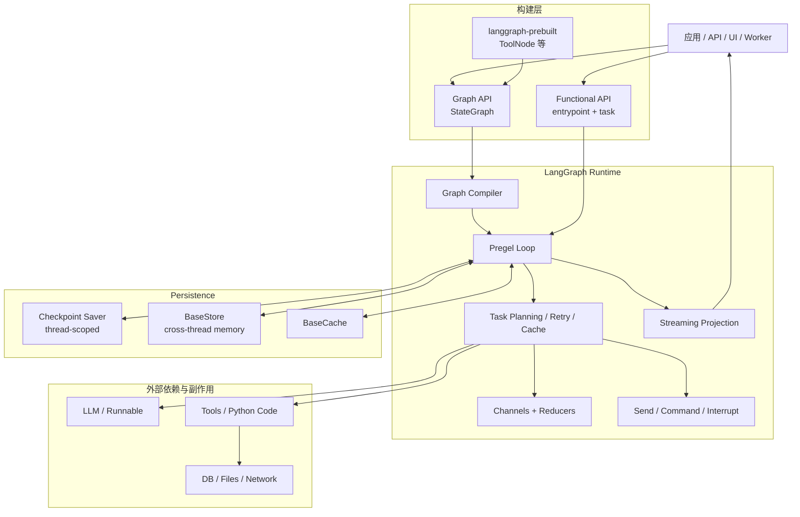
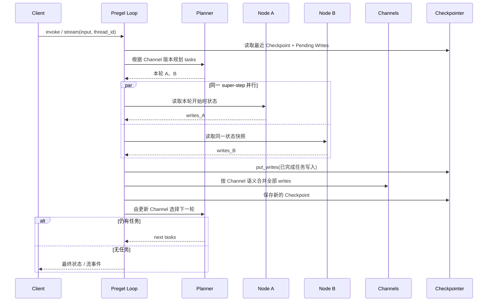
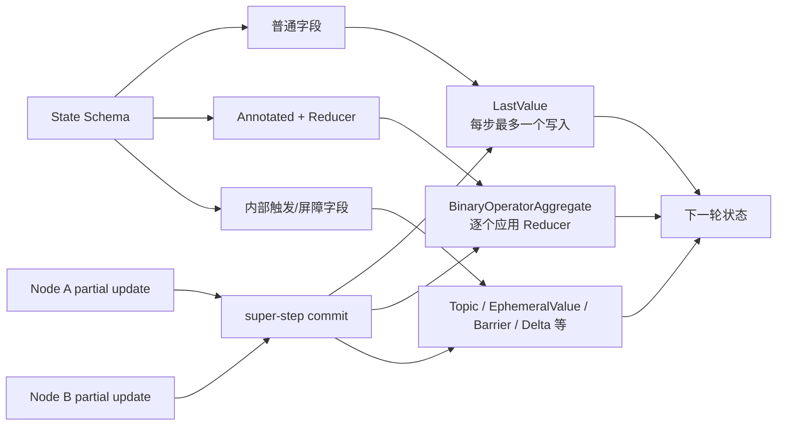
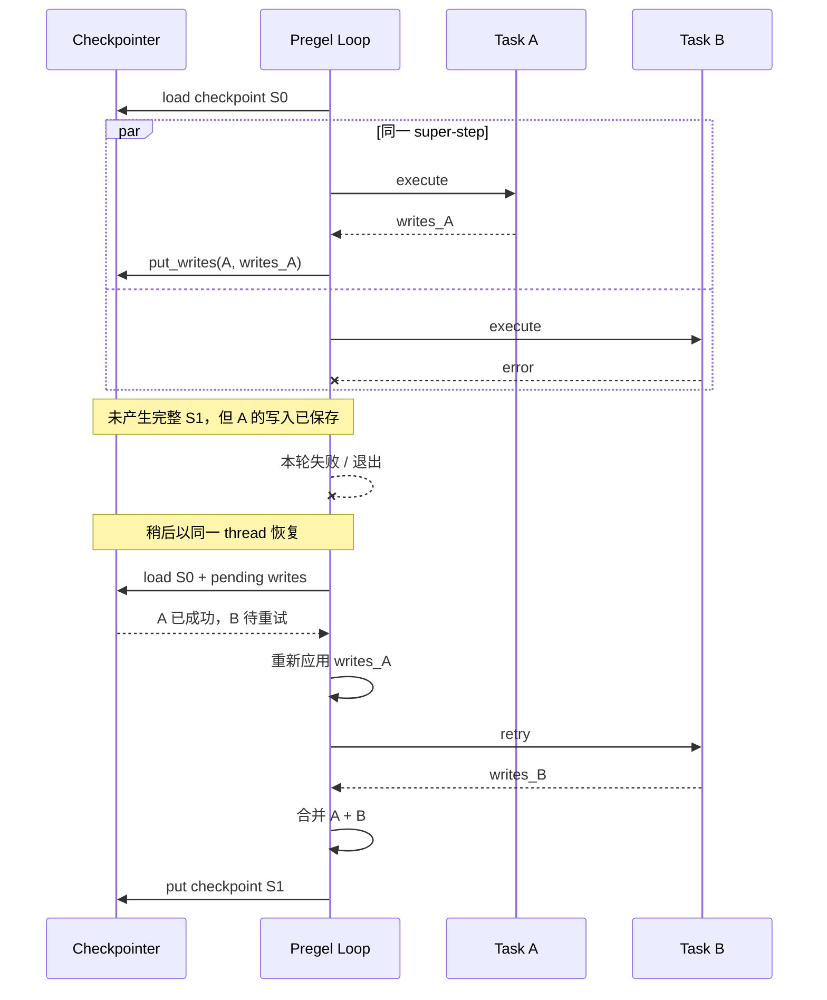
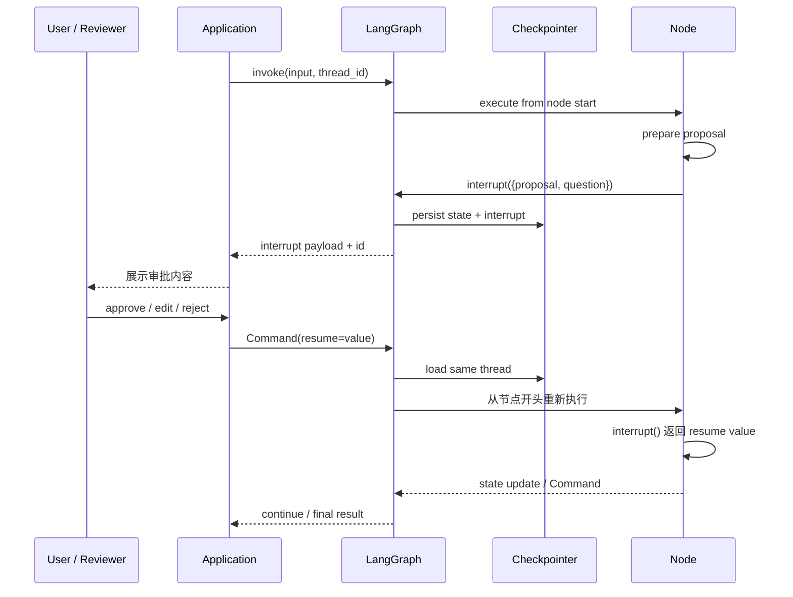

# LangGraph（langchain-ai/langgraph）Agent Runtime / Harness 架构调研报告

> 调研对象：[`langchain-ai/langgraph`](https://github.com/langchain-ai/langgraph) Python 官方仓库  
> 核验分支：`main`  
> 核验提交：[`7b23a1084683c58a4c20f4e1290968536cc34e85`](https://github.com/langchain-ai/langgraph/tree/7b23a1084683c58a4c20f4e1290968536cc34e85)  
> 仓库源码包版本：`langgraph==1.2.16`  
> 核验日期：2026-10-19  
> 研究范围：Python 开源运行时中的 Pregel、StateGraph、Channel、Functional API、Checkpoint/Store、Interrupt、Streaming、Subgraph、`langgraph-prebuilt` 及安全边界。LangSmith、Agent Server、云部署控制面只用于说明边界，不作为 LangGraph 开源内核能力。

## 1. 结论摘要

LangGraph 可以概括为：**一个以 Pregel/Bulk Synchronous Parallel 为执行模型、以 Channel 化状态为通信媒介、以 Checkpoint 为持久化边界、面向长运行与可恢复 Agent/Workflow 的低层编排运行时**。

它与典型的“Agent SDK”或“预制 ReAct Harness”不同。LangGraph 的核心并不规定 Prompt、模型、工具循环或 Agent 角色，而是提供两种构建入口——显式图结构的 Graph API 和保留普通 Python 控制流的 Functional API——并将二者统一落到 Pregel Runtime。官方 README 也将其定位为构建、管理和部署长运行、有状态 Agent 的低层编排框架，并明确建议：需要预制 Agent 架构和模型集成时优先使用 LangChain；需要确定性流程与 Agent 决策混合、重度定制和细粒度延迟控制时使用 LangGraph。[官方定位](https://github.com/langchain-ai/langgraph/blob/7b23a1084683c58a4c20f4e1290968536cc34e85/libs/langgraph/README.md#L20-L28)

其最重要的架构特征有八点：

1. **图执行不是普通 DAG 调度，而是分阶段的 super-step**：每轮分为 Plan、Execution、Update；同一轮中的节点可并行执行，但其写入到下一轮才对其他节点可见。
2. **State 本质上由 Channel 组成**：每个 State 字段都对应一种 Channel 更新语义；默认 `LastValue` 不允许同一步多个写入，Reducer 字段则通常映射到 `BinaryOperatorAggregate`。
3. **控制流和数据更新可以分离，也可以合并**：静态边、条件边负责声明拓扑；`Send` 支持动态扇出；`Command` 可在一次返回中同时表达状态更新、跳转、跨子图导航和 Resume。
4. **持久化覆盖“状态快照”和“任务中间写入”两层**：Checkpoint 保存 super-step 边界状态；`put_writes` 保存已完成任务的中间写入，使同一步其他任务失败后，恢复时可以复用已成功结果。
5. **Interrupt 是运行时原语，不是 UI 约定**：节点可动态暂停并暴露载荷，客户端用 `Command(resume=...)` 恢复；恢复时节点从头重跑，因此副作用必须具备幂等性或放在中断之后。
6. **短期状态与长期记忆分离**：Checkpointer 以 `thread_id` 管理线程内状态、恢复和时间旅行；Store 以 namespace/key 管理跨线程或跨会话数据，并可由具体实现提供语义搜索。
7. **Graph API 与 Functional API 共用同一运行时**：前者强调可视化拓扑、Reducer 和复杂路由；后者强调普通 Python 控制流、`@task` Future 和检查点复用。
8. **可靠执行不等于安全执行**：节点和工具仍是宿主进程中的 Python 代码；核心包不提供进程沙箱、文件系统/网络隔离、强制审批或秘密最小权限。

综合判断：LangGraph 的核心价值不是“替开发者写 Agent Loop”，而是**把 Agent Loop、审批流程、多 Agent 协作和长事务式工作流都转换成可观测、可暂停、可恢复、可分支的状态机执行问题**。它适合复杂、长运行、需要人工介入或故障恢复的 Agent 系统；对于一次性问答、极简工具调用或不需要状态恢复的短任务，其抽象和运维成本可能高于收益。

## 2. 调研对象与边界核验

### 2.1 仓库身份

| 识别项 | 已核验结果 |
|---|---|
| 官方仓库 | `https://github.com/langchain-ai/langgraph` |
| Python 核心包 | `langgraph` |
| 核验源码版本 | `1.2.16` |
| Python 要求 | `>=3.10` |
| 许可证 | MIT |
| 关键依赖 | `langchain-core`、`langgraph-checkpoint`、`langgraph-sdk`、`langgraph-prebuilt` |
| 运行时内核 | `langgraph.pregel.Pregel` |
| 主要高层 API | `StateGraph`、`@entrypoint`、`@task` |
| 持久化协议 | `BaseCheckpointSaver`、`BaseStore` |
| 预制工具层 | `langgraph-prebuilt` 的 `ToolNode` 等 |

包元数据将项目描述为“Building stateful, multi-actor applications with LLMs”，并声明对 `langgraph-checkpoint`、`langgraph-sdk` 和 `langgraph-prebuilt` 的依赖。[包版本与依赖](https://github.com/langchain-ai/langgraph/blob/7b23a1084683c58a4c20f4e1290968536cc34e85/libs/langgraph/pyproject.toml#L5-L40)

这里需要特别避免三类混淆：

- **不要与其他同名 Pi/LangGraph 项目混淆**：本文只研究 `langchain-ai/langgraph` 的 Python 实现。
- **不要把 LangChain Agent API 当作 LangGraph 内核**：LangChain `create_agent` 构建的是 LangGraph，但模型装配、Middleware 和 Agent 语义属于 LangChain。
- **不要把 LangSmith / Agent Server 当作开源运行时自带能力**：托管部署、远程 Run 管理、Studio、平台级可观测与权限控制属于独立产品或服务层。

### 2.2 LangGraph、LangChain 与平台层的职责

| 层次 | 主要职责 | 不应误归属的能力 |
|---|---|---|
| LangGraph Core | 图编译、Pregel 调度、Channel、Checkpoint、Interrupt、Streaming、Subgraph | 不定义通用 Prompt/Agent 人格，不自动决定工具审批策略 |
| `langgraph-prebuilt` | `ToolNode`、工具注入、若干预制组件 | 不是完整安全沙箱；旧 `create_react_agent` 已迁移/弃用 |
| LangChain | 模型与工具标准接口、`create_agent`、Middleware、Provider 集成 | 不独立实现 LangGraph 的持久执行内核 |
| LangSmith / Agent Server | 部署、远程执行、Tracing、评估、运维控制面 | 不是 `langgraph` Python 包本身 |

仓库 README 明确指出 LangChain Agent 构建在 LangGraph 之上，同时 LangGraph 也可以脱离 LangChain 高层 Agent API 使用。[README 边界说明](https://github.com/langchain-ai/langgraph/blob/7b23a1084683c58a4c20f4e1290968536cc34e85/libs/langgraph/README.md#L20-L26) 更精确地说，LangGraph 核心仍依赖 `langchain-core` 的 Runnable、消息或工具协议，但不要求使用 `langchain.agents.create_agent`。

### 2.3 证据等级

- **已核验**：固定提交中的源码、类型定义、包元数据或官方文档直接支持。
- **架构判断**：由多个已核验机制推导出的工程结论，使用“意味着”“可视为”“通常”等措辞。
- **待核验**：需要对具体 Checkpointer、模型 Provider、并发负载、故障注入、安全环境或托管平台进行实测。

## 3. 框架定位与总体架构

### 3.1 分层架构

### 3.2 核心模块及协作

| 模块 | 主要职责 | 关键协作关系 |
|---|---|---|
| `StateGraph` | 声明 State Schema、节点、边、条件分支和 Reducer | `compile()` 后生成 `CompiledStateGraph` |
| `CompiledStateGraph` | StateGraph 的可执行产物 | 直接继承 `Pregel`，绑定节点、Channel、边和持久化组件 |
| `Pregel` | 执行 super-step，调度 Actor，提交 Channel 更新 | 调用 Runner 执行任务，调用 Checkpointer 保存状态/写入 |
| Channel | 定义值、更新类型、合并、消费和检查点表示 | State 字段和内部触发器均通过 Channel 表达 |
| `Send` / `Command` | 动态扇出、更新、跳转、跨图导航、恢复 | 在条件路由、节点返回和 Interrupt Resume 中使用 |
| Checkpointer | 保存 Checkpoint、Metadata、Pending Writes | 支撑线程状态、暂停恢复、历史和时间旅行 |
| Store | 跨线程的 namespace/key 数据与可选检索 | 通过 `Runtime.store` 注入节点或工具 |
| `Runtime` | 注入 Context、Store、Stream Writer、Heartbeat、Previous | 区分运行依赖、长期数据和可观察输出 |
| Functional API | 用 `@entrypoint` 和 `@task` 表达工作流 | Task 产生 Future，结果可由 Checkpointer 复用 |
| `ToolNode` | 并行执行工具、注入状态/Store/Runtime、处理错误 | 属于可选预制层，不是 Pregel 的必要组件 |

`StateGraph` 本身只是 Builder，不能直接执行；`compile()` 将其节点、Channel、边、Checkpointer、Store 和 Interrupt 配置装配为 `CompiledStateGraph`。[StateGraph 定位](https://github.com/langchain-ai/langgraph/blob/7b23a1084683c58a4c20f4e1290968536cc34e85/libs/langgraph/langgraph/graph/state.py#L131-L157) [编译装配](https://github.com/langchain-ai/langgraph/blob/7b23a1084683c58a4c20f4e1290968536cc34e85/libs/langgraph/langgraph/graph/state.py#L1346-L1406)

## 4. Pregel Agent Loop 运行机制

### 4.1 Actor + Channel + Super-step

LangGraph 将节点视为 Actor（源码类型为 `PregelNode`），将 State 字段和内部信号视为 Channel。其 Pregel Runtime 明确采用 Bulk Synchronous Parallel 模型，把每个 super-step 分成三阶段：

1. **Plan**：根据输入 Channel 或上一轮更新过的 Channel 选择本轮要运行的节点；
2. **Execution**：并行执行选中的任务，直到全部完成、出现失败或超时；
3. **Update**：统一把本轮写入应用到 Channel，形成下一轮可见状态。

源码明确规定：Execution 阶段产生的 Channel 更新在下一步之前对其他 Actor 不可见；当无节点可运行或达到最大步数时停止。[Pregel 三阶段](https://github.com/langchain-ai/langgraph/blob/7b23a1084683c58a4c20f4e1290968536cc34e85/libs/langgraph/langgraph/pregel/main.py#L460-L487)

### 4.2 为什么这不是普通 `while` 循环

Agent 的“模型—工具—模型”可以用 LangGraph 表达，但 Pregel 不假设节点一定是模型或工具。它只关心：

- 哪些 Channel 发生变化；
- 哪些节点订阅了这些变化；
- 节点返回了哪些写入和控制指令；
- 同一步写入如何合并；
- 是否需要持久化、重试、缓存、暂停或终止。

因此，同一个内核既可以执行 ReAct Agent，也可以执行审批工作流、Map-Reduce、多 Agent 协作、数据处理管线或混合状态机。Agent Loop 只是图的一种拓扑，而不是运行时硬编码的唯一循环。

### 4.3 一轮执行的源码路径

`PregelLoop.tick()` 负责准备下一批任务、重新应用已持久化的成功写入、检查静态断点并判断是否结束；任务执行结束后，`after_tick()` 汇总所有任务写入并调用 `apply_writes()` 更新 Channel。[任务准备与恢复](https://github.com/langchain-ai/langgraph/blob/7b23a1084683c58a4c20f4e1290968536cc34e85/libs/langgraph/langgraph/pregel/_loop.py#L650-L735) [super-step 提交](https://github.com/langchain-ai/langgraph/blob/7b23a1084683c58a4c20f4e1290968536cc34e85/libs/langgraph/langgraph/pregel/_loop.py#L737-L776)

`apply_writes()` 会先按任务路径排序以获得确定的应用顺序，再更新节点已见 Channel 版本、把写入按 Channel 分组，最后调用各 Channel 的 `update(values)`。[写入合并算法](https://github.com/langchain-ai/langgraph/blob/7b23a1084683c58a4c20f4e1290968536cc34e85/libs/langgraph/langgraph/pregel/_algo.py#L233-L329)

这里的“确定性”需要准确理解：

- 框架能稳定控制任务写入的合并顺序和 super-step 可见性；
- 不能让 LLM 输出、网络响应、时间、随机数或外部数据库自动变得确定；
- 如果 Reducer 不满足结合律/交换律，或节点依赖隐式外部状态，重放仍可能产生不同结果；
- 并行任务完成的先后不应被业务逻辑当作可靠顺序。

## 5. State、Channel 与 Reducer

### 5.1 State 不是“共享可变字典”

`StateGraph` 的节点签名是 `State -> Partial<State>`：节点读取当前状态，返回部分更新，而不是就地修改一个共享对象。每个 State Key 可以用 Reducer 注解，Reducer 的签名为 `(Value, Value) -> Value`。[StateGraph 状态约定](https://github.com/langchain-ai/langgraph/blob/7b23a1084683c58a4c20f4e1290968536cc34e85/libs/langgraph/langgraph/graph/state.py#L131-L153)

编译后，每个 State Key 对应一个 Channel。Channel 不只是容器，还定义：

- 当前值类型；
- 节点允许写入的 Update 类型；
- 一轮收到多个 Update 时的合并规则；
- 一轮未收到写入时的行为；
- 如何生成和恢复 Checkpoint；
- 是否在消费后清空或改变状态。

`BaseChannel.update()` 在每个 step 末尾由 Pregel 调用，且传入更新序列的顺序对自定义 Channel 来说不能假设有业务含义。[Channel 协议](https://github.com/langchain-ai/langgraph/blob/7b23a1084683c58a4c20f4e1290968536cc34e85/libs/langgraph/langgraph/channels/base.py#L19-L99)

### 5.2 典型 Channel 语义

| Channel | 语义 | 架构用途 |
|---|---|---|
| `LastValue` | 保存本轮唯一写入；同一步多个值会报错 | 默认 State 字段、单写者状态 |
| `BinaryOperatorAggregate` | 将当前值与每个新值通过二元操作合并 | 列表追加、计数、并行结果归并 |
| `Topic` | 支持多值、可选去重和跨步累积 | Pub/Sub、多事件传播 |
| `EphemeralValue` | 临时值，通常用于内部输入或一次性信号 | START、临时触发 |
| `NamedBarrierValue` | 等待指定参与者全部到达 | 并行分支汇合 |
| `UntrackedValue` | 不纳入常规 Checkpoint 跟踪 | 不需恢复的瞬态数据 |
| `DeltaChannel` | 以增量和周期快照组织大状态历史 | 当前源码中带 Beta 边界，需谨慎采用 |

`LastValue` 明确限制每个 step 最多一个写入，并提示并发更新时应使用 Annotated Reducer。[LastValue 并发约束](https://github.com/langchain-ai/langgraph/blob/7b23a1084683c58a4c20f4e1290968536cc34e85/libs/langgraph/langgraph/channels/last_value.py#L20-L67) `BinaryOperatorAggregate` 则保存二元操作累计结果。[Reducer Channel](https://github.com/langchain-ai/langgraph/blob/7b23a1084683c58a4c20f4e1290968536cc34e85/libs/langgraph/langgraph/channels/binop.py#L66-L124)

### 5.3 并发正确性由 Reducer 决定

并行分支都写同一个字段时，框架不会自动猜测业务合并规则：

- 默认 `LastValue` 会拒绝多个写入，避免静默覆盖；
- Reducer 字段会把多个更新合并，但 Reducer 必须满足业务语义；
- `Overwrite` 可绕过 `BinaryOperatorAggregate` 直接替换值，但同一步对同一 Channel 出现多个 `Overwrite` 仍会报错。[Overwrite 约束](https://github.com/langchain-ai/langgraph/blob/7b23a1084683c58a4c20f4e1290968536cc34e85/libs/langgraph/langgraph/types.py#L1050-L1089)

这意味着 State Schema 不只是类型声明，也是并发一致性设计。消息列表常用 `add_messages` 而不是普通 `list + list`，因为它还要根据消息 ID 处理替换和删除；计数、集合、结果列表也应分别选择满足结合律和幂等要求的 Reducer。

## 6. 控制流：Edge、Send、Command 与 Subgraph

### 6.1 静态拓扑与动态路由

Graph API 提供：

- 普通 Edge：节点完成后调度固定目标；
- Waiting Edge：等待一组上游节点都完成后再进入目标；
- Conditional Edge：根据路由函数结果选择节点；
- START / END：图输入和终止的特殊边界。

这些边最终都被编译为 Pregel 的内部 Channel 与触发关系。图看起来像流程图，执行时则仍遵循 super-step，而不是递归调用下一个节点。

### 6.2 `Send`：运行时动态扇出

`Send(node, arg)` 表示在下一步以自定义输入调用指定节点，同一条件路由可返回多个 `Send`，形成动态 Map 阶段；结果再通过 Reducer 合并为 Reduce 结果。[Send 定义与 Map-Reduce 示例](https://github.com/langchain-ai/langgraph/blob/7b23a1084683c58a4c20f4e1290968536cc34e85/libs/langgraph/langgraph/types.py#L738-L782)

与静态 Edge 相比，`Send` 的关键能力是：

- 扇出数量可以由运行时数据决定；
- 每个任务可以获得不同于主图完整 State 的局部输入；
- 多个任务仍处于统一的 super-step、重试和 Checkpoint 体系中。

### 6.3 `Command`：把更新与导航作为一个原子结果表达

`Command` 可同时包含：

- `update`：State 更新；
- `goto`：目标节点、多个节点或 `Send`；
- `resume`：向 Interrupt 提交恢复值；
- `graph`：当前图或 `Command.PARENT` 父图。

其定义见 [`Command`](https://github.com/langchain-ai/langgraph/blob/7b23a1084683c58a4c20f4e1290968536cc34e85/libs/langgraph/langgraph/types.py#L833-L882)。与“节点返回更新，再由独立条件边重新读取状态决定下一步”相比，`Command` 适合工具或节点已经得出控制决策时减少重复计算，也支持从子图向父图更新和导航。

### 6.4 Subgraph

已编译图可以作为父图节点。默认情况下，子图可继承父图 Checkpointer；显式 `False` 可禁止继承。[Checkpointer 继承语义](https://github.com/langchain-ai/langgraph/blob/7b23a1084683c58a4c20f4e1290968536cc34e85/libs/langgraph/langgraph/graph/state.py#L1177-L1214)

Subgraph 的架构价值包括：

- 封装独立状态机或 Agent；
- 用 Checkpoint Namespace 隔离同一线程内的子图状态；
- 允许父子图共享 Store，同时保持短期 State 边界；
- 通过 `Command.PARENT` 从子图返回父图控制流。

需要注意：Subgraph 不是进程隔离或权限隔离。父子图仍通常运行在同一 Python 进程，能够访问同一外部依赖；其隔离主要是状态命名空间和编排边界。

## 7. Checkpoint、Durable Execution 与时间旅行

### 7.1 Checkpoint 数据模型

Checkpoint 不是简单的 State JSON。其核心字段包括：

- `id`、时间戳和格式版本；
- `channel_values`：各 Channel 的序列化状态；
- `channel_versions`：每个 Channel 的版本；
- `versions_seen`：各节点已观察到的 Channel 版本；
- `updated_channels`：本检查点更新的 Channel；
- Metadata：来源、step、父检查点、run ID 等；
- `pending_writes`：和检查点关联的任务中间写入。

这些字段让恢复不仅能“还原值”，还能重新判断哪些节点应该执行、哪些任务已完成。定义见 [Checkpoint 与 Metadata](https://github.com/langchain-ai/langgraph/blob/7b23a1084683c58a4c20f4e1290968536cc34e85/libs/checkpoint/langgraph/checkpoint/base/__init__.py#L39-L147)。

### 7.2 `thread_id` 是状态主键

启用 Checkpointer 后，调用方应提供 `configurable.thread_id`。它是保存、读取、暂停恢复和时间旅行的主键；重用同一个 ID 会让多次调用累积在线程状态上，使用新 ID 则创建独立执行。[BaseCheckpointSaver 约定](https://github.com/langchain-ai/langgraph/blob/7b23a1084683c58a4c20f4e1290968536cc34e85/libs/checkpoint/langgraph/checkpoint/base/__init__.py#L199-L229)

这带来几个运维要求：

- `thread_id` 必须由可信租户边界生成或验证，不能让用户任意读取他人线程；
- 应定义线程保留、归档和删除策略；
- Checkpointer 的索引、连接池和写吞吐会直接影响运行时延迟；
- Graph/State Schema 升级时，要考虑历史 Checkpoint 的兼容迁移。

### 7.3 为什么还要保存 Pending Writes

仅在每个 super-step 结束后保存完整状态，会产生一个问题：同一步中 A、B 并行，A 已成功但 B 失败，若只恢复到上一步，则 A 必须重跑。LangGraph 为每个已完成任务调用 `put_writes()`，把中间写入与 task ID、task path 绑定；恢复时 `tick()` 会把这些成功写入重新交给相应任务，从而减少重复执行。[中间写入协议](https://github.com/langchain-ai/langgraph/blob/7b23a1084683c58a4c20f4e1290968536cc34e85/libs/checkpoint/langgraph/checkpoint/base/__init__.py#L301-L342) [恢复时重放成功写入](https://github.com/langchain-ai/langgraph/blob/7b23a1084683c58a4c20f4e1290968536cc34e85/libs/langgraph/langgraph/pregel/_loop.py#L703-L733)

这是一种运行时恢复优化，不是外部副作用的事务回滚。A 在写入 Checkpoint 前如果已经调用支付、发邮件或修改外部数据库，框架无法自动撤销；如果 Checkpointer 写入失败或业务代码在边界处重试，仍需依靠幂等键、Outbox、事务或补偿逻辑。

### 7.4 Durability 模式

当前源码定义三种持久化模式：[Durability 类型](https://github.com/langchain-ai/langgraph/blob/7b23a1084683c58a4c20f4e1290968536cc34e85/libs/langgraph/langgraph/types.py#L98-L104)

| 模式 | 行为 | 主要权衡 |
|---|---|---|
| `sync` | 下一步开始前同步保存变化 | 最强边界清晰度，写延迟直接进入关键路径 |
| `async` | 下一步执行同时异步保存变化 | 默认吞吐/延迟更优，但异常退出时需接受最近保存工作的风险窗口 |
| `exit` | 仅在图退出时保存 | 写放大最小，但运行中故障的细粒度恢复能力最弱 |

Durability 只有配置了 Checkpointer 才有意义。生产选择不应只看吞吐，还要结合副作用成本、允许重算范围、数据库可靠性和恢复目标。

### 7.5 时间旅行与分支

Checkpointer 可列出历史 Checkpoint，`StateSnapshot` 暴露当前值、下一批节点、配置、Metadata、父配置、任务和 Interrupt。[StateSnapshot](https://github.com/langchain-ai/langgraph/blob/7b23a1084683c58a4c20f4e1290968536cc34e85/libs/langgraph/langgraph/types.py#L711-L735)

从历史 Checkpoint 恢复或更新状态，本质上是在检查点图上创建新的执行分支，而不是修改过去已经保存的快照。这支持：

- 重放失败路径；
- 修改某一步状态后探索另一分支；
- 调试路由或模型决策；
- 将人工修正插入现有线程。

但它不自动构成法律或审计意义上的不可变事件日志。若要求完整事件溯源、签名、防篡改或跨系统事务审计，应在 LangGraph 之外增加专用日志/事件存储。

## 8. Interrupt 与 Human-in-the-Loop

### 8.1 动态 Interrupt

节点内调用 `interrupt(value)` 时，第一次调用会抛出可恢复中断，把 `value` 暴露给客户端。客户端随后以同一线程调用并传入 `Command(resume=...)`，运行时把 Resume 值提供给原来的 `interrupt()`。[Interrupt 语义](https://github.com/langchain-ai/langgraph/blob/7b23a1084683c58a4c20f4e1290968536cc34e85/libs/langgraph/langgraph/types.py#L903-L925)

### 8.2 最重要的重执行规则

恢复不是从 Python 函数的中断行继续，而是**从节点开头重新执行**。因此：

- 中断前的纯计算可以重跑；
- 中断前的外部写操作应使用幂等键；
- 无法幂等的副作用应移动到中断确认之后；
- 多个 `interrupt()` 的顺序必须稳定，不能根据不稳定条件随意增删；
- Resume 值属于外部输入，应使用 `response_schema` 或业务校验进行验证。

### 8.3 静态断点与动态 Interrupt

`compile(interrupt_before=..., interrupt_after=...)` 提供节点级静态断点；`interrupt()` 则由节点运行时条件动态触发。两者用途不同：

- 静态断点适合调试、统一审批某类节点、环境级策略；
- 动态 Interrupt 适合根据金额、风险分数、内容或工具参数决定是否请求人工输入；
- 两者都依赖 Checkpointer 才能跨请求持久恢复。

## 9. Graph API 与 Functional API

### 9.1 Graph API

Graph API 使用 `StateGraph`、节点和边显式描述状态机。适合：

- 需要可视化拓扑和稳定流程边界；
- 多分支、多汇合、多 Agent 或复杂循环；
- 需要对每个 State Key 精确设计 Reducer；
- 需要按节点配置 Retry、Cache、Timeout、Interrupt；
- 希望治理团队可以审查“有哪些路径”。

代价是控制流被拆成节点和边，局部算法可能比普通 Python 更冗长；State Schema 和 Reducer 设计也要求理解 Channel 并发语义。

### 9.2 Functional API

Functional API 通过 `@entrypoint` 定义工作流，通过 `@task` 定义可重试、可缓存、可检查点复用的任务。`@task` 调用返回 Future，便于并行；启用 Checkpointer 后，输入和输出必须可序列化。[Task 语义](https://github.com/langchain-ai/langgraph/blob/7b23a1084683c58a4c20f4e1290968536cc34e85/libs/langgraph/langgraph/func/__init__.py#L132-L169)

`@entrypoint` 可注入 `config`、`previous` 和 `runtime`；`previous` 表示同一线程上次调用保存的返回值，`entrypoint.final` 可区分对调用方返回的值与写入 Checkpoint 的值。[Entrypoint 状态管理](https://github.com/langchain-ai/langgraph/blob/7b23a1084683c58a4c20f4e1290968536cc34e85/libs/langgraph/langgraph/func/__init__.py#L262-L312)

其关键恢复机制是：Entrypoint 在恢复时可能从头执行普通 Python 代码，但已完成的 Task 结果可由 Checkpointer 复用；因此昂贵操作和副作用应封装进 `@task`，而不是散落在 Entrypoint 普通代码中。源码示例也明确展示：Interrupt 恢复后，先前完成的 Task 不会再次执行。[Task 结果复用示例](https://github.com/langchain-ai/langgraph/blob/7b23a1084683c58a4c20f4e1290968536cc34e85/libs/langgraph/langgraph/func/__init__.py#L319-L345)

### 9.3 两种 API 的共同内核与选择

| 维度 | Graph API | Functional API |
|---|---|---|
| 控制流表达 | 节点与边显式声明 | 普通 Python `if/for/try` |
| 状态模型 | Schema + Channel + Reducer | Entrypoint 输入/返回值 + Task 结果 |
| 可视化 | 强 | 较弱，动态 Python 路径不完全等于静态图 |
| 并行 | `Send`、并行边 | 多个 Task Future |
| 复杂路由/子图 | 更自然 | 可实现，但结构感较弱 |
| 渐进迁移现有代码 | 需要拆节点 | 更自然 |
| 恢复要求 | 节点副作用幂等 | 非 Task 代码可能重跑，副作用应放入 Task |

二者不是两套独立引擎。它们最终都使用 Pregel 的任务、持久化、Streaming、Interrupt、Retry 和 Cache 机制，可以在同一应用中混用。

## 10. Runtime、Store 与 Streaming

### 10.1 State、Context、Store、Config 的数据边界

| 数据面 | 生命周期 | 典型内容 | 是否进入普通 State Checkpoint |
|---|---|---|---|
| State / Channel | 线程内、跨 step | 消息、计划、工具结果、流程状态 | 是 |
| Context | 单次 Run | `user_id`、DB 连接、租户配置、依赖 | 通常否 |
| Store | 跨线程/跨会话 | 用户偏好、长期记忆、共享知识条目 | 独立持久化 |
| RunnableConfig | 单次调用与运行配置 | `thread_id`、tags、callbacks、可配置项 | 部分用于定位 Checkpoint，不等于 State |
| Cache | 按 Cache Policy | 节点或 Task 计算结果 | 独立于 State/Store |

`Runtime` 把 `context`、`store`、`stream_writer`、`heartbeat`、`previous` 和执行信息注入节点；它不直接包含 `RunnableConfig`，需要节点显式请求或从配置上下文读取。[Runtime 字段](https://github.com/langchain-ai/langgraph/blob/7b23a1084683c58a4c20f4e1290968536cc34e85/libs/langgraph/langgraph/runtime.py#L125-L141) [Runtime 数据面](https://github.com/langchain-ai/langgraph/blob/7b23a1084683c58a4c20f4e1290968536cc34e85/libs/langgraph/langgraph/runtime.py#L198-L223)

### 10.2 Store 不是 Checkpointer

`BaseStore` 是可跨线程共享的持久键值存储，使用层级 Namespace 和 Key；具体实现可选支持语义搜索与 TTL。[BaseStore 定位](https://github.com/langchain-ai/langgraph/blob/7b23a1084683c58a4c20f4e1290968536cc34e85/libs/checkpoint/langgraph/store/base/__init__.py#L708-L724) [搜索与写入接口](https://github.com/langchain-ai/langgraph/blob/7b23a1084683c58a4c20f4e1290968536cc34e85/libs/checkpoint/langgraph/store/base/__init__.py#L784-L900)

- Checkpointer 回答“这个线程在某一步是什么状态、接下来运行什么”；
- Store 回答“某个用户/租户/Agent 跨线程保存了什么数据”；
- Vector Search 是否存在、如何索引和过滤由 Store 实现决定；
- Store 更新不自动与 Checkpoint 形成同一数据库事务。

### 10.3 Streaming 是运行状态的投影

当前 Runtime 支持七种主要 Stream Mode：[StreamMode 定义](https://github.com/langchain-ai/langgraph/blob/7b23a1084683c58a4c20f4e1290968536cc34e85/libs/langgraph/langgraph/types.py#L131-L145)

| 模式 | 输出内容 | 典型消费者 |
|---|---|---|
| `values` | 每一步后的完整 State 值 | UI 状态同步、调试 |
| `updates` | 节点/Task 返回的增量更新 | 低带宽进度展示、审计 |
| `messages` | LLM 消息 Token 与 Metadata | Chat UI |
| `custom` | 节点通过 Stream Writer 写出的任意事件 | 业务进度、阶段指标 |
| `checkpoints` | 新 Checkpoint 事件 | 状态监控、调试工具 |
| `tasks` | Task 启停、结果和错误 | 执行诊断 |
| `debug` | Checkpoint + Task 调试事件 | 开发排障 |

Streaming 不等于持久化：客户端断线后是否能补事件，取决于应用层、Checkpoint 历史或 Agent Server，而不是单次 Python Iterator 自动保证。生产系统还应处理背压、取消、子图 Namespace、重复事件和敏感数据脱敏。

## 11. ToolNode 与 Agent Harness 边界

### 11.1 ToolNode 的职责

`langgraph-prebuilt` 的 `ToolNode` 支持：

- 接收图 State、消息列表或直接 Tool Call；
- 将普通函数转换为工具；
- 注入 State、Store 和工具运行时信息；
- 并行执行多个工具调用；
- 把结果转换为 `ToolMessage` 或接受工具返回的 `Command`；
- 对参数错误和执行错误配置不同处理策略。

源码将其定位为构建自定义工作流时的细粒度工具执行节点，并建议标准 ReAct Agent 使用 LangChain `create_agent`。[ToolNode 定位与输入输出](https://github.com/langchain-ai/langgraph/blob/7b23a1084683c58a4c20f4e1290968536cc34e85/libs/prebuilt/langgraph/prebuilt/tool_node.py#L630-L703)

同步路径使用 Executor 映射多个工具调用，异步路径使用 `asyncio.gather`，因此同一模型消息中的多个工具调用可并发执行。但“可并发”不代表业务安全：写同一外部资源、调用有速率限制的 API 或依赖顺序时，应由工具或图拓扑显式串行化。

### 11.2 旧 `create_react_agent` 的位置

`langgraph-prebuilt` 仍包含 `create_react_agent`，但当前源码已将其标记为弃用，并要求迁移到 `langchain.agents.create_agent`。[弃用声明](https://github.com/langchain-ai/langgraph/blob/7b23a1084683c58a4c20f4e1290968536cc34e85/libs/prebuilt/langgraph/prebuilt/chat_agent_executor.py#L274-L317)

因此，在架构上应把它视为兼容/迁移面，而不是 LangGraph 未来的核心 Agent Harness。LangGraph 的稳定核心价值在运行时原语；高层标准 Agent 装配已由 LangChain 承担。

### 11.3 Extension 方式

LangGraph 没有把所有扩展都集中到一个 Plugin 接口，而是提供多层扩展点：

| 扩展点 | 扩展内容 | 主要风险 |
|---|---|---|
| Node / Runnable | 任意业务逻辑、模型、检索和工具 | 任意代码执行、不可重放副作用 |
| State Schema / Reducer | 数据结构与并发合并语义 | 合并错误、状态膨胀、迁移兼容 |
| Conditional Edge / `Send` / `Command` | 动态路由与跨图控制 | 路由环、步数爆炸、难以静态分析 |
| Channel | 自定义值、更新和检查点行为 | 必须理解 super-step 与序列化协议 |
| Checkpointer | SQLite、Postgres 或自定义持久化 | 一致性、写吞吐、加密、租户隔离 |
| Store | 长期记忆与检索 | 数据治理、索引成本、跨租户泄漏 |
| Cache | 节点/Task 结果缓存 | 键设计、陈旧结果、敏感数据 |
| Stream Transformer / Writer | 自定义事件和展示投影 | 数据泄漏、背压、兼容性 |
| Prebuilt Tool Runtime | 工具注入与控制返回 | 权限扩大、工具返回任意 `Command` |

## 12. 工具执行与安全边界

### 12.1 默认信任模型

LangGraph Core 默认假设图定义、节点代码、工具实现、Checkpointer 和 Store 都由应用开发者控制。它不是一个用来安全运行不可信 Python 代码的容器：

- Node 可读取宿主进程可访问的环境变量、文件、网络和数据库；
- ToolNode 调用的工具是普通 Python Callable 或 LangChain Tool；
- `Command` 可以更新状态和改变控制流；
- Checkpoint 和 Store 可能保存 Prompt、消息、工具结果、用户信息及秘密派生数据；
- Interrupt/Resume 在客户端与运行时之间形成新的外部输入边界。

### 12.2 Checkpoint 反序列化风险

默认 Checkpointer 使用 `JsonPlusSerializer`。源码明确警告：它不应处理不可信 Python 对象；若攻击者能直接写入 Checkpoint 数据库，反序列化时可能触发代码执行。当前默认 `pickle_fallback=False`，但 MsgPack 模式默认仍较宽松；可设置 `LANGGRAPH_STRICT_MSGPACK=true` 或显式 Allowlist 收紧类型。[Serializer 安全警告与默认值](https://github.com/langchain-ai/langgraph/blob/7b23a1084683c58a4c20f4e1290968536cc34e85/libs/checkpoint/langgraph/checkpoint/serde/jsonplus.py#L104-L141) [Pickle Fallback 行为](https://github.com/langchain-ai/langgraph/blob/7b23a1084683c58a4c20f4e1290968536cc34e85/libs/checkpoint/langgraph/checkpoint/serde/jsonplus.py#L280-L312)

建议的安全控制包括：

1. Checkpoint 数据库不接受终端用户直接写入；
2. 按租户隔离连接、Schema 或 Row-Level Security，并校验 `thread_id` 所属关系；
3. 生产环境启用严格 MsgPack Allowlist；
4. 不对不可信数据启用 Pickle Fallback；
5. 对备份、日志和 State History 进行同等级加密与访问控制；
6. 对敏感 Checkpoint 使用应用层/存储层加密，并管理密钥轮换。

仓库提供 `EncryptedSerializer` 包装任意 Serializer，并包含 AES 实现入口，但这只是数据加密能力，不替代数据库访问控制、密钥管理和类型白名单。[EncryptedSerializer](https://github.com/langchain-ai/langgraph/blob/7b23a1084683c58a4c20f4e1290968536cc34e85/libs/checkpoint/langgraph/checkpoint/serde/encrypted.py#L8-L78)

### 12.3 Tool 与 Node 的安全控制需要应用层实现

LangGraph 本身不强制：

- 每次高风险 Tool Call 必须审批；
- 文件系统只能访问指定目录；
- 网络只能访问白名单域名；
- Shell 命令运行在容器或低权限用户；
- 工具凭证按调用动态最小授权；
- 模型生成的参数必须通过业务授权策略。

建议把高风险操作设计为“生成提案 → Interrupt 审批 → 参数再次校验 → 独立受限执行器”，而不是让模型直接调用拥有长期凭证的宿主函数。对支付、删除、发布、外发、权限变更等操作，还应使用幂等键、额度限制、双人审批或补偿机制。

### 12.4 可靠性边界

- Checkpoint 保障的是图状态恢复，不是外部系统的 ACID 事务；
- Retry 可能重复调用模型、工具或外部 API；
- Timeout 对同步 Python 代码通常无法安全地在进程内强制取消，Functional API 文档也对同步 Task/Workflow 给出该限制；
- Async Cancel 不等于远端请求已取消；
- `async` Durability 在异常退出时存在最近保存工作的风险窗口；
- Streaming 事件可能重复、乱序到达应用层或在连接中断时丢失，需要消费者幂等。

## 13. 技术边界与非目标

### 13.1 LangGraph 原生解决的问题

- 将循环、分支、并行和汇合建模为状态图；
- 在 super-step 边界管理状态可见性；
- 通过 Reducer 处理并发 State 更新；
- 保存线程状态、任务中间写入和执行历史；
- 暂停、恢复、重放和从历史状态分支；
- 统一同步/异步、批处理和多种 Streaming 投影；
- 组合 Subgraph、动态 `Send` 和跨图 `Command`；
- 为 Retry、Cache、Timeout、Store 和自定义 Checkpointer 提供运行时接口。

### 13.2 需要外部系统补足的问题

- 模型与 Embedding Provider 集成、Prompt 和标准 Agent Middleware；
- 强身份认证、租户授权、审计和密钥管理；
- 进程/容器沙箱、网络与文件系统策略；
- 消息队列、Worker 弹性扩缩、跨区域灾备；
- 完整事件溯源、跨系统事务和不可变审计日志；
- Prompt Injection 检测、内容安全和数据防泄漏；
- 成本预算、模型路由、全局速率限制与熔断；
- 生产级可观测、评估、部署 UI 和运维控制面。

## 14. 优点、缺点与适用场景

### 14.1 主要优点

1. **执行模型清晰**：Plan/Execution/Update 和 Channel 可见性让并行状态更新比“多个协程直接改共享字典”更可控。
2. **Durable Execution 是内核能力**：Checkpoint、Pending Writes、Interrupt 和 Resume 由统一运行时实现，而不是业务层零散拼接。
3. **确定性流程与 Agent 决策可混合**：固定节点、条件边、LLM 路由、工具和人工审批可以存在于同一图。
4. **并发合并显式化**：Reducer/Channel 强迫架构设计者说明同一步多写者如何合并，默认拒绝静默覆盖。
5. **调试与回放能力强**：State History、Task/Checkpoint Stream 和历史分支适合调查长链路 Agent 故障。
6. **两种编程模型互补**：Graph API 适合显式状态机，Functional API 适合复用现有 Python 逻辑。
7. **持久化可插拔**：Checkpointer、Store、Cache、Serializer 均有协议边界，可适配本地或生产存储。
8. **高层与低层边界合理**：可直接用 LangGraph 做定制流程，也可让 LangChain `create_agent` 提供标准 Harness。

### 14.2 主要缺点与成本

1. **认知成本高**：要正确理解 super-step、Channel、Reducer、Pending Writes、Namespace 和 Resume 重执行。
2. **状态设计难以事后补救**：Reducer 错误、State 膨胀或 Schema 演进会直接影响并发正确性和历史 Checkpoint 兼容。
3. **外部副作用仍由开发者负责**：框架无法自动提供 Exactly-Once、跨系统事务或补偿。
4. **持久化带来运维成本**：Checkpoint 写放大、历史保留、索引、加密、迁移和租户隔离都需要治理。
5. **图可视化不等于行为完全可预测**：LLM、动态 `Send`、`Command`、Subgraph 和普通 Python 仍可能让路径在运行时展开。
6. **不是开箱即用的安全 Agent 平台**：无默认沙箱、审批、授权和秘密隔离。
7. **super-step 屏障可能增加延迟**：必须等待本轮任务完成再统一提交；长尾节点会拖慢下一步。
8. **生态边界容易混淆**：LangGraph、LangChain、`langgraph-prebuilt`、SDK、Agent Server 和 LangSmith 的能力常被错误归因。

### 14.3 适用场景

- 长运行、可暂停和可恢复的研究、编码、运营或数据 Agent；
- 需要人工审批、编辑或补充信息的工作流；
- 多分支、多工具、多 Agent 协作与动态 Map-Reduce；
- 需要将确定性业务流程与 LLM 决策组合的系统；
- 需要线程状态、短期记忆、长期 Store 和时间旅行调试；
- 需要精细控制 Retry、Cache、Timeout、Streaming 和持久化模式；
- 已有 Python 业务流程，希望通过 Functional API 增加 Durable Execution。

### 14.4 不适合或需谨慎的场景

- 一次模型调用即可完成的无状态请求；
- 极低延迟且不需要恢复的简单同步 API；
- 希望框架自动安全运行不可信代码或 Shell 命令；
- 要求跨数据库、支付和外部 API 的强 ACID 事务；
- 无法为副作用提供幂等键、补偿或审批机制；
- 团队不准备维护 Checkpointer、Store、Schema 迁移和线程生命周期；
- 把完整 Prompt/工具输出写入持久化会违反数据最小化或合规要求的环境。

## 15. 架构选型建议

### 15.1 选择 Graph API 的信号

- 流程图是团队的主要沟通和治理形式；
- 多个节点并行写入同一状态，需要显式 Reducer；
- 路由、汇合、子图和审批点比局部算法更重要；
- 需要按节点观察、重试、缓存或打断；
- 希望通过编译期校验减少无效边和节点配置。

### 15.2 选择 Functional API 的信号

- 现有逻辑已是清晰的 Python 函数和控制流；
- 希望最小改造获得 Task 级恢复、重试和并行；
- 工作流结构主要由局部 `if/for/try` 构成；
- 可以把所有重要副作用封装进 `@task`；
- 不强依赖完整静态拓扑可视化。

### 15.3 生产落地检查清单

1. 明确 State、Context、Store、Cache 各自承载什么数据；
2. 为每个并发写字段定义 Reducer 并做顺序/重放测试；
3. 为外部副作用设计幂等键、事务或补偿；
4. 根据恢复目标选择 `sync`、`async` 或 `exit` Durability；
5. 对 `thread_id`、Checkpoint Namespace 和 Store Namespace 实施租户授权；
6. 启用严格序列化 Allowlist，禁止不可信 Pickle；
7. 对 Interrupt 的请求与 Resume 值做类型和业务授权校验；
8. 为历史 Checkpoint 设置保留、删除、加密和 Schema 迁移策略；
9. 对工具使用独立受限执行环境，避免继承主服务全部权限；
10. 用故障注入验证节点失败、进程退出、数据库不可用和重复 Resume；
11. 对 Streaming 消费者实现幂等、断线和敏感字段脱敏；
12. 将图版本与 Checkpoint 版本关联，避免新代码直接恢复不兼容旧状态。

## 16. 已核验与待核验

### 16.1 已核验

- 官方仓库、包名、源码版本、Python 版本和直接依赖；
- LangGraph 的低层编排定位及与 LangChain 的上下层关系；
- `StateGraph` 是 Builder，`CompiledStateGraph` 继承 `Pregel`；
- Pregel 的 Plan / Execution / Update 三阶段及同一步写入不可见性；
- State Key 通过 Channel 表达，默认 `LastValue` 拒绝同一步多写；
- `Send`、`Command`、`Overwrite` 和 `Command.PARENT` 的语义；
- Checkpoint、Metadata、Pending Writes、`thread_id` 和 StateSnapshot 结构；
- `sync`、`async`、`exit` 三种 Durability 模式；
- Interrupt 依赖 Checkpointer，恢复时节点从头重执行；
- Functional API 的 Task Future、Previous 和 Checkpoint 结果复用；
- Store 与 Checkpointer 的职责分离；
- 七种 Stream Mode；
- ToolNode 的并发工具执行与旧 `create_react_agent` 弃用状态；
- `JsonPlusSerializer` 的信任边界、Strict MsgPack 开关和默认关闭 Pickle Fallback；
- 核心运行时不提供宿主进程沙箱、网络隔离或强制审批。

### 16.2 待结合目标环境核验

- SQLite、Postgres 或自定义 Checkpointer 在目标负载下的吞吐、锁竞争和恢复时间；
- `async` Durability 在进程强杀、节点崩溃和数据库故障下的实际丢失窗口；
- 大 State、长消息历史和高分支数对序列化、存储和内存的影响；
- 目标 Store 的语义搜索一致性、TTL、备份和租户隔离；
- LLM Provider 取消、超时、重试和 Token Streaming 的真实行为；
- Subgraph 深度、动态 `Send` 数量和 Recursion Limit 的容量边界；
- 图代码升级后恢复旧 Checkpoint 的兼容策略；
- EncryptedSerializer、数据库加密和密钥轮换的端到端方案；
- Agent Server / LangSmith 部署时的身份、队列、并发、回调和数据保留策略；
- 高风险工具在独立沙箱、审批和最小权限凭证下的完整攻击面。

## 17. 参考资料

### 17.1 固定提交源码

- [LangGraph README 与定位](https://github.com/langchain-ai/langgraph/blob/7b23a1084683c58a4c20f4e1290968536cc34e85/libs/langgraph/README.md#L20-L46)
- [包版本与依赖](https://github.com/langchain-ai/langgraph/blob/7b23a1084683c58a4c20f4e1290968536cc34e85/libs/langgraph/pyproject.toml#L5-L40)
- [StateGraph](https://github.com/langchain-ai/langgraph/blob/7b23a1084683c58a4c20f4e1290968536cc34e85/libs/langgraph/langgraph/graph/state.py#L131-L205)
- [StateGraph.compile](https://github.com/langchain-ai/langgraph/blob/7b23a1084683c58a4c20f4e1290968536cc34e85/libs/langgraph/langgraph/graph/state.py#L1177-L1230)
- [CompiledStateGraph 与 Pregel 继承](https://github.com/langchain-ai/langgraph/blob/7b23a1084683c58a4c20f4e1290968536cc34e85/libs/langgraph/langgraph/graph/state.py#L1346-L1408)
- [Pregel 执行模型](https://github.com/langchain-ai/langgraph/blob/7b23a1084683c58a4c20f4e1290968536cc34e85/libs/langgraph/langgraph/pregel/main.py#L460-L533)
- [PregelLoop.tick / after_tick](https://github.com/langchain-ai/langgraph/blob/7b23a1084683c58a4c20f4e1290968536cc34e85/libs/langgraph/langgraph/pregel/_loop.py#L650-L776)
- [apply_writes](https://github.com/langchain-ai/langgraph/blob/7b23a1084683c58a4c20f4e1290968536cc34e85/libs/langgraph/langgraph/pregel/_algo.py#L233-L329)
- [BaseChannel](https://github.com/langchain-ai/langgraph/blob/7b23a1084683c58a4c20f4e1290968536cc34e85/libs/langgraph/langgraph/channels/base.py#L19-L110)
- [LastValue](https://github.com/langchain-ai/langgraph/blob/7b23a1084683c58a4c20f4e1290968536cc34e85/libs/langgraph/langgraph/channels/last_value.py#L20-L67)
- [BinaryOperatorAggregate](https://github.com/langchain-ai/langgraph/blob/7b23a1084683c58a4c20f4e1290968536cc34e85/libs/langgraph/langgraph/channels/binop.py#L66-L124)
- [Durability 与 StreamMode](https://github.com/langchain-ai/langgraph/blob/7b23a1084683c58a4c20f4e1290968536cc34e85/libs/langgraph/langgraph/types.py#L98-L145)
- [StateSnapshot 与 Send](https://github.com/langchain-ai/langgraph/blob/7b23a1084683c58a4c20f4e1290968536cc34e85/libs/langgraph/langgraph/types.py#L711-L790)
- [Command 与 Interrupt](https://github.com/langchain-ai/langgraph/blob/7b23a1084683c58a4c20f4e1290968536cc34e85/libs/langgraph/langgraph/types.py#L833-L925)
- [Checkpoint 协议](https://github.com/langchain-ai/langgraph/blob/7b23a1084683c58a4c20f4e1290968536cc34e85/libs/checkpoint/langgraph/checkpoint/base/__init__.py#L39-L147)
- [BaseCheckpointSaver](https://github.com/langchain-ai/langgraph/blob/7b23a1084683c58a4c20f4e1290968536cc34e85/libs/checkpoint/langgraph/checkpoint/base/__init__.py#L199-L342)
- [Functional API task](https://github.com/langchain-ai/langgraph/blob/7b23a1084683c58a4c20f4e1290968536cc34e85/libs/langgraph/langgraph/func/__init__.py#L132-L169)
- [Functional API entrypoint](https://github.com/langchain-ai/langgraph/blob/7b23a1084683c58a4c20f4e1290968536cc34e85/libs/langgraph/langgraph/func/__init__.py#L262-L345)
- [Runtime](https://github.com/langchain-ai/langgraph/blob/7b23a1084683c58a4c20f4e1290968536cc34e85/libs/langgraph/langgraph/runtime.py#L125-L223)
- [BaseStore](https://github.com/langchain-ai/langgraph/blob/7b23a1084683c58a4c20f4e1290968536cc34e85/libs/checkpoint/langgraph/store/base/__init__.py#L708-L900)
- [ToolNode](https://github.com/langchain-ai/langgraph/blob/7b23a1084683c58a4c20f4e1290968536cc34e85/libs/prebuilt/langgraph/prebuilt/tool_node.py#L630-L703)
- [create_react_agent 弃用](https://github.com/langchain-ai/langgraph/blob/7b23a1084683c58a4c20f4e1290968536cc34e85/libs/prebuilt/langgraph/prebuilt/chat_agent_executor.py#L274-L317)
- [JsonPlusSerializer 安全边界](https://github.com/langchain-ai/langgraph/blob/7b23a1084683c58a4c20f4e1290968536cc34e85/libs/checkpoint/langgraph/checkpoint/serde/jsonplus.py#L104-L141)
- [EncryptedSerializer](https://github.com/langchain-ai/langgraph/blob/7b23a1084683c58a4c20f4e1290968536cc34e85/libs/checkpoint/langgraph/checkpoint/serde/encrypted.py#L8-L78)

### 17.2 官方文档

- [LangGraph Overview](https://docs.langchain.com/oss/python/langgraph/overview)
- [Graph API](https://docs.langchain.com/oss/python/langgraph/use-graph-api)
- [Functional API](https://docs.langchain.com/oss/python/langgraph/use-functional-api)
- [Persistence](https://docs.langchain.com/oss/python/langgraph/persistence)
- [Durable Execution](https://docs.langchain.com/oss/python/langgraph/durable-execution)
- [Interrupts](https://docs.langchain.com/oss/python/langgraph/interrupts)
- [Streaming](https://docs.langchain.com/oss/python/langgraph/streaming)
- [Memory](https://docs.langchain.com/oss/python/langgraph/memory)
- [Subgraphs](https://docs.langchain.com/oss/python/langgraph/subgraphs)
- [Time Travel](https://docs.langchain.com/oss/python/langgraph/time-travel)
- [LangGraph Python API Reference](https://reference.langchain.com/python/langgraph/)

## 18. 最终判断

从 Agent Harness 视角看，LangGraph 更准确的身份是 **Harness Runtime / Orchestration Kernel**：它不替应用规定“Agent 应该怎样思考”，而是规定“状态如何传播、并行写入如何合并、任务何时可见、执行如何持久化、人工输入如何恢复、历史如何分支”。

其最有差异化的能力不是单个 API，而是四组机制的组合：

1. Pregel super-step 为并行节点提供明确的状态可见性边界；
2. Channel/Reducer 把并发一致性从隐式共享内存提升为显式 Schema 设计；
3. Checkpoint + Pending Writes 把长运行执行转换为可恢复的任务图；
4. Interrupt + Command + Subgraph 把人工审批和多 Agent 控制流纳入同一运行时。

如果团队需要的是快速创建一个标准模型—工具 Agent，LangChain `create_agent` 通常是更合适的入口；如果需要深度控制状态、恢复、并发、审批、长任务和多 Agent 拓扑，LangGraph 才是主要架构层。无论选择哪一层，都应把安全沙箱、授权、外部事务、数据治理和生产运维视为独立工程，而不是由 Durable Execution 自动解决。
