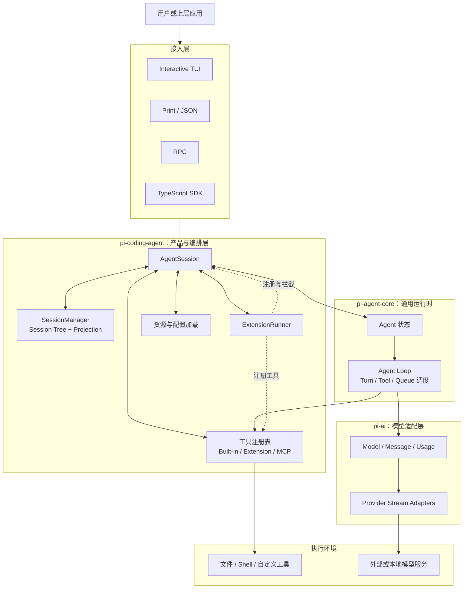
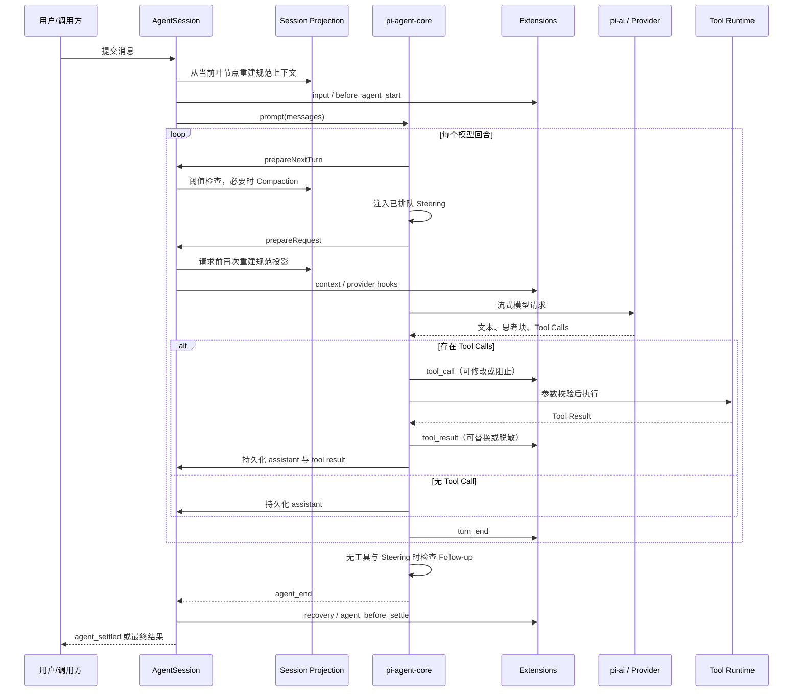
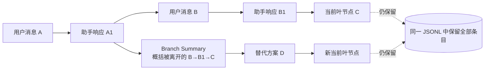
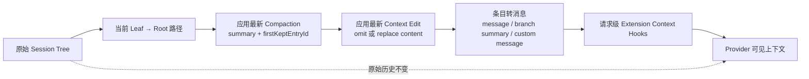

# Pi（earendil-works/pi）Agent Harness 架构调研报告

> 调研对象：[`earendil-works/pi`](https://github.com/earendil-works/pi)  
> 核验分支：`main`  
> 核验提交：[`2ec55d808d455b1a64a2bf7888198207a096120a`](https://github.com/earendil-works/pi/tree/2ec55d808d455b1a64a2bf7888198207a096120a)  
> 对应包版本：`1.3.0`  
> 核验日期：2026-10-19  
> 研究范围：终端 Agent Harness 主链路，即 `pi-ai`、`pi-agent-core`、`pi-coding-agent` 及其直接依赖的 TUI、MCP、CodeMode 能力。

## 1. 结论摘要

Pi 不是一个把工作流、权限审批、子 Agent 和计划模式全部固化好的“全功能 Agent 平台”，而是一个**小内核、强扩展、会话原生的 Agent Harness**。它把通用模型调用、Agent Loop、工具执行、会话持久化、上下文投影、终端交互拆成独立层，再通过 TypeScript Extensions 将策略性能力留给用户和生态。

其最值得关注的设计不是某个入口函数，而是以下四组架构机制：

1. **Session Tree 是事实存储**：会话以追加式 JSONL 保存，每个条目通过 `id/parentId` 形成树；分支切换不会删除旧路径，当前叶节点决定下一次模型请求使用哪条历史。
2. **Context Projection 是模型视图**：原始会话树不直接等于模型上下文。Pi 从当前分支出发，应用最新压缩边界与分支内 `context_edit`，再把条目投影为模型消息；因此“审计历史”和“模型可见历史”被有意识地分离。
3. **Agent Loop 是带双队列的回合调度器**：工具结果驱动连续回合；Steering 在当前 assistant 回合及其工具调用结束后进入下一次请求，Follow-up 仅在 Agent 原本要停止时才进入。
4. **Extensions 是主要策略层**：扩展可注册工具、命令、模型提供商、MCP、虚拟模型、渲染器，并可在输入、上下文、Provider 请求、工具调用、压缩和会话切换等边界介入。代价是扩展与 Pi 同进程、同权限运行，必须视为受信任代码。

综合判断：Pi 很适合需要深度定制、愿意自行定义工作流与安全策略的个人开发者、研究者和 Agent 产品团队；不适合在没有额外隔离与治理层的情况下直接承担强合规、多租户或高风险无人值守执行。

## 2. 调研对象与身份核验

### 2.1 如何确认没有混淆同名项目

本报告仅研究以下对象：

| 识别项 | 已核验结果 |
|---|---|
| 官方仓库 | `https://github.com/earendil-works/pi` |
| 仓库定位 | README 明确定义为 “minimal, extensible agent harness” |
| Monorepo 根包 | `pi-monorepo` |
| NPM 命名空间 | `@earendil-works/*` |
| CLI 包 | `@earendil-works/pi-coding-agent` |
| 通用 Agent 包 | `@earendil-works/pi-agent-core` |
| 统一模型层 | `@earendil-works/pi-ai` |
| 当前核验版本 | `1.3.0`，Node.js `>=22.19.0` |

因此，本报告不讨论 Raspberry Pi、Pi Network，也不把其他组织或个人名下的同名 Agent 项目作为依据。所有源码链接均固定到上述提交，避免 `main` 后续变化导致结论漂移。

证据：仓库 [README 定位](https://github.com/earendil-works/pi/blob/2ec55d808d455b1a64a2bf7888198207a096120a/README.md#L13-L15)、[Monorepo 包列表](https://github.com/earendil-works/pi/blob/2ec55d808d455b1a64a2bf7888198207a096120a/README.md#L72-L85)、[`pi-coding-agent` 包清单](https://github.com/earendil-works/pi/blob/2ec55d808d455b1a64a2bf7888198207a096120a/packages/coding-agent/package.json)。

### 2.2 证据等级

本文使用三类判断：

- **已核验**：可由固定提交下的官方源码、仓库文档或包清单直接确认。
- **架构判断**：由多个已核验事实推导出的设计评价，会明确使用“可视为”“意味着”等措辞。
- **待核验**：需要真实负载、跨平台或第三方扩展测试，不能仅凭静态源码得出。

## 3. 框架定位与总体架构

### 3.1 定位

Pi 的核心定位可以概括为：

> 用统一的模型与工具协议驱动一个可嵌入、可持久化、可扩展的 Agent Loop，并为终端交互提供完整产品外壳。

这里的 “Harness” 比 “Agent 应用” 更准确，因为 Pi 同时提供：

- 可独立复用的 LLM Provider 抽象；
- 通用 Agent 状态机与工具循环；
- 带分支和压缩语义的会话运行时；
- TUI、Print、JSON、RPC、SDK 多种接入面；
- 把策略交给扩展的生命周期和拦截点。

官方明确说明，Pi 默认不内置子 Agent 和 Plan Mode，而是鼓励通过扩展或包按需增加。这表明其设计目标是保持核心机制简洁，而不是提供唯一标准工作流。

### 3.2 模块关系图



### 3.3 核心模块及协作

| 模块 | 主要职责 | 与其他模块的协作方式 |
|---|---|---|
| `@earendil-works/pi-ai` | 统一模型、消息、内容块、流式事件、用量与 Provider API | 为 Agent Loop 提供统一 `stream`/`streamSimple` 边界；具体 Provider 差异在适配层处理 |
| `@earendil-works/pi-agent-core` | Agent 状态、消息循环、工具调用、事件流、Steering/Follow-up 队列 | 不负责磁盘会话和终端 UI；通过回调接收上下文转换、工具前后置处理和下一回合准备 |
| `@earendil-works/pi-coding-agent` | 会话、上下文、压缩、扩展、配置、内置工具、CLI 与 SDK 编排 | 用 `AgentSession` 把 SessionManager、Agent、模型注册表和 ExtensionRunner 组合为完整产品运行时 |
| `@earendil-works/pi-tui` | 终端组件、输入、增量渲染 | 消费 AgentSession 事件，不改变 Agent Loop 的核心语义 |
| `@earendil-works/pi-mcp` | MCP 客户端能力 | MCP 扩展将远端工具注册到统一工具注册表，最终仍走同一工具执行管线 |
| `@earendil-works/pi-codemode` | 在受限 JavaScript 环境中编排已注入工具 | 作为工具编排机制接入；其能力边界由可调用工具集合决定 |
| `pi-telemetry` | 厂商无关的遥测契约 | 为 Provider 与运行时提供观测接口，不承担 Agent 决策 |

主依赖方向是 `pi-coding-agent → pi-agent-core → pi-ai`；TUI、MCP、CodeMode 是 `pi-coding-agent` 的直接能力组件。[包依赖关系](https://github.com/earendil-works/pi/blob/2ec55d808d455b1a64a2bf7888198207a096120a/packages/coding-agent/package.json) 与 [Agent Core 包清单](https://github.com/earendil-works/pi/blob/2ec55d808d455b1a64a2bf7888198207a096120a/packages/agent/package.json) 支持这一判断。

`chord`、`pi-durable`、`pi-env` 也位于同一仓库，但不是终端 Coding Agent 每次请求的必要主链路。本报告将其视为相邻运行时能力，不据此推断 Pi CLI 已天然具备分布式任务编排或远程持久执行语义。

## 4. Agent Loop 运行机制

### 4.1 两层循环

Pi 的执行不是一个简单的“用户输入 → 模型输出”函数，而是两层循环：

- **内层回合循环**：模型输出工具调用后，执行工具并把结果加入上下文，再发起下一次模型请求；Steering 也在这个循环的回合边界进入。
- **外层收尾循环**：当工具调用和 Steering 都耗尽、Agent 原本准备停止时，再检查 Follow-up；若存在则重新进入内层循环。

低层循环源码见 [`runLoop()`](https://github.com/earendil-works/pi/blob/2ec55d808d455b1a64a2bf7888198207a096120a/packages/agent/src/agent-loop.ts#L163-L320)。

### 4.2 一次运行的关键路径



### 4.3 关键调度语义

1. **请求前上下文不是沿用内存快照**：`AgentSession` 在每个 Provider 请求前调用 `buildSessionProjection()`，确保压缩、上下文编辑和会话变更已反映到模型视图；源码见 [`_installAgentRequestProjection()`](https://github.com/earendil-works/pi/blob/2ec55d808d455b1a64a2bf7888198207a096120a/packages/coding-agent/src/core/agent-session.ts#L788-L844)。
2. **工具调用构成一个 turn 的一部分**：一个 turn 是 assistant 响应加其工具执行与结果，而不是单次 Provider 流结束即完成。
3. **工具结果自然触发下一回合**：只要 assistant 发出工具调用且工具批次未要求终止，循环就继续。
4. **截断的工具参数不会执行**：若 assistant 因 `stopReason: "length"` 截断，Pi 将该响应中的工具调用全部转为错误结果，避免执行可能被截断但仍能通过 JSON 解析的参数。[对应保护逻辑](https://github.com/earendil-works/pi/blob/2ec55d808d455b1a64a2bf7888198207a096120a/packages/agent/src/agent-loop.ts#L258-L277)。
5. **`agent_end` 不一定等于全局空闲**：上层还可能执行溢出恢复、自动压缩、重试或队列续跑。扩展若需要“所有自动处理均停止”的信号，应使用 `agent_settled`，而不是仅监听 `agent_end`。

## 5. 特色机制深度分析

### 5.1 Session Tree：把对话历史变成可导航状态空间

#### 数据模型

持久化会话是 JSONL 文件。除首行 Header 外，每个条目至少具有：

```text
type + id + parentId + timestamp
```

`parentId` 将追加的条目连接成树。当前 `leafId` 决定活动路径；`getBranch()` 从叶节点沿父指针回溯到根，再反转为请求顺序。[条目基础类型](https://github.com/earendil-works/pi/blob/2ec55d808d455b1a64a2bf7888198207a096120a/packages/coding-agent/src/core/session-manager.ts#L43-L62) 与 [`getBranch()`](https://github.com/earendil-works/pi/blob/2ec55d808d455b1a64a2bf7888198207a096120a/packages/coding-agent/src/core/session-manager.ts#L1464-L1479) 已直接核验。



#### 分支操作的语义

- `/tree`：只移动当前会话文件中的叶指针；下一次追加会成为目标条目的新子节点。
- `/fork`：从历史位置创建新的会话文件，适合把替代方向分离出去。
- `/clone`：把当前活动分支复制为新会话。
- `branchWithSummary()`：移动到目标位置后追加一个 `branch_summary`，把离开路径中的重要信息带到新分支。

`branch()` 只改变叶指针，不改写或删除旧条目；这一点由 [`SessionManager.branch()`](https://github.com/earendil-works/pi/blob/2ec55d808d455b1a64a2bf7888198207a096120a/packages/coding-agent/src/core/session-manager.ts#L1573-L1584) 明确保证。

#### 架构价值

Session Tree 的价值不只是“可以回到旧消息”，而是同时满足：

- **可探索性**：不同方案可以留在同一任务的状态空间内；
- **可追溯性**：旧分支未被覆盖，导出和调试仍能检查；
- **分支局部状态**：模型选择、思考等级、扩展状态和上下文编辑都可以沿活动路径重建；
- **低迁移成本**：存储仍是易检查、易导出的 JSONL，而不是专用数据库。

#### 边界与代价

- 模型只看到活动分支，不会自动比较所有分支；跨分支知识需要 Branch Summary 或显式注入。
- 树越来越大时，原始文件会持续增长；上下文虽可压缩，但磁盘历史并未被压缩删除。
- Branch Summary 是语义压缩，可能遗漏离开分支的细节；原始条目仍在，但后续模型默认不会读取它们。
- JSONL 的简单性有利于透明度，但大型会话的加载、索引和崩溃一致性仍需实测，不能仅凭结构推断其规模上限。

### 5.2 Compaction 与 Context Projection：事实历史和模型历史分离

#### 规范投影管线

Pi 当前版本将上下文构建分为三个概念层：

1. **Raw Session Tree**：追加式、可审计的原始条目。
2. **Context Entries**：沿当前叶节点取路径，并应用最新 Compaction 的保留边界。
3. **Session Projection**：对选中条目应用当前分支上的最新 `context_edit`，再转换为模型可见消息，同时保留来源条目映射。



`buildContextEntries()` 负责最新压缩边界选择；`buildSessionProjection()` 建立 `sourceEntry → messages` 的来源保持映射，并应用每个目标的最新编辑。源码见 [`buildContextEntries()`](https://github.com/earendil-works/pi/blob/2ec55d808d455b1a64a2bf7888198207a096120a/packages/coding-agent/src/core/session-manager.ts#L468-L512) 与 [`buildSessionProjection()`](https://github.com/earendil-works/pi/blob/2ec55d808d455b1a64a2bf7888198207a096120a/packages/coding-agent/src/core/session-manager.ts#L519-L582)。

#### Compaction 如何工作

自动压缩的触发条件是：

```text
contextTokens > contextWindow - reserveTokens
```

默认 `reserveTokens` 为 16384，默认保留最近 `keepRecentTokens` 为 20000，可按模型覆盖。高层步骤为：

1. 从规范投影的尾部向前估算，寻找合法切点；
2. 将旧区间序列化并生成结构化摘要；
3. 追加 `CompactionEntry`，记录 `summary`、`firstKeptEntryId`、`tokensBefore` 和完整系统提示/工具检查点；
4. 下一次投影用“摘要 + 保留的近期消息”代替更早历史；
5. 重复压缩时带入前一次摘要，实现迭代更新。

切点不会落在孤立的 tool result 上，避免把工具结果与对应 tool call 拆开。若单个用户消息跨度本身过大，Pi 可在 assistant 边界拆分，并分别总结更早历史与该跨度的前缀。实现入口见 [`prepareCompaction()`](https://github.com/earendil-works/pi/blob/2ec55d808d455b1a64a2bf7888198207a096120a/packages/coding-agent/src/core/compaction/compaction.ts#L859-L923) 和 [`compact()`](https://github.com/earendil-works/pi/blob/2ec55d808d455b1a64a2bf7888198207a096120a/packages/coding-agent/src/core/compaction/compaction.ts#L952-L1056)。

#### `context_edit` 的意义

`context_edit` 是追加式的上下文改写：

- `replacement: null`：从未来模型上下文中省略目标消息；
- 非空 replacement：只替换目标消息的内容，不改角色、来源和原始条目；
- 同一目标有多次编辑时，活动分支上最新编辑生效；
- 切换到编辑发生之前的分支位置时，原始贡献重新可见。

这使 Pi 能在不破坏审计历史、UI、导出和用量记录的前提下，修复溢出尝试、移除噪声或替换模型可见内容。[`ContextEditEntry` 定义](https://github.com/earendil-works/pi/blob/2ec55d808d455b1a64a2bf7888198207a096120a/packages/coding-agent/src/core/session-manager.ts#L167-L180) 已核验。

#### 为什么这是 Pi 的核心设计

从架构上看，Pi 把“会话事实”与“当前模型工作集”分开：

- 会话树负责追溯、分支和恢复；
- Projection 负责当前模型到底看到什么；
- Compaction 是持久化的窗口重写；
- Extension `context` hook 是单次请求级变换，不自动成为会话事实。

这种分离让压缩、撤回式上下文修复、分支局部编辑和原始记录保留能够共存，是 Pi 相比线性聊天日志更有辨识度的能力。

#### 风险

- 摘要是有损表示，错误或遗漏会影响后续决策；保留原始历史并不意味着模型会自动恢复细节。
- 压缩需要额外模型调用，会增加延迟和成本，也可能因 Provider 限制而失败。
- Token 估算、Provider 返回的 usage、图片与工具输出都可能让阈值判断存在偏差；Pi 为此提供溢出后的 compact-and-retry，但不能保证所有兼容端点都返回可识别的溢出错误。
- 持久化 Projection 与请求级扩展变换同时存在时，扩展作者必须清楚自己修改的是“会话事实”还是“本次请求视图”。

### 5.3 Steering 与 Follow-up：运行中输入的双队列模型

Pi 对运行中的新消息提供两个不同语义的队列：

| 队列 | 注入时机 | 适合场景 |
|---|---|---|
| Steering | 当前 assistant 回合及其工具调用完成后、下一次模型请求前 | 修正方向、追加约束、阻止继续沿错误方向推理 |
| Follow-up | 工具调用与 Steering 均已耗尽，Agent 原本要停止时 | 排队后续任务，不打乱当前任务的自然收尾 |

两个队列默认都是 `one-at-a-time`，也可设为 `all`。Agent 类中的队列与默认模式见 [`Agent` 构造和队列 API](https://github.com/earendil-works/pi/blob/2ec55d808d455b1a64a2bf7888198207a096120a/packages/agent/src/agent.ts#L188-L305)。

需要特别注意：**Steering 不是对正在执行工具的抢占式中断**。低层循环在工具批次完成并触发 `turn_end` 后才再次拉取 Steering；若要立即停止当前操作，应使用 abort。Steering 的优势是保持工具调用和结果成对、会话事件顺序稳定，同时允许用户在长任务中持续纠偏。

调度优先级可以简化为：

```text
当前回合工具结果
→ Steering
→ 扩展请求的显式 continuation
→ Follow-up
→ 结束
```

其中显式 continuation 可被工具结果或 Steering 自然满足，不会无条件多发一次请求。实际循环顺序见 [`runLoop()` 的队列处理](https://github.com/earendil-works/pi/blob/2ec55d808d455b1a64a2bf7888198207a096120a/packages/agent/src/agent-loop.ts#L174-L318)。

### 5.4 Extensions：把策略从核心中抽离

#### 扩展能力面

扩展是加载进 Pi 进程的 TypeScript/JavaScript 模块。工厂函数接收 `ExtensionAPI`，可注册：

- 生命周期事件处理器；
- 模型可调用工具；
- Slash Command、快捷键和 CLI Flag；
- Provider、MCP Server、Virtual Model；
- 自定义消息、持久状态和分支局部状态；
- TUI 组件、消息/条目/工具渲染器；
- Context、Provider 请求、工具调用与结果的变换或拦截。

完整 API 面可见 [`ExtensionAPI`](https://github.com/earendil-works/pi/blob/2ec55d808d455b1a64a2bf7888198207a096120a/packages/coding-agent/src/core/extensions/types.ts#L1589-L1765)。

#### 生命周期与组合语义

Extensions 的关键不只是“可注册工具”，而是具有明确的事件边界：

```text
input
→ before_agent_start
→ agent_start
→ turn_start
→ context / context_with_system
→ provider hooks
→ message stream
→ tool_call
→ tool execution
→ tool_result
→ turn_end
→ agent_end
→ agent_before_settle
→ agent_settled
```

处理器按扩展加载和注册顺序运行。不同事件采用不同组合规则：通知、链式变换、原位修改、Gate、最后覆盖或可执行边界。工具授权属于 Gate：`tool_call` 可修改参数或返回 `block`；失败时 Pi 采取 fail-closed，阻止工具执行。`tool_result` 可替换、脱敏或重新标记错误结果。

#### 工具暴露模型

工具不是简单的“注册即全部展示给模型”。`ToolExposure` 支持：

- `direct`：激活时直接声明给模型，也可被其他工具调用；
- `model-only`：只允许模型直接调用；
- `codemode`：不直接占用模型工具列表，由 CodeMode 脚本调用；
- `deferred`：由工具搜索发现并激活；
- `hidden`：已注册但不可达。

这套设计允许大型工具生态减少 Provider 请求中的工具声明体积，也允许工具编排器动态控制模型可见工具。[暴露类型与工具定义](https://github.com/earendil-works/pi/blob/2ec55d808d455b1a64a2bf7888198207a096120a/packages/coding-agent/src/core/extensions/types.ts#L516-L638) 已核验。

#### 状态与会话协作

扩展可以选择不同状态载体：

- Tool Result `details`：与活动分支一起重建的工具状态；
- `appendEntry()`：持久化但不进入模型上下文；
- `sendMessage()`：持久化且进入上下文；
- 外部存储：跨会话数据。

正确做法是从 `sessionManager.getBranch()` 重建分支敏感状态，而不是扫描整个文件后把废弃分支混入当前状态。会话切换或 reload 会替换扩展运行时，旧上下文不应继续使用。

#### 架构评价

Extensions 让 Pi 核心保持小而稳定，同时允许在不 fork 主仓库的情况下增加权限审批、远程执行、专用工具、上下文策略和 UI。代价是：

- 扩展 API 面较大，生命周期和组合顺序需要严格理解；
- 扩展与核心同进程，错误、阻塞和资源泄漏可能直接影响主程序；
- 扩展能接触提示词、工具参数、文件、凭据与会话历史，安全审查成本高；
- 深度依赖内部事件时，升级兼容性需要持续验证。

## 6. 工具执行管线与安全边界

### 6.1 工具执行管线

Pi 的默认启动工具是 `read`、`bash`、`edit`、`write`；完整内置集合还包括 `powershell`、`grep`、`find`、`ls`。默认列表见 [`DEFAULT_TOOL_NAMES`](https://github.com/earendil-works/pi/blob/2ec55d808d455b1a64a2bf7888198207a096120a/packages/coding-agent/src/core/settings-manager.ts#L84-L85)，工具工厂见 [`tools/index.ts`](https://github.com/earendil-works/pi/blob/2ec55d808d455b1a64a2bf7888198207a096120a/packages/coding-agent/src/core/tools/index.ts#L93-L223)。

模型发出工具调用后，主执行路径为：

1. 按名称解析工具；
2. 兼容性预处理参数；
3. 按 TypeBox/JSON Schema 校验参数；
4. 执行 `beforeToolCall` / Extension `tool_call`；
5. 若未阻止，则调用工具 `execute()`；
6. 捕获异常并转换为错误 Tool Result；
7. 执行 `afterToolCall` / Extension `tool_result`；
8. 发出执行事件并把 Tool Result 追加到会话；
9. Tool Result 作为下一回合模型输入的一部分。

参数校验和阻断逻辑见 [`prepareToolCall()`](https://github.com/earendil-works/pi/blob/2ec55d808d455b1a64a2bf7888198207a096120a/packages/agent/src/agent-loop.ts#L708-L777)，执行和结果后处理见 [`executePreparedToolCall()` 与 `finalizeExecutedToolCall()`](https://github.com/earendil-works/pi/blob/2ec55d808d455b1a64a2bf7888198207a096120a/packages/agent/src/agent-loop.ts#L821-L909)。

### 6.2 并行与一致性

工具默认并行执行；全局可切为串行，任何一个工具声明 `executionMode: "sequential"` 时，该批次也会串行。并行模式先依次完成工具查找、参数校验和安全前置处理，再并发执行允许的调用；最终 Tool Result 按 assistant 原始调用顺序写回。[并行/串行选择](https://github.com/earendil-works/pi/blob/2ec55d808d455b1a64a2bf7888198207a096120a/packages/agent/src/agent-loop.ts#L508-L659) 已核验。

内置 `edit` 与 `write` 使用按规范化文件路径建立的 mutation queue：同一文件的修改串行，不同文件仍可并行。这降低了并发工具调用覆盖同一文件的风险，但不能替代跨文件事务或版本控制。[文件修改队列](https://github.com/earendil-works/pi/blob/2ec55d808d455b1a64a2bf7888198207a096120a/packages/coding-agent/src/core/tools/file-mutation-queue.ts#L1-L55)。

### 6.3 安全边界：哪些是，哪些不是

| 机制 | 能做什么 | 不能做什么 |
|---|---|---|
| Tool Schema | 阻止结构不合法的参数直接进入工具 | 不能判断合法参数代表的操作是否安全 |
| `tool_call` Hook | 实现审批、路径策略、命令过滤、审计 | 默认并未自动提供完整权限系统 |
| Tool Annotations | 提示只读、破坏性、幂等、开放世界属性 | 只是声明性提示，不由 Pi 自动验证真实性 |
| Project Trust | 在批准前阻止大部分项目设置、扩展和资源自动加载 | 不限制工具访问范围；也不把已加载内容变成安全内容 |
| Working Directory | 决定资源发现和工具默认路径 | 不是文件系统沙箱，命令仍可访问进程有权访问的其他路径 |
| AbortSignal | 协作式取消 Provider、工具和扩展工作 | 不能保证所有外部进程或第三方扩展立即、彻底停止 |
| 容器/VM/沙箱 | 形成真正的 OS/虚拟化访问边界 | 仍需控制挂载的文件、凭据和网络 |

官方明确说明：Pi **没有内置的文件系统、进程、网络或凭据权限系统**，默认以启动它的用户和进程权限运行；扩展也在同一权限域内。[README 安全声明](https://github.com/earendil-works/pi/blob/2ec55d808d455b1a64a2bf7888198207a096120a/README.md#L88-L98) 与 [安全文档](https://github.com/earendil-works/pi/blob/2ec55d808d455b1a64a2bf7888198207a096120a/packages/coding-agent/docs/security.md) 对此表述一致。

因此，企业或无人值守场景至少应增加：

- 容器、虚拟机或策略沙箱；
- 最小化挂载目录和网络出口；
- 短期、最小权限凭据；
- 独立权限扩展或外部审批网关；
- 版本控制、快照、审计日志与会话脱敏。

## 7. 技术边界

### 已核验边界

1. **Pi CLI 的主会话存储是本地 JSONL**，不是默认分布式数据库。
2. **活动分支决定模型历史**，其他分支不会自动进入请求。
3. **Compaction 不删除原始条目**，只是改变未来上下文投影。
4. **Extensions 是进程内插件**，不具备天然故障和权限隔离。
5. **项目信任不是工具沙箱**，拒绝信任也不等于忽略所有项目文本指令；例如上下文文件仍可能被加载。
6. **多种界面共享同一 Agent 与 Session 机制**，但 TUI 专属交互并不自动适用于 Print/JSON，RPC 只转发其协议支持的 UI 能力。
7. **核心默认不提供子 Agent 与 Plan Mode**，需要用户通过扩展、包或上层应用实现。

### 架构判断

- Pi 更像“可编程 Agent 操作系统内核 + 终端发行版”，而不是规定好组织流程的 SaaS Agent。
- Session Tree 和 Projection 让它特别适合探索式任务，但也把一致性责任从线性历史转移到“当前分支 + 摘要 + 编辑”的组合语义上。
- Extensions 的高能力与高权限是同一设计的两面：它同时构成 Pi 最大的可塑性来源和最大的供应链/运行时风险面。

## 8. 优点、缺点与适用场景

### 8.1 主要优点

| 优点 | 架构原因 |
|---|---|
| 分支探索自然 | 会话原生为树，回到历史位置不会覆盖旧路径 |
| 上下文治理透明 | Compaction、Branch Summary、Context Edit 都是显式持久化条目 |
| 审计历史与模型视图可分离 | 原始条目保留，Projection 决定当前模型工作集 |
| 核心可复用 | Provider、Agent Loop、Coding Agent 产品层相互解耦 |
| 扩展能力完整 | 从输入到 Provider、工具、会话和 UI 都有明确 Hook |
| 接入方式丰富 | TUI、Print、JSON、RPC、SDK 共享核心语义 |
| 工具循环有防御性 | 参数校验、截断工具调用拒绝执行、前后置 Hook、错误结果化 |

### 8.2 主要缺点

| 缺点 | 实际影响 |
|---|---|
| 默认安全边界弱 | 直接运行时拥有当前用户权限，需要外部隔离才能用于高风险任务 |
| 扩展同进程、同权限 | 第三方扩展可读取敏感上下文，也可能阻塞或破坏主运行时 |
| 压缩有语义损失 | 长任务可能因摘要遗漏而偏离，即使原始历史仍在磁盘中 |
| 生命周期复杂 | 深度扩展必须理解 turn、run、settlement、session replacement 等多个边界 |
| 本地会话持续增长 | 模型上下文缩小不代表会话文件缩小，大规模性能需实测 |
| 策略能力不默认提供 | 权限审批、子 Agent、计划模式和组织治理需要自行组合 |
| Provider 差异只能被抽象、不能被消除 | 不同模型对工具、系统消息、缓存、思考内容和错误的支持仍有差异 |

### 8.3 适合场景

- 个人或小团队需要高度可定制的终端 Coding/Research Agent；
- 需要保留多个探索分支、回到历史节点继续工作的复杂任务；
- 希望用 TypeScript SDK 嵌入 Agent，并复用成熟的会话与工具循环；
- 需要开发定制 Provider、MCP、权限 Hook、上下文策略或 TUI；
- 研究 Agent Harness、上下文工程和会话持久化机制。

### 8.4 不宜直接使用的场景

- 未增加沙箱、审批与审计层的生产级无人值守运维；
- 多租户、强隔离、强合规环境；
- 要求默认内置固定企业工作流、RBAC、策略中心和审批链的组织；
- 要求会话天然具备分布式事务、跨节点故障恢复或服务端协同编辑的系统；
- 无法持续维护扩展兼容性、但又高度依赖深层 Hook 的长期产品。

## 9. 已核验与待核验清单

### 9.1 已核验

| 项目 | 结论 | 依据 |
|---|---|---|
| 仓库与包身份 | 官方仓库为 `earendil-works/pi`，核心包使用 `@earendil-works` 命名空间 | README、package manifests、Git remote |
| 核心分层 | `pi-coding-agent → pi-agent-core → pi-ai` | 包依赖与源码导入 |
| Session Tree | JSONL 条目以 `id/parentId` 形成树，当前叶决定活动分支 | `session-manager.ts` |
| Context Projection | 最新 Compaction 选择上下文范围，最新分支内 Context Edit 改变模型视图 | `buildContextEntries()`、`buildSessionProjection()` |
| Compaction | 摘要旧历史、保留近期消息、原始条目不删除 | `compaction.ts`、官方文档 |
| Steering/Follow-up | 两个独立队列，分别在回合边界和自然停止点注入 | `agent.ts`、`agent-loop.ts` |
| Tool Pipeline | Schema 校验、Hook、执行、结果后处理；默认并行 | `agent-loop.ts` |
| Extensions | 进程内注册工具、事件、Provider、MCP、消息、UI 等 | `extensions/types.ts`、`runner.ts` |
| 安全边界 | 无默认 OS 级权限隔离，Project Trust 不是沙箱 | README、`security.md` |

### 9.2 待核验

以下内容未做运行时或压测验证，不应视为本报告已经证明：

- Windows、macOS、Linux 上所有内置工具和取消语义的一致性；
- 各 Provider 在超长上下文、工具调用截断、缓存和溢出错误下的完整兼容性；
- 超大 Session Tree 的启动时间、内存占用、导出性能和异常中断恢复能力；
- Compaction 在真实长期任务中的信息保持率和任务成功率影响；
- 第三方 Extensions、Pi Packages 和 MCP Servers 的安全性与版本兼容性；
- `pi-durable` 在具体部署环境中的持久执行、幂等和故障恢复保证；
- 官方 `main` 在本报告固定提交之后的 API、存储格式或默认行为变化。

## 10. 参考资料

### 官方概览与文档

- [Pi 仓库 README](https://github.com/earendil-works/pi/blob/2ec55d808d455b1a64a2bf7888198207a096120a/README.md)
- [How Pi Works](https://github.com/earendil-works/pi/blob/2ec55d808d455b1a64a2bf7888198207a096120a/packages/coding-agent/docs/how-pi-works.md)
- [Sessions and Context](https://github.com/earendil-works/pi/blob/2ec55d808d455b1a64a2bf7888198207a096120a/packages/coding-agent/docs/sessions.md)
- [Session File Format](https://github.com/earendil-works/pi/blob/2ec55d808d455b1a64a2bf7888198207a096120a/packages/coding-agent/docs/session-format.md)
- [Compaction Reference](https://github.com/earendil-works/pi/blob/2ec55d808d455b1a64a2bf7888198207a096120a/packages/coding-agent/docs/compaction.md)
- [Extensions](https://github.com/earendil-works/pi/blob/2ec55d808d455b1a64a2bf7888198207a096120a/packages/coding-agent/docs/extensions.md)
- [Security](https://github.com/earendil-works/pi/blob/2ec55d808d455b1a64a2bf7888198207a096120a/packages/coding-agent/docs/security.md)
- [SDK](https://github.com/earendil-works/pi/blob/2ec55d808d455b1a64a2bf7888198207a096120a/packages/coding-agent/docs/sdk.md)

### 核心源码

- [Agent Loop](https://github.com/earendil-works/pi/blob/2ec55d808d455b1a64a2bf7888198207a096120a/packages/agent/src/agent-loop.ts)
- [Agent 状态与消息队列](https://github.com/earendil-works/pi/blob/2ec55d808d455b1a64a2bf7888198207a096120a/packages/agent/src/agent.ts)
- [Agent Core 类型与工具契约](https://github.com/earendil-works/pi/blob/2ec55d808d455b1a64a2bf7888198207a096120a/packages/agent/src/types.ts)
- [AgentSession 编排层](https://github.com/earendil-works/pi/blob/2ec55d808d455b1a64a2bf7888198207a096120a/packages/coding-agent/src/core/agent-session.ts)
- [SessionManager 与 Context Projection](https://github.com/earendil-works/pi/blob/2ec55d808d455b1a64a2bf7888198207a096120a/packages/coding-agent/src/core/session-manager.ts)
- [Compaction 实现](https://github.com/earendil-works/pi/blob/2ec55d808d455b1a64a2bf7888198207a096120a/packages/coding-agent/src/core/compaction/compaction.ts)
- [Branch Summarization](https://github.com/earendil-works/pi/blob/2ec55d808d455b1a64a2bf7888198207a096120a/packages/coding-agent/src/core/compaction/branch-summarization.ts)
- [Extension API 类型](https://github.com/earendil-works/pi/blob/2ec55d808d455b1a64a2bf7888198207a096120a/packages/coding-agent/src/core/extensions/types.ts)
- [Extension Runner](https://github.com/earendil-works/pi/blob/2ec55d808d455b1a64a2bf7888198207a096120a/packages/coding-agent/src/core/extensions/runner.ts)
- [内置工具注册](https://github.com/earendil-works/pi/blob/2ec55d808d455b1a64a2bf7888198207a096120a/packages/coding-agent/src/core/tools/index.ts)

---

本报告的所有确定性结论均以固定提交为准；若用于技术选型，建议在评审时同时检查最新 release、变更日志和目标扩展的兼容性。
