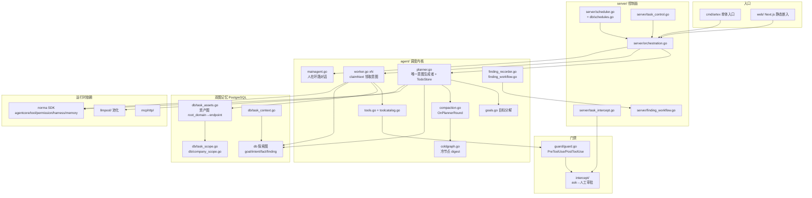

# ARTEX · 代码模块拓扑（代码视角）

> 依据：`01-competitors/ARTEX.md` + `_trees/ARTEX.json`；仅模块/调用关系。不含利用步骤。

## 说明

1. **Planner–Worker**：`planner.go` 跨唤醒共享 `TodoStore`，串行派发利用链步骤；worker 经 `claimNext` 领取。
2. **双图**：资产图全局共享，探索图每任务独立，靠血缘边与 `exploration_anchors` 锚定。
3. **冷压缩**：`compaction.go` + `coldgraph.go` 在每 planner 轮打冷/热戳，阈值 N=20 / M=8 触发 LLM digest。
4. **门禁**：`guard/guard.go` allow/deny/ask；ask 失败或超时 block（平台管控文案）。
5. **日历调度**：`server/scheduler.go` + `db/schedules.go` 负责任务级定时，非 Agent 内循环。
6. 深度能力在外部 **norma SDK**；本仓可见层是 Go 封装与双图存储。
