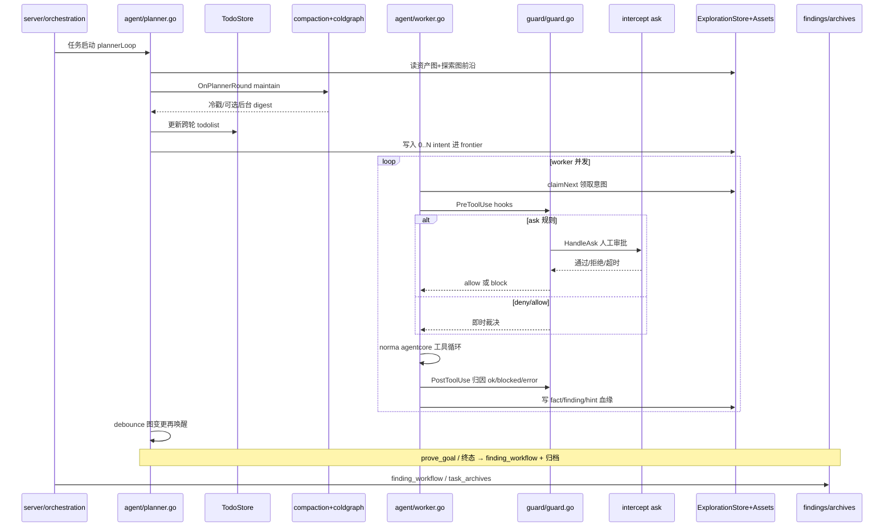

# ARTEX · 代码时序（代码视角）

> 依据：`01-competitors/ARTEX.md` + `_trees/ARTEX.json`。调度/门禁视角。

## 说明

1. 闭环驱动：**图变更 debounce → planner → frontier → worker**，非 LangGraph 节点边。
2. 门禁落在 **工具钩子**（Pre/PostToolUse），审批超时 fail-closed。
3. 压缩与调度同拍：每 planner 轮先 `maintain`，再可能后台 LLM 压冷子图。
4. 产物：探索图节点 + findings 工作流 + 可选 task archive 包。
5. worker 终态 `done/exhausted/blocked`；planner 可 `kill_work/steer_work`。
