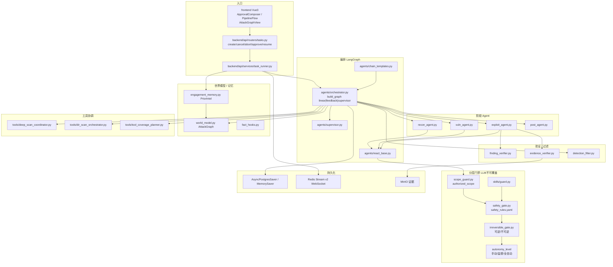

# AuroraRecon · 代码模块拓扑（代码视角）

> 依据：`01-competitors/AuroraRecon.md` + `_trees/AuroraRecon.json`；仅模块/调用关系。不含利用步骤。

## 说明

1. **三种图模式**由 `ATTACK_CHAIN_MODE` 切换：`_build_graph_linear|feedback|supervisor`。
2. HITL：`interrupt_before=["human_approval","post_foothold_approval"]` + Postgres checkpointer。
3. 门禁四件套：**scope_guard → safety_gate YAML → irreversible_gate → autonomy_level**，确定性规则优先于 LLM。
4. 世界模型 `AttackGraph` 承载 host/service/finding/credential…；跨任务 `PriorIntel` 只注存在性不注明文。
5. Skill 引擎：确定性步骤优先，失败再 ReAct；草案需人工 promote。
6. 急停 `POST .../abort` + 容器清理；节点 `@retry_node` 最多 3 次。
