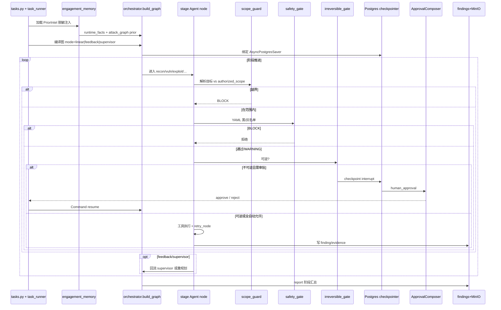

# AuroraRecon · 代码时序（代码视角）

> 依据：`01-competitors/AuroraRecon.md` + `_trees/AuroraRecon.json`。

## 说明

1. 入口先注入 **跨任务 prior**，再编译 Kill-Chain 图。
2. 每次工具前过 **scope → safety YAML → irreversible**；LLM 不能覆盖 YAML 黑名单。
3. 不可逆动作走 **interrupt + UI 审批 + resume**；autonomous 仅自动放行可逆类。
4. checkpointer 使取消/恢复/聊天续跑成为一等能力。
5. 产物：AttackGraph 状态、findings、MinIO 证据对象。
