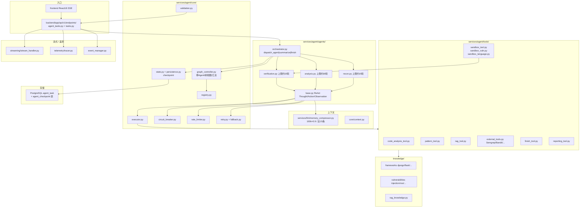

# DeepAudit · 代码模块拓扑（代码视角）

> 依据：`01-competitors/DeepAudit.md` + `_trees/DeepAudit.json`；SAST 向多 Agent。

## 说明

1. 拓扑：**OrchestratorAgent → Recon / Analysis / Verification**，统一 `BaseAgent` ReAct。
2. `TaskHandoff` 结构化交接；`AgentGraphController` 管停树、用户指令、findings 汇总。
3. 压缩：`MemoryCompressor` 阈值总 token>100k×0.9，保留 system+近15，旧消息变 `<context_summary>`。
4. 工程门：熔断、令牌桶限流、指数退避、迭代 checkpoint、最大 findings。
5. Verification + **sandbox_*** 工具做误报抑制/PoC 级验证（审计场景）。
6. 缺 Aurora 式 scope/不可逆分级——主战场是读代码审计。
