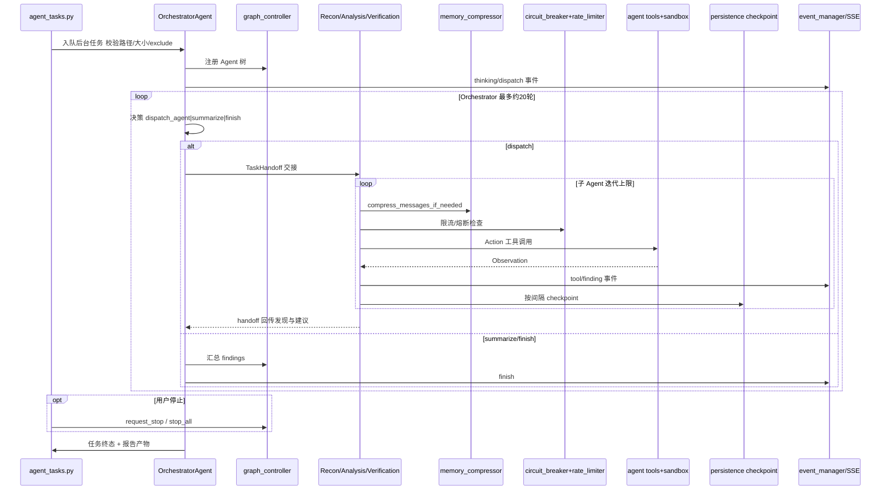

# DeepAudit · 代码时序（代码视角）

> 依据：`01-competitors/DeepAudit.md` + `_trees/DeepAudit.json`。

## 说明

1. 调度是 **Orchestrator ReAct 派生子 Agent**，非子图 LangGraph（文档称自研 graph_controller）。
2. 每层有迭代上限；checkpoint 支持恢复查询。
3. 压缩在 BaseAgent 回合内触发，与熔断/限流并列。
4. 门禁偏资源与输入校验 + Verification 降误报，非进攻 bash 审批。
5. SSE 事件模型：thinking_token / tool / finding / dispatch 驱动前端。
