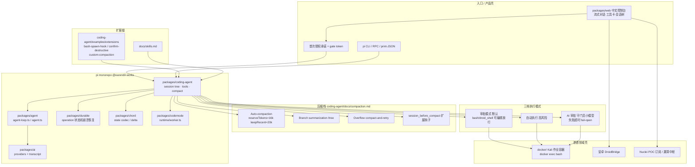

# Full-Chain-Sentinel-System · 代码模块拓扑（代码视角）

> 依据：`01-competitors/Full-Chain-Sentinel-System.md` + `_trees/Full-Chain-Sentinel-System.json`。pi fork + 渗透壳。

## 说明

1. 内核是 **pi harness**：prompt→model→tools→compact→resume；默认无内建 sub-agent/plan mode。
2. 产品差异在 **Web 壳 + Kali 容器 + 三档审批**；包名仍 `@earendil-works/*`。
3. 压缩工业文档在 `packages/coding-agent/docs/compaction.md`；会话 JSONL = 审计真相源。
4. 审批链覆盖 bash/droid_shell；**不覆盖** read/edit/write、MCP、抓包等直连工具（README 已声明）。
5. AI 审批 **fail-open**；容器 root、无 seccomp——非整体沙箱。
6. Docker 检查失败则拒绝 prompt/compact/持续目标。
