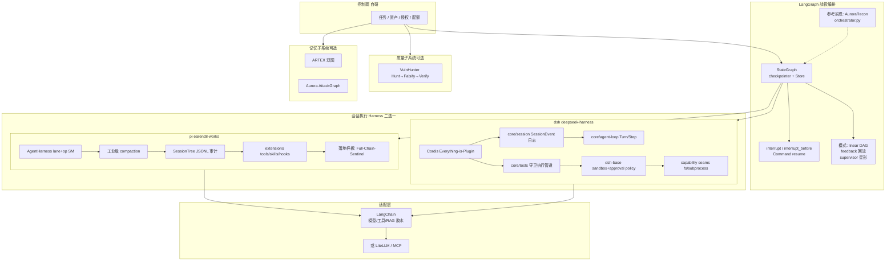

# 框架对比 · 代码模块拓扑（代码视角）

> 依据：`02-frameworks/pi-dsh-langchain-langgraph.md`。Harness vs 编排运行时选型图。

## 说明

1. **推荐组合**：LangGraph 管阶段与审批 interrupt；pi 或 dsh 管子会话 tool loop 与压缩；LangChain/LiteLLM 做适配。
2. pi：极简可扩展，默认弱多 Agent；压缩与会话树成熟（Sentinel 已验证嵌入）。
3. dsh：插件 OS + 会话日志为真相源；sandbox/approval 一等插件；学习曲线高。
4. LangChain：勿当战役调度器；HITL middleware 仍依赖 Graph checkpointer。
5. 论文 2608.23953：harness 收敛五要素，共同缺口 **external verifiability**——正好对接 VulnHunter 质量子系统。
6. 本图为选型拓扑，非单一仓库路径。
