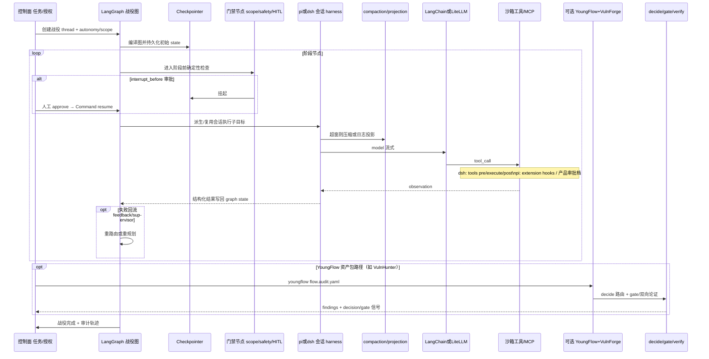

# 框架对比 · 代码时序（代码视角）

> 依据：`02-frameworks/pi-dsh-langchain-langgraph.md`。推荐栈一次战役回合时序。

## 说明

1. **Graph 管阶段与 HITL**；**Harness 管单会话 tool loop/压缩/审计日志**——职责分离。
2. dsh Turn 流：`turn/start → pre-step → request → tool/call* → turn/end`，瀑布须 `next()`。
3. pi：lane + operation 状态机；overflow 时 compact-and-retry。
4. 门禁应尽量落在 Graph 确定性节点或 harness 策略插件，避免只靠 prompt。
5. 质量门：VulnForge 用独立 stage（verify）+ gate 文件；YoungFlow 按 stage 隔离 pi session（可 session.reuse）。
6. YoungFlow 与「LangGraph 控制面自建」可二选一，避免双编排叠床架屋。
