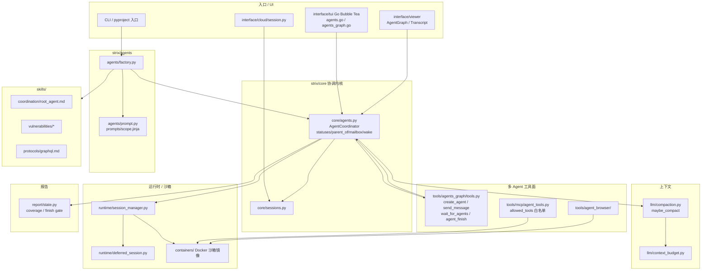

# strix · 代码模块拓扑（代码视角）

> 依据：`01-competitors/strix.md` + `_trees/strix.json`；仅模块/调用关系。

## 说明

1. **AgentCoordinator**（`core/agents.py`）是图心脏：statuses / parent_of / mailbox / wake Event。
2. 子 Agent 经 `tools/agents_graph/tools.py` 派生；Root 用 `finish_scan`，子用 `agent_finish` 回父 inbox。
3. **安全压缩**：`compaction.py` 产出 `<conversation-checkpoint>`，模板强制保留 Findings/Credentials，禁止合并去重发现。
4. **预算门**：`budget_paused/stopped` + `test_budget_pause_policy.py`；完成门 `finish_coverage_gate`。
5. 执行面在 **Docker 沙箱** + MCP `allowed_tools`；无 Aurora 级不可逆分级默认链。
6. Skills 建议每子 Agent 挂 1–3 个专家技能。
