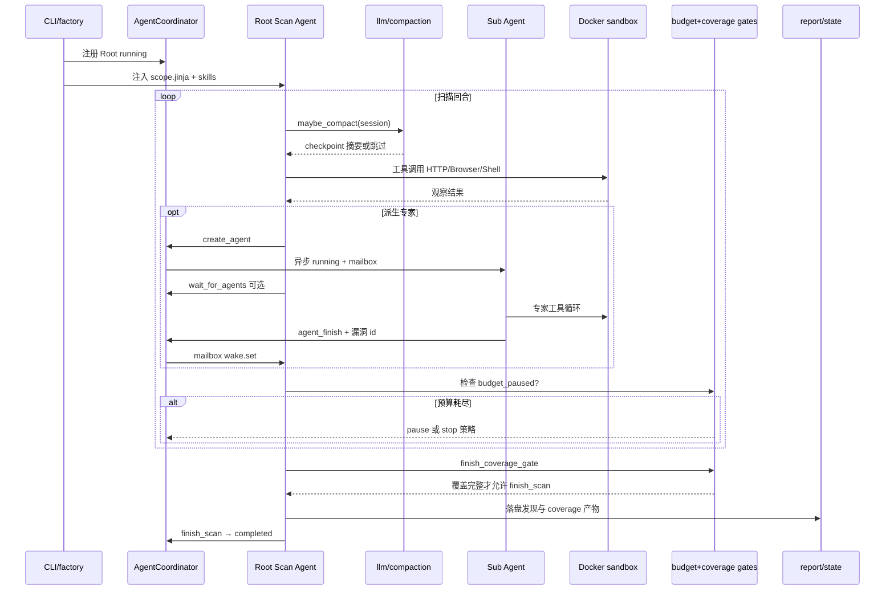

# strix · 代码时序（代码视角）

> 依据：`01-competitors/strix.md` + `_trees/strix.json`。

## 说明

1. 调度语义：**mailbox + wake + wait_for_agents**（默认 300s，禁止同 turn 重复 wait）。
2. 终态：completed/stopped/crashed/failed/budget_*；非交互终态不可再投递。
3. 压缩切点保证 tool_call/result 成对；overflow 识别 LiteLLM/OpenRouter 400。
4. 门禁主轴是 **授权 scope + 沙箱 + 预算 + 覆盖完成门**，不是逐条 bash 审批。
5. 可 snapshot 恢复预算暂停会话。
