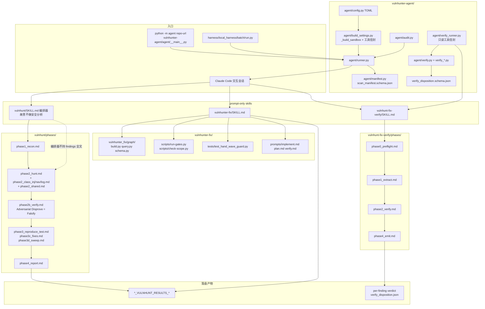

# VulnHunter · 代码模块拓扑（代码视角）

> 依据：`01-competitors/vulnhunter.md` + `_trees/VulnHunter.json` + 上游树；仅模块/调用关系。不含利用步骤。

## 说明

1. 三 skill 分权：`/vulnhunt` 找洞、`/vulnhunter-fix` 修、`/vulnhunt-fix-verify` 独立复核。
2. **Falsify** = `phases/phase2b_verify.md`（对抗证伪），再经 Capability Filter 后才进报告。
3. Headless：`runner.py` + Claude Agent SDK；`build_settings._build_sandbox` 限制 FS/网络（默认可关）。
4. Verify：`verify_runner.py` **剥离 Bash/Network**，只留 Read/Write/Edit/Glob/Grep/Agent。
5. CI 契约：`scan_manifest.schema.json` + `verify_disposition.schema.json`。
6. Fix 侧脚本门 `run-gates.py` / `check-scope.py` + hand-wave guard；结构外置到 `vulnhunter_fix/graph/`。
