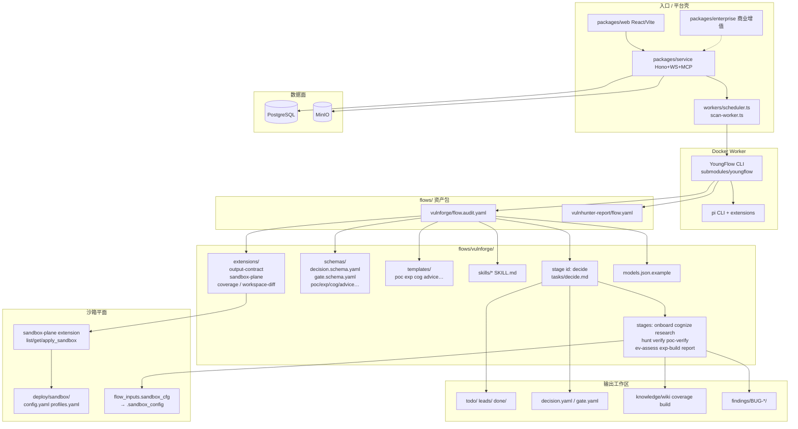

# VulnHunter（Clouditera）· 代码模块拓扑（代码视角）

> 依据：Clouditera/VulnHunter 树 + `flows/vulnforge/flow.audit.yaml` + YoungFlow 子模块。  
> **纠偏**：非 capitalone Claude Code 三技能；主轴为 **flows → stages → decide → schemas/templates → sandbox**。不含利用步骤。

## 说明

1. **YoungFlow** 跑 `flow.audit.yaml`；平台只负责任务/存储/Worker 生命周期。
2. **decide** 写 `decision.yaml.next` 做路由；**onboard** 写 `gate.yaml` 做环境门禁。
3. **sandbox_cfg** 经 sandbox-plane 申请；扩展不泄露沙箱地址/凭证。
4. schemas/templates 约束产物契约；skills 外置方法论。
5. capitalone 的 `vulnhunter-agent` / `/vulnhunt` skill **不在本仓**。
