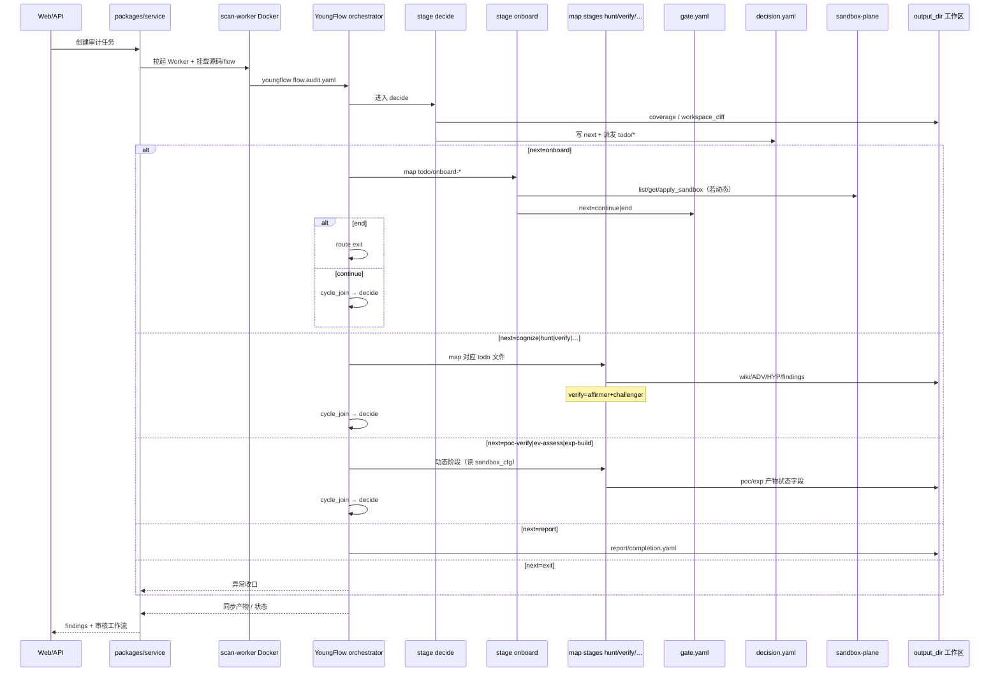

# VulnHunter（Clouditera）· 代码时序（代码视角）

> Decide 螺旋：decide → 执行 stage → cycle_join → decide… → report。质量门 = gate + 双向论证 + 可选沙箱 POC。不含利用步骤。

## 说明

1. 路由信号是 **文件**：`decision.yaml` / `gate.yaml`，不是 Claude Code skill 切换。
2. `cycle_join` 收口后回到 decide（`max_loops`）；`recursion_limit` 是 LangGraph 步进预算。
3. 动态阶段依赖 `enable_poc/exp/chain` + sandbox available；未配置 sandbox_cfg 时可本地执行（产品需自行收紧）。
4. 平台侧 findings 审核与 flow 内 verify **分层**：前者人审状态，后者论证裁决。
