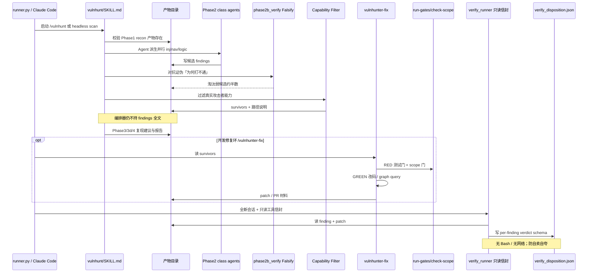

# VulnHunter · 代码时序（代码视角）

> 依据：`01-competitors/vulnhunter.md` + 上游 phases / agent 树。Hunt→Falsify→Verify 为质量闭环。

## 说明

1. 阶段闸门靠 **产物文件存在** 推进，不是常驻服务状态机。
2. Phase2b **Falsify** 与 Capability Filter 是 Hunt 内硬质量门。
3. Fix 可选；脚本门防止空话修复（hand-wave guard）。
4. Verify **分 skill、分会话、只读信封** → `verify_disposition.json`。
5. Batch：`harness/local_harness/batch` 多仓 + `--resume`；扫描默认不改目标仓。
6. Sandbox 段与 `--enable-bash` 控制是否允许动态复现工具。
